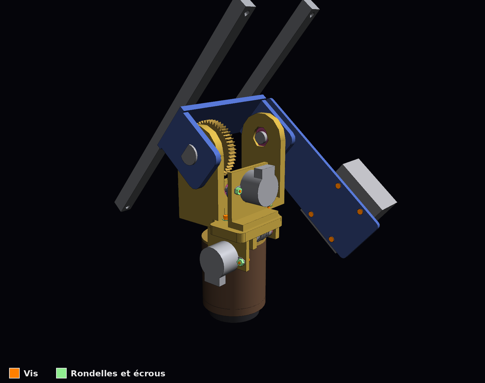
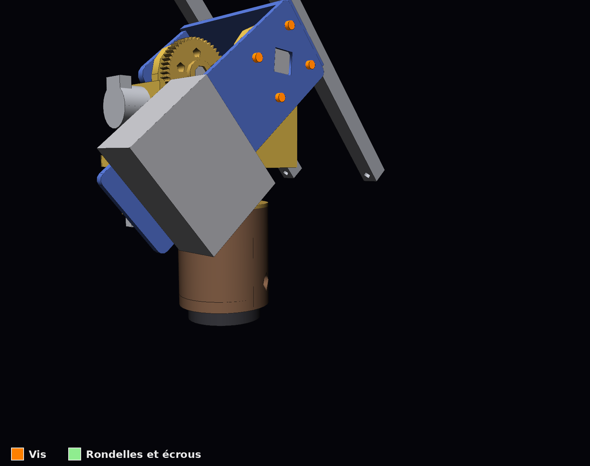
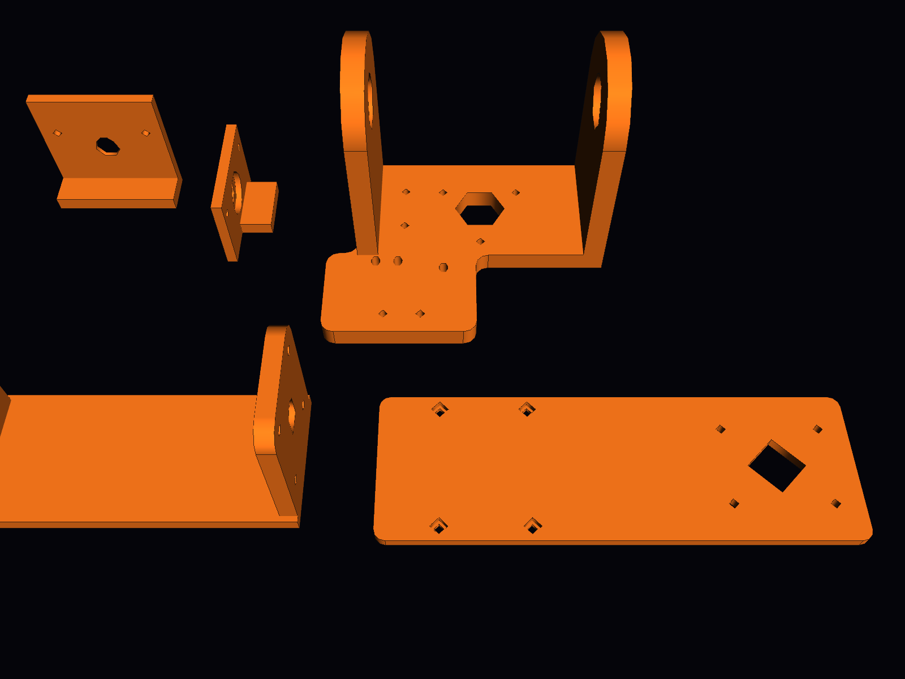
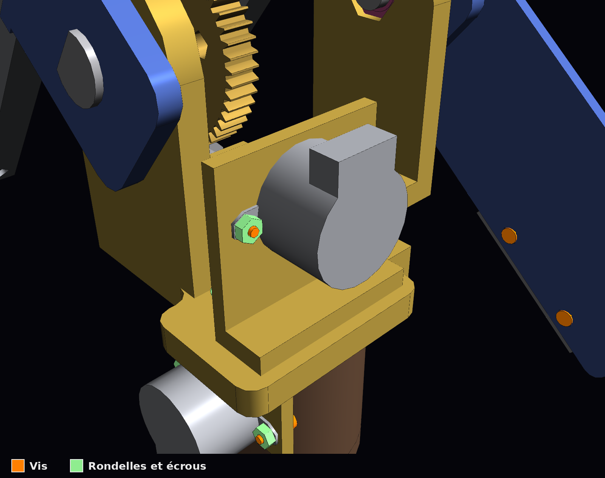
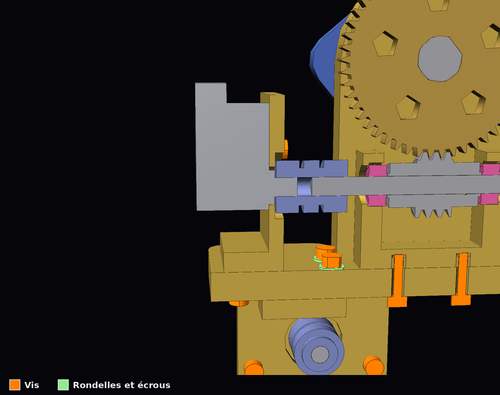
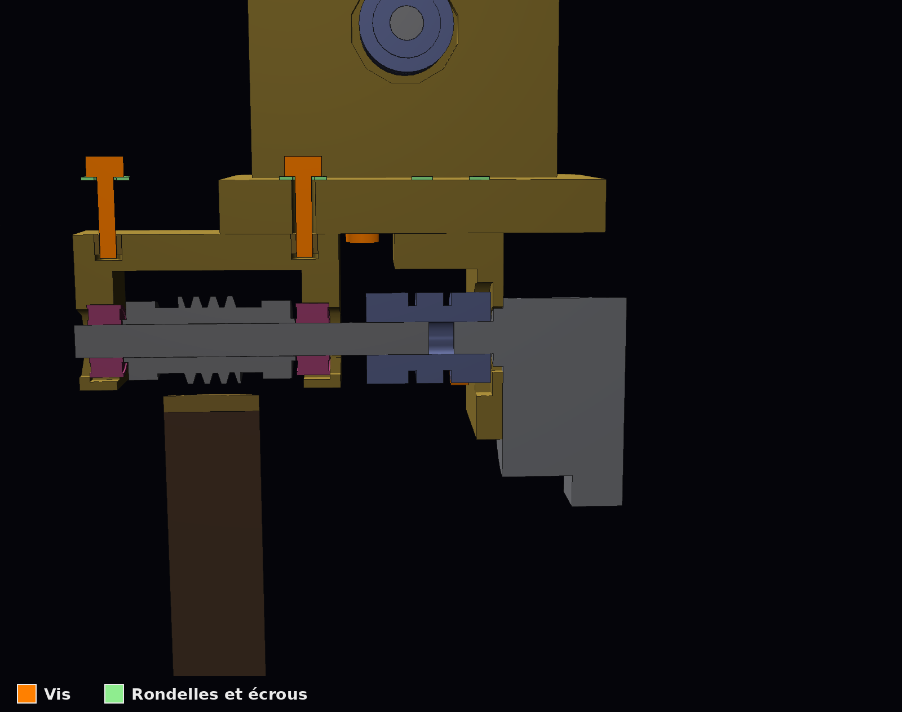
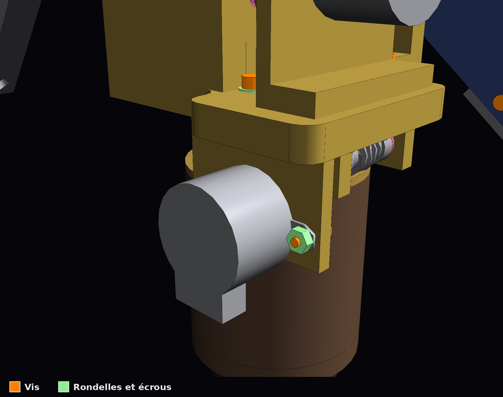
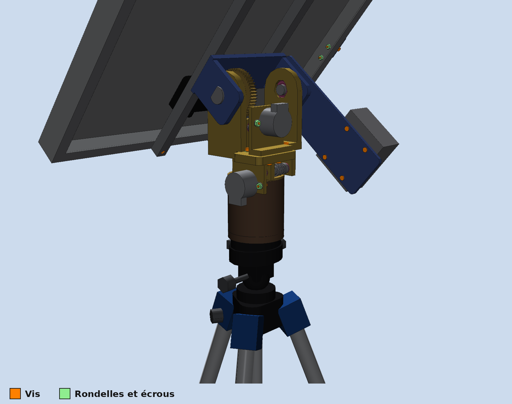

# Variante terrestre avec deux moteurs 28BYJ-48 (contrepoids obligatoire)

> **Document caché, archivé.** Il décrit une **variante** de l'ancienne démonstration terrestre
> (tête à chape) dont les deux moteurs pas à pas (NEMA 17 et NEMA 11) sont remplacés par deux petits
> **28BYJ-48**, avec un **contrepoids**. **Elle n'est plus retenue** : le cas terrestre est
> désormais une **tête à fourche à moteurs 28BYJ-48 sans contrepoids**
> ([README du cas terrestre](../Fichiers%203D%20%28CAO%29/Cas%20Terrestre%20%28d%C3%A9monstration%29/README.md)),
> et l'ancien modèle NEMA est conservé dans le [modèle idéal personnel](../.modele_ideal_personnel/README.md).
> Dans ce document, la « version principale » désigne ce modèle NEMA (le modèle idéal personnel).
> **Cette variante est la seule du projet qui utilise un contrepoids.**
>
> **État : modélisée et vérifiée sur la CAO.** Supports de moteur, accouplements, platine du
> contrepoids et assemblage complets (§ 5 et § 10). Les marges de couple du § 3 sont calculées
> par [`calcul_marges.py`](calcul_marges.py), avec le modèle de couples du projet
> (`scripts/generate_tete_vis_sans_fin.py`) : mêmes vis sans fin, mêmes frottements, mêmes
> couples de vent. Les cotes du 28BYJ-48 viennent de fiches techniques courantes : **à vérifier
> au pied à coulisse sur les moteurs reçus** (§ 8).



## 1. Verdict

| Question | Réponse |
|---|---|
| Les 28BYJ-48 suffisent-ils **sans** contrepoids ? | **Non.** L'élévation demande 0,93 N·m rien que pour porter le panneau ; un 28BYJ-48 en donne 0,50 N·m à la roue : marge de **×0,5, même en intérieur**. |
| Y a-t-il une autre solution que le contrepoids ? | Pas de raisonnable : il faudrait une vis sans fin d'environ 190 dents au lieu de 50 (soit une roue de près de 19 cm, et 27 minutes pour 90°), ou un second étage de réduction. Le contrepoids est plus simple. |
| Et **avec** contrepoids ? | **Oui**, avec une marge réduite au vent : ×17 (élévation) et ×21 (azimut) en intérieur, ×4 à 5 m/s, **×1,2 à 1,3 à 10 m/s** (valeurs nominales). |
| Limite d'utilisation | Suivi jusqu'à **6 m/s (22 km/h)** avec une marge d'au moins ×2, même avec un moteur faible. Au-delà, garer le panneau à plat. |
| Ce qui devient **obligatoire** | Contrepoids ; vis et roues **graissées** ; roulements **ZZ** (pas de 2RS) ; un seul moteur alimenté à la fois ; une extension d'entrées/sorties (§ 6). |

## 2. Le moteur 28BYJ-48

| Caractéristique | Valeur |
|---|---|
| Alimentation | 5 V, unipolaire, 5 fils (rouge = commun) |
| Résistance d'une bobine | environ 50 Ω, donc ≈ 100 mA par bobine allumée |
| Réduction intégrée | 64:1 nominal, **63,68:1** mesuré ; environ 4076 demi-pas par tour de l'arbre de sortie |
| Couple de sortie | **34,3 mN·m** à 120 Hz (« in-traction torque » de la fiche technique) |
| Frottement du réducteur | 600 à 1200 gf·cm (59 à 118 mN·m) : le réducteur tient le moteur coupé, mais il est en plastique |
| Arbre de sortie | Ø5 mm à deux méplats (3 mm entre méplats), court (environ 6 mm au-dessus du bossage de Ø9 mm) et **décentré de 8 mm** par rapport au corps (à vérifier au pied à coulisse sur les moteurs reçus) |
| Fixation | corps Ø28 mm, deux oreilles à 35 mm d'entraxe |
| Masse | environ 30 g, contre 220 g (NEMA 17) et 180 g (NEMA 11) |

Sources : [fiche technique 28BYJ-48](https://cdn.shopify.com/s/files/1/0015/7571/4865/files/datasheet_28BYJ-48.pdf),
[fiche 52Pi](https://wiki.52pi.com/images/3/3a/Stepper-Motor-28BJY-48-Datasheet.pdf).
Une autre fiche donne un couple d'au moins 78,4 mN·m pour une variante différente : **elle n'est
pas retenue**.

**Pourquoi 34,3 mN·m et pas plus.** Les NEMA du projet sont donnés en couple de *maintien* : le
script applique un facteur 0,7 pour passer au couple *en marche*. Les 34,3 mN·m du 28BYJ-48 sont
déjà un couple en marche, à l'arbre de sortie : ils sont pris tels quels. Le calcul utilise aussi
une valeur **prudente de 25 mN·m**, pour la dispersion d'un moteur à l'autre, l'usure du réducteur
et une alimentation à 4,5 V.

**Vitesse.** À 120 demi-pas par seconde (vitesse où le couple est garanti), l'arbre fait environ
1,8 tr/min. Pour 90° de roue : **7 min en élévation et 8,5 min en azimut**. C'est long pour la
mise en position initiale, sans importance pour le suivi (une correction de 0,25° se fait en
quelques secondes). Résolution : 0,0018° par demi-pas en élévation, 0,0015° en azimut.

## 3. Couples et marges

Couple disponible **à la roue** = couple du moteur × nombre de dents × rendement de la vis. Les vis
sont celles du projet : 50:1 en élévation (rendement 0,29 graissé, 0,17 à sec), 60:1 en azimut
(0,31 et 0,18).

| Couple à la roue (N·m) | Élévation | Azimut |
|---|---|---|
| NEMA du projet (référence) | 2,08 | 1,22 |
| 28BYJ-48 nominal, graissé | **0,50** | **0,63** |
| 28BYJ-48 prudent (25 mN·m), graissé | 0,36 | 0,46 |
| 28BYJ-48 nominal, à sec | 0,29 | 0,37 |

**Couple à fournir.** En élévation, le panneau pèse sur la denture : partie basculante de
**1,51 kg, centre de gravité à 61,9 mm de l'axe**, soit 0,92 N·m, plus 0,01 N·m de frottement.
Le vent de 10 m/s ajoute 0,35 N·m en élévation et 0,50 N·m en azimut. Le couple du vent varie
comme le carré de la vitesse.

**Marges, 28BYJ-48 nominal, graissé :**

| | Sans contrepoids | Avec contrepoids |
|---|---|---|
| Élévation, intérieur | **×0,5** (ne tient pas) | **×17** |
| Élévation, vent de 10 m/s | ×0,4 | **×1,3** |
| Azimut, intérieur | ×21 | ×21 |
| Azimut, vent de 10 m/s | ×1,2 | ×1,2 |

Le contrepoids ramène le centre de gravité sur l'axe : il ne reste que le déséquilibre résiduel
(bloc pesé à ± 2 % : 0,02 N·m, pris en compte) et le vent. L'azimut ne dépend pas du contrepoids.

**Marge selon le vent, avec contrepoids, nominal, graissé :**

| Vent | 3 m/s | 5 m/s | 8 m/s | 10 m/s |
|---|---|---|---|---|
| Élévation | ×8,1 | ×4,3 | ×2,0 | ×1,3 |
| Azimut | ×8,4 | ×4,0 | ×1,8 | ×1,2 |

**Vent maximal que le moteur peut encore vaincre** (marge de ×1) :

| | Élévation | Azimut |
|---|---|---|
| Nominal, graissé | 11,6 m/s | 10,9 m/s |
| Prudent (25 mN·m), graissé | 9,8 m/s | 9,2 m/s |
| Nominal, **à sec** | 8,6 m/s | 8,2 m/s |
| Prudent, à sec | 7,2 m/s | 6,9 m/s |

On retient une **limite de suivi de 6 m/s (22 km/h)** : marge de ×2,3 en élévation et ×2,2 en
azimut avec le moteur prudent, graissé. Cette variante **ne tient pas la marge de ×1,5 à ×2 visée
par la version principale au vent de 10 m/s**. Si le vent dépasse la limite, le moteur peut
décrocher (perte de pas) ; il n'y a pas de dégât, les vis sans fin tenant le panneau moteurs
coupés. Garer alors le panneau à plat (élévation 90°).

**Ce qui devient obligatoire**
* **Roulements ZZ uniquement.** Les joints d'un 2RS freinent : 0,008 N·m pour la paire de 685
  (le quart du couple du moteur !) et 0,15 N·m pour la paire de 6806 d'azimut. Avec des 2RS,
  la marge de l'azimut à 10 m/s tomberait à ×0,9.
* **Graisse PTFE** sur les vis et les roues. À sec, la marge à 10 m/s passe sous ×1 (×0,8 en
  élévation, ×0,7 en azimut).
* **Dents en PETG** : à 0,5 à 0,6 N·m, la contrainte en pied de dent est d'environ **6 à 8 MPa**,
  contre 37 MPa moteur calé avec le NEMA 17. Les dents sont plus ménagées, et il n'y a pas de
  courant à limiter. Le fusible mécanique devient le réducteur plastique du 28BYJ-48 lui-même.
* **Fluage** : avec le contrepoids, la pesanteur ne charge plus la denture. Garer à plat reste
  conseillé pour le vent.

## 4. Le contrepoids

Le contrepoids est **celui qui avait été étudié pour la version NEMA** (commit `3cdd766` de
l'historique git, retiré ensuite de la version principale), repris tel quel et adapté aux inserts.
Il est modélisé : platine imprimée `Support_Contrepoids` et bloc d'acier `Masse_Contrepoids`.



| Élément | Valeur |
|---|---|
| Bloc d'acier doux | 30 × 70 × 55 mm, **905 g**, centré à 100 mm sous l'axe d'élévation, décalé de 3 mm en Y, côté +X (le côté −X est pris par le moteur d'azimut) |
| Partie qui bascule | **2,46 kg, centre de gravité à (31 ; 0,0 ; 0,0) mm** (calculé sur la CAO) : sur l'axe d'élévation |
| Platine `Support_Contrepoids` | PETG, 4 mm, 54 × 164 mm : plaquée sur la face extérieure du flanc +X du chapeau par **4 vis M3×8 dans 4 inserts M3×3** (perçage Ø4,0 × 4,2 mm, 1,8 mm de matière derrière) ; la tête du pivot libre passe dans un trou Ø20 |
| Bloc sur la platine | 4 vis M3×10, têtes dans des lamages de la platine, **8,6 mm de prise** dans des trous Ø2,5 taraudés M3 de 9 mm dans l'acier |
| Garde mini de la partie basculante | **2,0 mm** sur toute la course, comme dans la version principale |
| Interférences | **aucune**, ni dans la tête, ni sur le trépied (garde de 32,6 mm au plateau) |

**Réglage à la pesée.** 1 % de masse du bloc (9 g) déplace le centre de gravité de 0,37 mm. Couper
le bloc, le peser et le limer sur sa hauteur jusqu'à **905 g à ± 2 %** : l'erreur restante est de
0,02 N·m au plus. Contrôle : poser la partie basculante sur ses deux pivots, sur deux appuis de
même hauteur : elle doit rester dans **n'importe quelle position**.

**Effet sur le trépied**, calculé sur la CAO assemblée (`Demo_Trepied_28BYJ.step`, qui contient
aussi le lest) :
* charge sur la rotule : **3,00 kg** (tête et panneau, contrepoids compris). Le centre de gravité
  s'écarte jusqu'à 24 mm de l'axe, soit **0,70 N·m** à tenir par les blocages de la rotule ;
* vent de basculement avec 0, 3 et 11 kg de lest : **30, 41 et 60 km/h** ; pente de basculement
  sans vent : 8,5°, 15,1° et 28,1° ; panneau à plat : 61, 85 et 127 km/h (second calcul
  indépendant, `scripts/verification_stabilite.py`, qui donne 31, 41 et 60 km/h).

| Vent de basculement (0 / 3 / 11 kg de lest) | Version principale (NEMA, sans contrepoids) | NEMA avec contrepoids (commit `3cdd766`) | **Cette variante** |
|---|---|---|---|
| Pire orientation | 26 / 37 / 57 km/h | 31 / 41 / 60 km/h | **30 / 41 / 60 km/h** |

Le contrepoids rend le trépied un peu plus stable au vent (le panneau est moins déporté) ; les 28BYJ-48,
plus légers de 0,34 kg que les NEMA, compensent presque la masse ajoutée. Le trépied et le lest ne
sont pas modifiés.

## 5. Ce qui change dans la mécanique

Cinq pièces imprimées changent. Elles sont dans [`a_imprimer/`](a_imprimer) (STL et STEP, déjà
orientées sur le plateau). **Les 14 autres pièces imprimées sont celles de la version principale** :
roues, vis sans fin, paliers, pivots, socle, moyeu, bague d'arrêt, fond, capteur solaire.



| Pièce | Changement |
|---|---|
| `Support_Moteur_Elevation` | Plaque de 4 mm pour un 28BYJ-48 (deux oreilles à 35 mm d'entraxe, **2 vis M3×8 + écrous derrière les oreilles**), passage du bossage Ø9,6 dans un fond de 1,6 mm, **lamage Ø17** du côté de l'accouplement. Semelle de 16 mm **du côté du moteur** (sous son corps), avec 2 inserts M3×3 à (−37 ; −52) et (−23 ; −52) : de l'autre côté, sous la chape, la place est prise par les pièces d'azimut. |
| `Support_Moteur_Azimut` | Même principe : plaque de 4 mm, 42 mm de large, oreilles horizontales, lamage Ø17, semelle sous la chape avec 2 inserts M3×3 à x = −40,8 et −32,2. |
| `Chape` | Lumières de l'azimut déplacées avec les inserts du support, queue qui porte les moteurs inchangée. |
| `Chapeau_U` | 4 inserts M3×3 (perçage Ø4,2 × 4,2 mm) dans la face extérieure du flanc +X, pour la platine du contrepoids. |
| `Support_Contrepoids` | Nouvelle pièce (§ 4). |

**Moteur et accouplement**



* Le **28BYJ-48** modélisé : corps Ø28 × 19 mm décentré de 8 mm par rapport à l'arbre, bossage de
  Ø9 × 1,5 mm, arbre Ø5 à deux méplats de 3 mm, 10 mm au-dessus de la face, deux oreilles de
  0,8 mm à 35 mm d'entraxe (trous Ø4,2), bloc de connexion à l'arrière (approximation). En
  élévation, le corps est **au-dessus** de l'arbre ; en azimut, **au-dessous**.
* **Accouplement flexible Ø14 × 19 mm** (au lieu de Ø19 × 25) : l'arbre du 28BYJ-48 est court. Il
  entre de 8,1 mm dans l'accouplement, qui s'engage de 2,1 mm dans le lamage du support, à 0,3 mm
  du fond. La face du moteur est **12,6 mm plus près** de l'accouplement qu'avec un NEMA. Les
  arbres Ø5 des vis sans fin, les paliers et les vis sans fin ne bougent pas.

| Coupe dans l'axe de l'élévation | Coupe dans l'axe de l'azimut |
|---|---|
|  |  |



**Vérifications sur la CAO** (`scripts/generate_variante_28byj.py`) :
* **aucune interférence** entre pièces, vis, écrous et inserts ;
* prise des vis : **au moins 3,5 mm** dans le plastique, au moins 3 mm dans les inserts
  courts ; M3×10 dans le bloc d'acier : 8,6 mm ; M3×8 des oreilles : écrou complet ;
* appuis sur les roulements corrects, vis et roues **engrènent sans chevauchement** à plusieurs poses ;
* **29 inserts** (7 longs M3×5,7, 18 courts, 4 dans le flanc du chapeau) : de la matière sur 1,6 mm
  autour de chaque perçage, et de 1,5 à 3,0 mm derrière le fond (`scripts/verifier_inserts.py`) ;
* épaisseurs de paroi (`scripts/verifier_parois.py`) : **aucune zone sous 1,6 mm** dans les deux
  supports et dans la platine. Un premier essai avait trouvé 4 zones de 1,2 mm au bord de la
  platine, près des lamages : la platine a été élargie de 52 à 54 mm. Le chapeau garde les trois
  collerettes de pivot de la version principale.

## 6. Électronique

On remplace les deux **TMC2209** (et leur 12 V) par deux **cartes ULN2003** alimentées en 5 V,
fournies avec le moteur dans les kits courants.

**Problème de broches.** Le Heltec V4 n'a que 9 broches libres, toutes utilisées (voir le README
du cas terrestre, § 6). La version NEMA en consacre 5 aux moteurs (STEP_EL 47, DIR_EL 43,
STEP_AZ 48, DIR_AZ 45, EN 33). Un 28BYJ-48 sur ULN2003 en demande **4 par moteur, soit 8**. Il en
manque 3.

**Solution : un MCP23017** (16 sorties, sur l'I²C déjà en place) :
* alimenté en **3,3 V**, adresse **0x20** (A0, A1, A2 à la masse), aucun conflit avec les
  adresses 0x48, 0x40 et 0x45 déjà présentes ;
* ses 8 sorties pilotent IN1 à IN4 des deux cartes ULN2003 ; les 5 broches du Heltec libérées
  (47, 43, 48, 45, 33) restent disponibles ;
* **8 résistances de 10 kΩ vers la masse** sur les sorties : à la mise sous tension, le MCP23017
  a ses sorties en haute impédance, et sans tirage une bobine pourrait s'allumer au démarrage ;
* alternative : un 74HC595 (3 broches : données, horloge, verrou) plus une 4ᵉ pour OE.

| Signal | Vers |
|---|---|
| MCP23017 GPA0 à GPA3 | IN1 à IN4 de la carte d'élévation |
| MCP23017 GPB0 à GPB3 | IN1 à IN4 de la carte d'azimut |
| 5 V (sortie de U1, **avant la diode D1**, comme le capteur Hall) | broche + des deux cartes ULN2003 |
| 0 V | broche − des deux cartes, 0 V du boîtier |

**Alimentation.** Un 28BYJ-48 tire environ 0,2 A à 5 V. Le mini abaisseur U1 doit donc fournir
au moins **0,6 A** (Heltec, Hall, un moteur) : vérifier la référence du module. **Ne jamais
faire tourner les deux moteurs ensemble** : le suivi corrige l'élévation, puis l'azimut. Le
12 V n'alimente plus que U1 : la batterie, le régulateur et les wattmètres ne changent pas.
Le 100 µF des anciens drivers n'est plus utile ; garder 100 µF sur le 5 V des cartes.

**À l'arrêt, les 8 sorties à 0** : une bobine alimentée en continu dissipe environ 1 W et
chaufferait le support en PETG. Les vis sans fin tiennent le panneau moteurs coupés, comme dans
la version principale. Les sorties sont mises à 0 entre deux corrections.

**Séquence demi-pas** (ordre des fils de la carte ULN2003, IN1 à IN4 sur les bits 0 à 3 du
quartet de chaque moteur) :

```cpp
// 8 phases pour un 28BYJ-48 sur ULN2003 : IN1 = bit 0 ... IN4 = bit 3
const uint8_t PHASES[8] = {0b0001, 0b0011, 0b0010, 0b0110, 0b0100, 0b1100, 0b1000, 0b1001};
// une phase = une écriture I2C de 2 octets (registre OLATA ou OLATB du MCP23017)
// pour tourner à l'envers : parcourir le tableau dans l'autre sens
// vitesse : 120 phases par seconde (environ 1,8 tr/min de l'arbre de sortie), pas plus tant
// que le couple n'a pas été mesuré à plus haute fréquence
```

Les 4 bobines sont brochées dans l'ordre bleu, rose, jaune, orange pour IN1 à IN4 sur les cartes
courantes : **vérifier le sens et l'ordre sur le moteur reçu**, une inversion fait vibrer l'arbre
sans le faire tourner.

Fin de course d'élévation, Hall d'azimut, capteur solaire (ADS1115), wattmètres, LoRa : **sans
changement**.

## 7. Nomenclature : ce qui change

| Retiré (version NEMA) | Ajouté (variante 28BYJ-48) |
|---|---|
| NEMA 17 (Usongshine 17HS3401), NEMA 11 (11HS18-0674S) | 2 × **28BYJ-48 5 V**, avec leurs cartes ULN2003 |
| 2 × driver TMC2209 | 1 × **MCP23017** (module ou composant) + 8 × 10 kΩ |
| 2 × accouplement flexible 5 mm / 5 mm, Ø19 × 25 | 2 × accouplement flexible **Ø5 / Ø5, Ø14 × 19 mm** (ou Ø14 × 25 si le 19 n'existe pas : la CAO est faite pour 19) |
| 4 × M3×8 + 4 × M2,5×6 (moteurs) | 4 × M3×8 + **4 écrous M3** (oreilles des moteurs) |
| | **Contrepoids** : bloc d'acier doux 30 × 70 × 55 mm (≈ 0,9 kg), 4 × M3×8 (platine) et 4 × M3×10 (bloc), 4 inserts M3×3 |

Visserie de la variante, en tout : **M3×8 : 10 ; M3×10 : 11 ; M3×12 : 15 ; M3×14 : 4 ; fraisées
M3×6 : 3** (43 vis, contre 39 dans la version principale, qui compte aussi 4 M2,5×6). Écrous M3 :
**10** (6 + 4). Inserts à chaud : **7 × M3×5,7 et 22 × M3×3**. Rondelles M3 : 4.

Le coût des moteurs et des drivers baisse nettement (deux 28BYJ-48 avec cartes valent quelques
euros pièce), le bloc d'acier est peu cher. Tout le reste de la nomenclature est celui de
[`Liste-composants.md`](../.modele_ideal_personnel/Liste-composants.md).

## 8. À valider avant de commander et d'imprimer

1. **Mesurer le couple réel de chaque moteur**, avant tout montage : arbre horizontal, un bras
   de 100 mm fixé sur l'arbre, une masse accrochée au bout. À 5 V et 120 phases/s, le moteur doit
   lever **25 g** (prudent) et idéalement **35 g** (nominal) sans perdre de pas. Si un moteur
   n'y arrive pas, le changer : ils sont très dispersés.
2. **Contrôler le couple à la roue** une fois la tête assemblée (avec le contrepoids) : accrocher
   une masse de 300 g à 100 mm de l'axe d'élévation (0,29 N·m, ce que le moteur doit encore
   vaincre à sec) ; le moteur doit faire tourner la roue.
3. **Vérifier l'équilibre** du contrepoids (pesée, puis les deux appuis, § 4).
4. **Mesurer le 28BYJ-48 reçu** avant d'imprimer les supports : arbre (10 mm au-dessus de la face,
   méplats de 3 mm), bossage (Ø9 × 1,5 mm), décentrage de 8 mm, entraxe des oreilles (35 mm), trous
   Ø4,2. Les supports sont modélisés sur ces cotes (§ 5) ; une différence de 0,5 mm se rattrape au
   lamage, pas davantage. L'éprouvette d'ajustements de la version principale permet de régler la
   température de pose des inserts.
5. **Tester la fréquence maximale** : monter peu à peu de 120 à 300 phases/s. Le couple baisse
   avec la fréquence : si le moteur décroche à 200, ne pas aller au-delà de 120.

## 9. Pour aller plus loin

* **Gagner du couple**, au prix d'un montage moins simple : la version **bipolaire** du
  28BYJ-48 (on coupe la liaison du fil rouge commun sur le moteur) est souvent citée pour donner
  un meilleur couple, mais il faut la mesurer ; elle demande un driver bipolaire (A4988, DRV8833)
  et 4 broches par moteur.
* **Augmenter le couple à la roue** en gardant les moteurs : agrandir la vis d'élévation (plus de
  dents). Cela coûte en vitesse et en place.
* **Garer à plat** (élévation 90°) dès que le vent dépasse la limite de 6 m/s : le panneau
  prend alors beaucoup moins le vent, et la version à contrepoids reste stable (voir § 4).

## 10. Fichiers et régénération

| Fichier | Contenu |
|---|---|
| [`Tete_Rotative_PETG_28BYJ.step`](Tete_Rotative_PETG_28BYJ.step) | Assemblage de la tête : moteurs, accouplements, contrepoids, vis, écrous et inserts |
| [`Demo_Trepied_28BYJ.step`](Demo_Trepied_28BYJ.step) | La même tête sur le trépied, avec le lest |
| [`a_imprimer/`](a_imprimer) | Les 5 pièces propres à la variante (STL + STEP) |
| [`apercus/`](apercus) | Les images de ce document, et 5 vues de la tête sur le trépied (`variante_trepied_*.png`) |
| [`calcul_marges.py`](calcul_marges.py) | Couples et marges, avec et sans contrepoids |

Régénération, depuis la racine du dépôt :

```
python scripts/generate_variante_28byj.py                     # CAO, STEP, STL et contrôles
xvfb-run -a python scripts/render_variante_28byj.py           # images
VARIANTE_28BYJ=1 python scripts/generate_demo_trepied.py      # tête sur le trépied : STEP, stabilité
VARIANTE_28BYJ=1 python scripts/verification_stabilite.py     # second calcul de stabilité
VARIANTE_28BYJ=1 python scripts/verifier_inserts.py           # inserts
VARIANTE_28BYJ=1 python scripts/verifier_parois.py 0.15 1.6 Support_Contrepoids
```

La variante est un **mode** du générateur (`set_variante("28byj")` dans `scripts/generate_tracker.py`),
désactivé par défaut : la version principale est inchangée.


