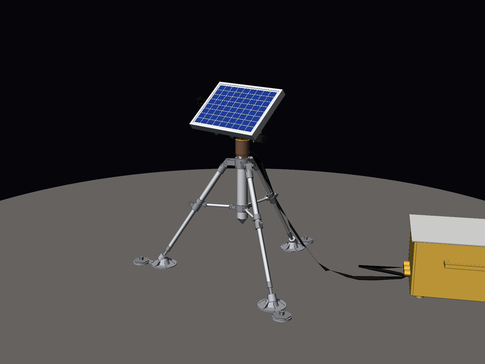
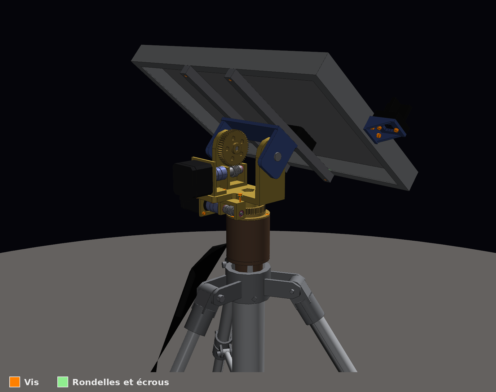
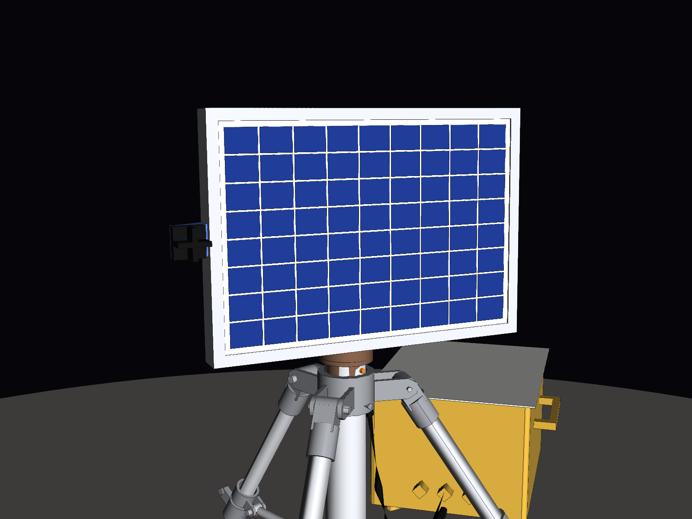
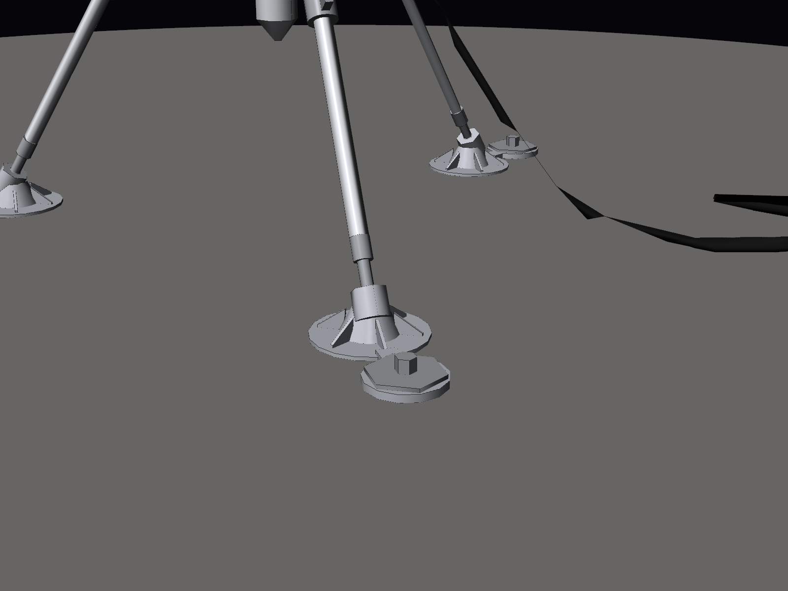
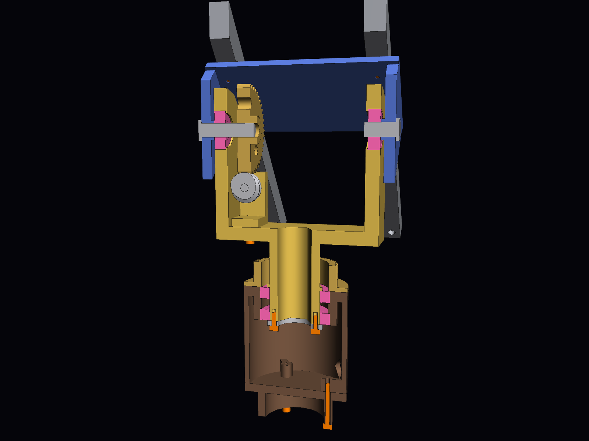

# 🌙 Modèle lunaire (cas réel)

[⬅ Retour au README principal](../../README.md) · [Modèle terrestre ➜](../Demo_Terre_PETG/README.md)

Le tracker conçu pour la **surface de la Lune** : trépied déployable, tête rotative à vis sans
fin en aluminium, bronze et inox, panneau de 356 × 253 mm avec son capteur solaire, faisceau de
câbles et unité de contrôle posée au sol. C'est une **maquette de conception** à l'échelle 1:1,
pas un matériel qualifié pour le vol (§ 9).

La tête, le panneau, le capteur solaire et la commande, communs aux deux modèles, sont décrits
dans le [README principal](../../README.md). Ce document traite de ce qui est propre à la Lune.

**Sommaire**

1. [La tête en version lunaire](#1-la-tête-en-version-lunaire)
2. [Suivi du Soleil sur la Lune](#2-suivi-du-soleil-sur-la-lune)
3. [Conditions lunaires et réponses de conception](#3-conditions-lunaires-et-réponses-de-conception)
4. [Choix de l'angle](#4-choix-de-langle)
5. [Trépied](#5-trépied)
6. [Matériaux](#6-matériaux)
7. [Caractéristiques principales](#7-caractéristiques-principales)
8. [Vérifications effectuées par les scripts](#8-vérifications-effectuées-par-les-scripts)
9. [Limites](#9-limites)
10. [Fichiers de ce dossier](#10-fichiers-de-ce-dossier)

| Vue d'ensemble (panneau à 40°) | Tête rotative à vis sans fin |
|---|---|
|  |  |
|  |  |

## 1. La tête en version lunaire

| Coupe par les axes (cas réel) : roulements en rose (6806 dans le socle, 608 dans les bras) |
|---|
|  |

### Roulements (en rose dans les fichiers 3D et les aperçus)

Tous les roulements sont **protégés** des deux côtés par des flasques métalliques (**ZZ**).
Leurs cotes sont celles des roulements ouverts, sauf pour le 685. Dans les fichiers 3D, la
protection est l'anneau en retrait de 0,2 mm sur chaque face.

| Réf. | Dimensions (Ø int. × Ø ext. × largeur) | Qté | Emplacement |
|---|---|---|---|
| **6806** (ISO 61806) | 30 × 42 × 7 mm | 2 | Azimut : dans le socle, autour du moyeu de la chape |
| **608** | 8 × 22 × 7 mm | 2 | Élévation : dans les bras de la chape, sur les axes Ø8 du chapeau |
| **685ZZ** | 5 × 11 × 5 mm | 4 | Arbres des deux vis sans fin, deux par vis, dans les paliers. Le 685 ouvert ne fait que 3 mm de large : il faut la version protégée |

**Aucune pièce ne touche la protection.** Une pièce qui tourne avec l'arbre n'appuie que sur la
bague intérieure, et une pièce fixe que sur la bague extérieure. Sinon, une pièce frotterait
sur la flasque, ou bien une pièce fixe freinerait la bague qui tourne.

| Roulement | Appui sur la bague intérieure (Ø maxi) | Appui sur la bague extérieure (Ø mini) |
|---|---|---|
| 6806 (azimut) | Collerette du moyeu et rondelle d'arrêt : **Ø33** | Épaulement du socle entre les deux roulements, et dessous de la roue d'azimut : alésage **Ø40** |
| 608 (élévation) | Bossage de chaque flanc du chapeau : **Ø11,5**, à 0,1 mm de la bague | Épaulement du bras de la chape : alésage **Ø19,8** |
| 685 (vis) | Épaulement de chaque moyeu de la vis : **Ø6,5**, à 0,15 mm de la bague | Lèvre de 1 mm de chaque joue du palier : alésage **Ø9,8** |

`scripts/generate_tete_vis_sans_fin.py` le vérifie à chaque génération, pour le cas réel et
pour la démonstration. Il contrôle les deux faces de chaque roulement : rien à moins de
0,3 mm de la protection, et chaque bague n'est approchée que par ce qui tourne avec elle.

Sur la Lune, les roulements sont en **acier 440C**, en version **ZZ** : les flasques
métalliques arrêtent la poussière de régolithe sans frotter. La lubrification est sèche
(MoS₂) : ni joint caoutchouc ni graisse, qui dégazeraient dans le vide.

### Couples : besoins et marges dans tous les cas

Les besoins sont calculés par `scripts/generate_tete_vis_sans_fin.py` à partir de la CAO :
* partie basculante (chapeau, roue, rails, panneau, capteur solaire) : 1,73 kg, dont 1,16 kg
  de panneau (pesé) et 0,06 kg de capteur solaire ;
* centre de gravité à 55,7 mm de l'axe, puisqu'il n'y a pas de contrepoids ;
* couple de gravité maximal (panneau vertical) : 0,95 N·m sur Terre et 0,16 N·m sur la Lune ;
* frottements : 0,01 N·m en élévation et 0,02 N·m en azimut ;
* vent de 10 m/s (36 km/h), pour les essais sur Terre en extérieur. La pression dynamique
  vaut 60 Pa, soit environ 6,5 N sur le panneau. Le centre de poussée est décalé de 5 à 8 cm
  en vent oblique, ce qui donne **+0,35 N·m en élévation et 0,50 N·m en azimut**.

Le couple disponible vaut couple de maintien × 0,7 (couple en marche lente en micro-pas) ×
rapport × rendement de la vis. Le rendement d'une vis à un filet vaut 0,29 (élévation) et
0,30 (azimut), avec un frottement prudent μ = 0,15.

| Marge = disponible / besoin | Lune | Terre, intérieur | Terre, extérieur (vent 10 m/s) |
|---|---|---|---|
| Élévation (3,47 N·m disponibles, moteur à 1,0 A) | ×21 | ×3,6 | **×2,7** |
| Azimut (1,22 N·m disponibles) | ×61 | ×41 | **×2,3** |

* **Le cas qui dimensionne est l'essai sur Terre, en extérieur.** On y vise une marge
  d'environ 2, sans surdimensionner. Les grandes marges sur la Lune viennent de l'absence de
  vent et de la gravité six fois plus faible : le même matériel doit aussi être essayé à 1 g.
* **Chaque moteur est le plus petit moteur courant qui convient.** Avec le moteur juste en
  dessous, la marge en vent devient insuffisante :
  * élévation : NEMA 11 de 45 mm, ×0,77 ;
  * azimut : NEMA 11 court (32 mm, ≈ 0,05 N·m), ×1,2.

### Bilan de dimensionnement : est-ce surdimensionné ?

Calculé avec le panneau pesé (1,16 kg), les masses des pièces d'après leurs matériaux, le
rendement des vis, les roulements et les câbles.

| Ce qu'on regarde | Cas réel | Verdict |
|---|---|---|
| Part du couple moteur utilisée, élévation | 38 % dehors (vent 10 m/s), 5 % sur la Lune, à 1,0 A | Bien dimensionné dehors ; ×21 de trop sur la Lune |
| Part du couple moteur utilisée, azimut | 43 % dehors, 2 % sur la Lune | Dimensionné par le vent ; sans vent, ×40 à ×60 de trop |
| Roulements | En marche : poussée de la vis ≈ 1/5 de la capacité statique d'un 685 ; charge ≈ 1/100 de celle d'un 6806 | Choisis pour leurs dimensions (câbles, axes), pas pour la charge |
| Inertie | ≈ 0,012 kg·m² basculants : < 1 % du couple de gravité même en retour rapide | Négligeable |

* **Dehors, les marges sont de ×2,7 (élévation) et ×2,3 (azimut).** Pour un moteur pas à pas,
  on vise ×1,5 à ×2 : au-delà de son couple, il ne ralentit pas, il **saute des pas** et perd
  sa position. Le couple réel varie aussi de 10 à 20 % selon le vendeur et la température.
* **Les grandes marges (intérieur, Lune) ne coûtent rien.** Le même matériel doit tenir le
  pire cas. Un moteur plus petit ne tiendrait pas le vent (voir ci-dessus). Pour une
  version de vol seulement, sans essais à 1 g, un NEMA 8 long (≈ 0,04 N·m) suffirait en
  élévation sur la Lune : il n'y faut que 0,011 N·m au moteur.
* **Vitesse** : le Soleil avance de 15°/h en moyenne sur Terre (jusqu'à ≈ 40°/h en azimut
  vers midi en été) et de 0,5°/h sur la Lune. Sur Terre, le moteur d'azimut fait donc de
  2,5 à environ 7 tours par heure, et celui d'élévation au plus 2,1. À cette vitesse, un
  pas à pas donne tout son couple, et la puissance mécanique à l'axe est de l'ordre de
  0,1 mW.
* **Pertes** : chaque vis perd 70 % du couple moteur en frottement (rendement 0,29 à
  0,30). C'est le prix de l'irréversibilité : la vis sert de frein, sans frein à acheter ni
  courant de maintien. Les roulements et les câbles ne coûtent que 0,01 à 0,02 N·m, soit 1 à
  4 % du besoin.
* **Énergie** : alimentés, les moteurs consomment environ 5,5 W (NEMA 17 à 1,0 A) et 6 W
  (NEMA 11). Comme les vis tiennent seules, les drivers sont coupés entre deux corrections.
  Avec une correction de 0,5° toutes les 2 minutes (cadence au
  [README du modèle terrestre](../Demo_Terre_PETG/README.md), § 7), les moteurs sont alimentés
  moins de 1 % du temps, soit quelques dizaines de mW en moyenne au lieu de 12 W.

### Tenue moteurs coupés

| Cas | Ce qui tient | Résultat |
|---|---|---|
| **Terre**, vis graissées (μ ≈ 0,10) | La vis se bloque : hélice de 3,6° (élévation) et 3,8° (azimut), angle de frottement 5,7° | **Tient dans toutes les positions, même dans le vent** |
| Terre, frottement réduit par des vibrations (μ ≈ 0,05) | La vis peut redevenir réversible. Le couple résiduel du moteur coupé (valeurs typiques : 0,016 N·m pour le NEMA 17, 0,005 N·m pour le NEMA 11) prend le relais | Tient : ×3,1 en élévation, ×2,4 en azimut |
| **Lune**, MoS₂ sous vide (μ ≈ 0,02) | La vis est réversible, mais la gravité ne donne que 0,16 N·m et il n'y a pas de vent | **Tient** : ×7,5 en élévation par le couple résiduel du moteur. En azimut, rien ne pousse |

Conséquences :
* **Aucun courant à l'arrêt** : drivers désactivés entre deux mouvements, donc consommation
  nulle. Le suivi consomme moins de 0,5 Wh par jour, ce qui compte pour la nuit lunaire de
  14 jours.
* **Pas de surchauffe dans le vide**, puisque les moteurs sont presque toujours coupés.
* **La position n'est pas perdue** : au réveil, le moteur bouge au plus d'un pas, soit
  0,036° au panneau.
* **Ne jamais forcer le panneau à la main** : on forcerait directement sur les dents de la
  roue en bronze. Pour le bouger, alimenter le moteur ou tourner l'arbre de la vis.

### Limites de vent (sur Terre)

| | Limite |
|---|---|
| Tourner sans perdre de pas | environ 24 m/s en élévation, **environ 15 m/s (55 km/h) en azimut** |
| Tenir moteurs coupés | environ 30 m/s : au-delà, ce sont les dents de bronze qui limitent |
| **Trépied non ancré** (pire orientation) | **basculement vers 16 m/s (58 km/h)** |

Au-delà d'environ 15 m/s, c'est le trépied qui limite. Pour un essai en extérieur,
planter les vis d'ancrage ou lester les pieds. Au-dessus de 10 m/s, mettre le panneau à plat
(élévation 90°), où le vent a le moins de prise, puis couper les moteurs.

### Commande, pour le vol

Pour le vol, l'ESP32 et les drivers TMC2209 doivent être remplacés par des équivalents
résistants aux rayonnements, dans l'unité de contrôle au sol, avec la batterie. Le principe
de la commande est au [README principal](../../README.md) (§ 5), et le câblage détaillé, celui du
modèle terrestre, dans le [README du modèle terrestre](../Demo_Terre_PETG/README.md).

## 2. Suivi du Soleil sur la Lune

* **Il n'y a pas de GPS sur la Lune**, et le trépied posé par un astronaute n'est ni orienté
  ni parfaitement de niveau. Les photodiodes ne dépendent de rien de tout cela : elles mesurent
  directement l'écart entre le panneau et le Soleil. Ce sont elles qui pilotent.
* **Le calcul théorique sert de redondance.** Il n'a pas besoin de GPS :
  * la position du site d'atterrissage est connue de la mission ;
  * l'heure vient de l'horloge de bord ;
  * avec les éphémérides de la Lune, l'ESP32 en déduit la direction du Soleil ;
  * l'inclinaison du trépied se mesure avec un accéléromètre, qui marche aussi en gravité
    lunaire ;
  * l'orientation vers le nord est apprise au premier pointage. L'ESP32 fait tourner la tête
    en azimut jusqu'à ce que les photodiodes voient le Soleil, puis le centre ; l'écart avec
    l'azimut calculé donne le nord.
* **À quoi sert ce secours** :
  * reprendre le Soleil à l'aube, après les 14 jours de la nuit lunaire, ou après le passage
    d'une ombre. Le calcul pointe le panneau au bon endroit, puis le capteur prend le relais ;
  * continuer si une photodiode tombe en panne ou se couvre de poussière d'un seul côté.
    L'ESP32 compare en permanence les deux. S'ils restent en désaccord de plus de 1 à 2°, il
    suit le calcul et signale le défaut.
* Comme une erreur de quelques degrés ne coûte presque rien en énergie (README principal,
  § 4), le
  calcul seul suffit à alimenter le système le temps d'une panne du capteur.
* **Cadence** : le Soleil ne se déplace que de 0,5° par heure dans le ciel lunaire. Avec la
  même règle que sur Terre (correction de 0,5° dès que l'écart atteint 0,25°), le panneau
  bouge **une fois par heure** environ, et les moteurs restent coupés le reste du temps.

Pour une version de vol, le capteur serait en aluminium anodisé noir (c'est déjà le
matériau du cas réel dans la CAO), avec une **fenêtre en silice fondue** contre la poussière
de régolithe, et des photodiodes qualifiées pour le spatial (rayonnements, −173 à +127 °C).
La BPW34, utilisée pour la démonstration
([README du modèle terrestre](../Demo_Terre_PETG/README.md), § 7), est un composant du commerce.

## 3. Conditions lunaires et réponses de conception

| Contrainte lunaire | Conséquence sur le tracker |
|---|---|
| **Gravité 1,62 m/s² (1/6 g)**, **pas de vent** | Charges très faibles sur la tête et le trépied. Le couple dû au décentrage du panneau autour de l'axe d'élévation est six fois plus faible que sur Terre. Les essais au sol à 1 g, avec du vent, restent le cas le plus exigeant pour les moteurs. |
| **Vide** | **Soudage à froid** : chaque contact associe deux matériaux différents (vis en inox 17-4PH contre roues en bronze, roulements en acier 440C), avec une lubrification sèche au MoS₂. **Pas de convection** : les moteurs ne sont alimentés que pendant les mouvements, grâce aux vis irréversibles, et leur chaleur part par conduction vers la chape. Il faut des moteurs en version « vide » (graisses et isolants à faible dégazage), de même taille. |
| **Températures de −173 °C à +127 °C** | Jeu de denture de 0,1 mm. Jeu axial de 0,1 mm par côté entre les bossages du chapeau et les bagues intérieures des 608 : chapeau et chape sont dans le même alliage et se dilatent ensemble. Pas de plastique ordinaire dans la tête : le PLA d'un prototype imprimé en 3D se ramollit vers 60 °C. |
| **Régolithe abrasif et électrostatique** | Vis et roues à protéger par un soufflet ou un capot, connecteurs orientés vers le bas, câbles passés par l'axe d'azimut. |
| **Sol meuble et irrégulier** | Trépied à trois appuis, patins Ø120 à crampons sur rotule, jambes télescopiques, vis d'ancrage hélicoïdales (voir § 5). |
| **Jour lunaire de 29,5 jours terrestres, nuit de 14 jours** | Suivi très lent (≈ 0,5°/h), donc peu de pas moteur. Aucune consommation à l'arrêt grâce aux vis irréversibles. |

## 4. Choix de l'angle

Sur la Lune, l'axe de rotation n'est incliné que de **1,54°**. La hauteur du Soleil à midi
vaut donc presque exactement 90° moins la latitude du site :

* **Pôle Sud (programme Artemis)** : le Soleil reste à **±1,5° de l'horizon** et fait
  **un tour complet d'azimut par jour lunaire**. Le panneau est **quasi vertical** et
  l'azimut tourne en continu. C'est la pose du fichier principal.
* **Latitudes moyennes (sites Apollo, environ 20 à 26°N)** : le Soleil monte jusqu'à 64–70°.
  La pose fournie (Soleil à 50°) donne un panneau **incliné à 40°**.
* Au lever et au coucher du Soleil, **tout site** exige un panneau vertical, d'où la plage
  d'élévation de −2° à +92°.

## 5. Trépied

Le trépied est **dimensionné pour le panneau de 356 × 253 mm et la tête à vis sans fin**.
Architecture : trois jambes en Y à 120°, articulées sur un moyeu, avec entretoises vers un
collier inférieur coulissant, jambes télescopiques, patins sur rotule et ancrages.

### Angle φ des jambes : optimisé, **φ = 33,0°** (angle entre jambe et colonne)

L'articulation haute est fixée par le panneau : tout le trépied doit rester sous le volume
qu'il balaie. Elle est donc à 509 mm du sol, juste sous le socle de la tête. φ fixe alors
le rayon des pieds, la longueur des jambes et leur course télescopique.
`scripts/optimisation_angle.py` évalue chaque angle de 25° à 60° avec les masses et le
centre de gravité réels de la CAO, dans la pire orientation du panneau.

| Contrainte | Exigence | Effet de φ |
|---|---|---|
| **C1 Stabilité sans ancrage** | Tenir sur une pente de 15°, avec un caillou ou un enfoncement de 50 mm sous un pied, et 5° de marge | Plus φ est grand, plus les pieds sont écartés et plus le tracker est stable : **φ ≥ 33,0°** |
| **C2 Mise à niveau** | Les jambes télescopiques (deux tubes) remettent la tête de niveau sur une pente de 10° | Plus φ est grand, plus la course nécessaire croît vite : φ ≤ 52° |
| **C3 Garde au sol** | Pointe de la colonne à au moins 150 mm du sol | φ ≤ 49,4° |

Tous les autres critères se dégradent quand φ augmente : longueur et masse des jambes,
poussée reprise par les entretoises (le frottement au sol est six fois plus faible sur la
Lune), course de nivelage et emprise au sol. **L'optimum est donc le plus petit angle
admissible, 33,0°** (plage admissible : 33,0° à 49°). La rigidité latérale, maximale à 54,7°,
ne dimensionne pas sur la Lune, où il n'y a pas de vent.

La tête à vis sans fin est légère (tête + panneau : 3,0 kg, avec le panneau pesé à
1,16 kg) : le centre de gravité du tracker est bas, ce qui permet cet angle faible. Avec
le panneau estimé d'abord à 1,01 kg, l'optimum était 32,5° ; les 150 g de plus au sommet
l'ont fait passer à 33,0°.

L'optimum dépend des exigences. Par exemple, il passe à 38° pour une pente de 20° ou une
marge de 10°. Le détail est dans
[`docs/optimisation_angle_jambes.md`](../../docs/optimisation_angle_jambes.md). Si la masse
de la tête ou du panneau change, relancer `python scripts/optimisation_angle.py`.

### Dimensions qui en découlent

| Dimension | Ce qui l'a fixée |
|---|---|
| **Axe d'élévation à 700 mm** | Le point bas du panneau vertical doit rester nettement au-dessus du sol : il est à 571 mm. Plus haut, le tracker serait plus lourd et moins stable sans raison. |
| **Sommet de la colonne à 544 mm**, moyeu des jambes à 509 mm | La tête met l'axe d'élévation 156 mm au-dessus de la colonne. Tout le trépied reste sous le volume balayé par le panneau. |
| **Pieds sur un cercle de Ø749 mm**, jambes de 559 mm | Conséquence de φ = 33,0°. Basculement sans ancrage à 25,2° dans la pire orientation du panneau (exigé : 25,1°). |
| **Course télescopique ±79 mm**, bague de blocage | Remise à niveau sur une pente de 10°. Le tube inférieur Ø20 coulisse dans le tube supérieur Ø25 avec au moins 45 mm de recouvrement. |
| **Entretoises horizontales** Ø12 × 1, bride juste au-dessus de la bague | Meilleur bras de levier. Le collier inférieur se place à leur hauteur (304 mm). |
| **Tubes Ø25 × 1,5 et Ø20 × 1,5, colonne Ø50 × 2, axes Ø6 et Ø5** | Minimum pratique à cette échelle (manutention avec des gants de scaphandre, chocs). Ces sections ne sont pas calculées d'après le poids : à vérifier quand la masse sera figée. |
| **Patins Ø120 à crampons, rotule ±20°** | Pression sur le régolithe d'environ 340 Pa sur la Lune ; adaptation aux pentes et aux cailloux. |
| **Vis d'ancrage hélicoïdales Ø60, enfoncées de 400 mm** | Un piquet lisse tient par frottement, six fois plus faible que sur Terre. L'hélice s'appuie au contraire sur la couche compacte du régolithe, sous 30 cm. Les vis se posent avec une visseuse à travers l'anneau du patin. Sur Terre, elles servent aussi contre le vent (voir § 1, « Limites de vent »). |

Le trépied pèse 4,3 kg.

## 6. Matériaux

| Élément | Matériau (cas réel) |
|---|---|
| Socle, fond, chape, chapeau en U, paliers et supports de moteurs | Al 6061-T6 anodisé |
| Rondelle d'arrêt du moyeu | Inox 17-4PH |
| Roues des vis sans fin (azimut et élévation) | Bronze CuSn12 |
| Vis sans fin | Inox 17-4PH |
| Arbres des vis sans fin Ø5 | Inox 17-4PH |
| Pivots d'élévation | Inox 17-4PH, Ø8 (dont un en D), sur 608 |
| Accouplements | Al 7075-T73 |
| Roulements | 6806, 608, 685 **ZZ** en acier 440C, lubrification sèche (MoS₂) |
| Lubrification des vis et des roues | MoS₂ sec |
| Visserie | Inox ou titane |
| Moteurs | Version vide / spatiale (même taille) |
| Rails du panneau | Al 6061-T6 |
| Ferrures et colliers du trépied, axes, vis d'ancrage | Ti-6Al-4V |
| Tubes de jambes, colonne, entretoises, patins | Al 7075-T73 anodisé dur |
| Cadre du panneau | Al 6063-T5 |
| Capteur solaire : boîtier à croix et équerre | Al 6061-T6 anodisé noir, fenêtre en silice fondue, photodiodes qualifiées pour le spatial |

## 7. Caractéristiques principales

| Grandeur | Valeur |
|---|---|
| Hauteur de l'axe d'élévation | 700 mm |
| Angle des jambes | φ = 33,0° par rapport à la colonne (optimisé) |
| Emprise au sol | Pieds sur Ø749 mm, Ø869 mm hors patins (≈ Ø1050 mm avec les anneaux d'ancrage) |
| Panneau | Velleman SOL10P, 356 × 253 × 30 mm |
| Puissance du panneau | 10 W crête sur Terre : 17,6 V et 0,61 A au point de puissance maximale, 21,8 V à vide |
| Débattements | Azimut ±180° (boucle de câble), élévation −2° à +92° |
| Réductions | Azimut 60:1, élévation 50:1, vis sans fin irréversibles |
| Moteurs | NEMA 17 de 34 mm (élévation), NEMA 11 de 45 mm (azimut), pilotés par ESP32 + TMC2209 |
| Masse de la tête (partie fixe + partie tournante, hors panneau) | 1,86 kg, dont 0,40 kg de moteurs |
| Masse de la partie qui bascule (panneau + chapeau + roue + rails + capteur solaire) | 1,73 kg, dont 1,16 kg de panneau |
| Masse du trépied | 4,3 kg |
| Masse du tracker complet | 7,4 kg (poids lunaire ≈ 12 N) |

Le détail pièce par pièce est dans `docs/bilan_masse.csv`. Les moteurs et l'unité au sol ont
une **masse forfaitaire**, car leur intérieur n'est pas modélisé.

## 8. Vérifications effectuées par les scripts

* **Interférences pièce à pièce** dans les deux poses du tracker et dans la tête seule,
  en cotes réelles comme en version PETG, capteur solaire compris : **aucune**.
  * Toutes les vis sont modélisées, avec leur tête et leur noyau : chaque tête est
    accessible, et aucune vis ne dépasse de son trou ni ne touche une autre pièce.
  * **Prise de chaque vis** : le script suit chaque vis le long de son axe. Toutes mordent d'au
    moins 3,5 mm dans la dernière pièce (2 mm dans les taraudages du NEMA 11, limités à 2,5 mm),
    et les écrous sont en prise sur toute leur hauteur. Ce contrôle a fait allonger les 4 vis du
    palier et du support d'azimut (M3×10 → M3×12, avec une rondelle sur les lumières) : elles ne
    mordaient que de 2 mm.
  * Ce contrôle a conduit à revoir plusieurs fixations : la roue d'azimut est vissée par en
    dessous de la vis qui la parcourt, et les vis du fond n'ont plus leur tête sur la colonne.
    Le palier et le support d'azimut sont vissés par-dessus, et des lamages laissent la place
    aux têtes des vis des moteurs.
* **Engrènement** : les vis sont calées sur leurs roues, avec les dents en prise et sans
  chevauchement :
  * à −2°, 40° et 92° d'élévation ;
  * à des azimuts quelconques (37° et 113°), ce qui valide la loi de rotation de la vis
    d'azimut.

  Sur la vis d'azimut, il reste un recouvrement de 0,2 mm³. Il vient de la roue modélisée
  à dents droites, alors qu'une vraie roue de vis sans fin est taillée à la fraise-mère.
* **Garde sur toute la plage de mouvement** (élévation de −2° à +92°, azimut sur 360°,
  `python scripts/generate_tracker.py --balayage`, environ 11 min) :
  * partie qui bascule (panneau + chapeau) face à tout le reste : 2,0 mm, entre les flancs
    du chapeau et les bras de la chape ; en butée basse, le cadre du panneau passe à
    10,6 mm du socle. Seuls les bossages des flancs viennent plus près : à 0,1 mm des
    bagues intérieures des roulements de pivots, ce qui est voulu (voir « Roulements ») ;
  * denture roue / vis d'élévation : contact flanc contre flanc, sans aucun chevauchement
    de −2° à 92° (vérifié tous les 15°) ;
  * chape, moteurs et vis face à la partie fixe (socle, trépied, faisceau) : 1,0 mm au plus
    près, entre l'accouplement d'azimut et le voile de la roue fixe.
* **Stabilité** : basculement sans ancrage à 25,2° dans la pire orientation du panneau
  (`scripts/optimisation_angle.py`).
* **Relecture** des fichiers STEP produits : 203 solides, géométrie valide.

## 9. Limites

* Il s'agit d'une maquette de conception, pas d'un matériel qualifié pour le vol.
* Le panneau de 356 × 253 mm est un panneau terrestre (verre, EVA, boîte de jonction en
  plastique). Sur la Lune, les cycles thermiques et le vide le dégraderaient.
* Les moteurs NEMA du commerce ne sont pas prévus pour le vide ni pour −173 °C. Il faut
  leur équivalent en version vide ou spatiale : même taille, même couple, même pilotage.
  De même, les photodiodes BPW34 du capteur solaire sont des composants du commerce
  ([README principal](../../README.md), § 4, et
  [README du modèle terrestre](../Demo_Terre_PETG/README.md), § 7).
* Les roues des vis sont modélisées à dents droites. Les vraies roues sont taillées pour
  leur vis (dents inclinées et creusées), ce qui augmente la portée et la durée de vie.
* Sur Terre, le trépied non ancré bascule vers 16 m/s de vent : l'ancrer pour les
  essais en extérieur.
* Le dimensionnement mécanique (efforts, lancement, thermique) reste à faire une fois la
  masse définitive connue. Trois points sont déjà identifiés pour une version de vol :
  * **verrou de lancement** : au lancement (≈ 15 g), le panneau non équilibré ferait
    environ 13,5 N·m sur l'axe d'élévation, à la limite des dents de bronze. Il faut le
    brider à plat pendant le voyage, puis le libérer une fois posé ;
  * **logements de roulements en titane**, ou avec des bagues en acier : entre −173 °C et
    +127 °C, un logement en aluminium serrerait le 6806 de 0,11 mm de plus à froid et lui
    laisserait 0,06 mm de jeu à chaud ;
  * **capots sur les engrenages**, avec des passages en chicane : la poussière de régolithe
    est très abrasive. Les roulements, eux, sont déjà protégés par leurs flasques.

## 10. Fichiers de ce dossier

| Fichier | Contenu |
|---|---|
| `CAO/Cas_Reel/Tracker_Lunaire_PoleSud.step` | **Assemblage principal** : pose de fonctionnement au pôle Sud (site Artemis), Soleil à +1,5°, panneau quasi vertical |
| `CAO/Cas_Reel/Tracker_Lunaire_LatitudeMoyenne.step` | Même assemblage, pose « sites Apollo » : Soleil à 50°, panneau incliné à 40° |
| `CAO/Cas_Reel/Tete_Rotative_VisSansFin.step` | La tête rotative seule, avec le haut de la colonne et le panneau monté à 40° |
| `CAO/Cas_Reel/pieces/*.step` | Toutes les pièces seules (trépied, tête, panneau, unité au sol), chacune dans son repère de construction |

Arborescence de l'assemblage principal dans SolidWorks (voir « Ouvrir dans SolidWorks » au
[README principal](../../README.md)) :

```
Tracker_Lunaire_PoleSud
├── SA_Trepied            colonne, colliers, 3 × Jambe_n, 3 × entretoises, 3 × patins, 3 × vis d'ancrage
├── SA_Tete_Fixe          fond et socle Ø62, 2 roulements 6806, roue d'azimut fixe (bronze)
├── SA_Tete_Orientable    chape en U (jaune), vis + moteur d'azimut, vis + moteur d'élévation,
│   │                     paliers, accouplements, roulements                                  ← tourne en azimut (Y)
│   └── SA_Panneau        chapeau en U renversé (bleu), pivots, roue d'élévation (bronze),
│                         2 rails, cadre, laminé, cellules, boîte de jonction                 ← tourne en élévation (X)
├── SA_Unite_Sol          unité de contrôle / batterie + radiateur
└── SA_Faisceau           faisceau de câbles
```
