# 🌍 Modèle terrestre (démonstration en PETG)

[⬅ Retour au README principal](../../README.md) · [Modèle lunaire ➜](../Cas_Reel/README.md)

La même tête, imprimée en PETG, avec le panneau et le capteur solaire, vissée sur un
trépied photo grand public (§ 8) :

| Vue d'ensemble, panneau à 40° | Côté moteurs |
|---|---|
| 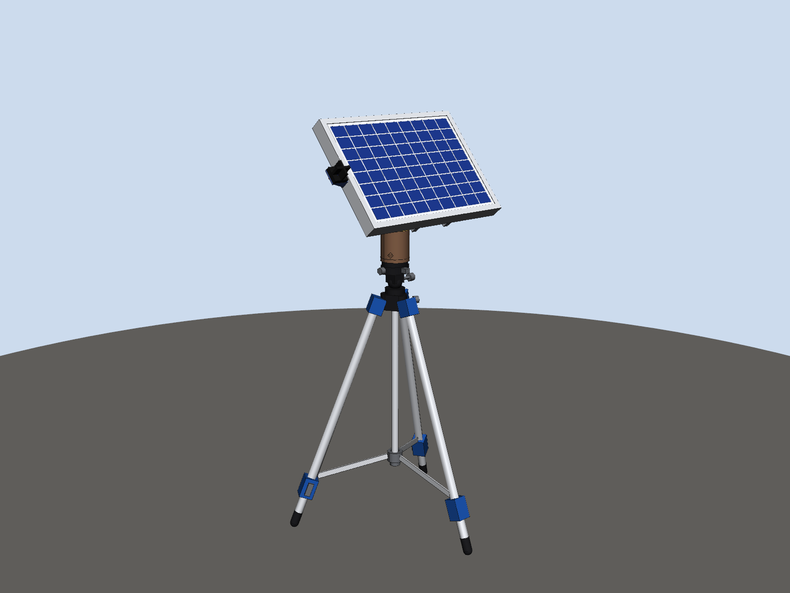 | 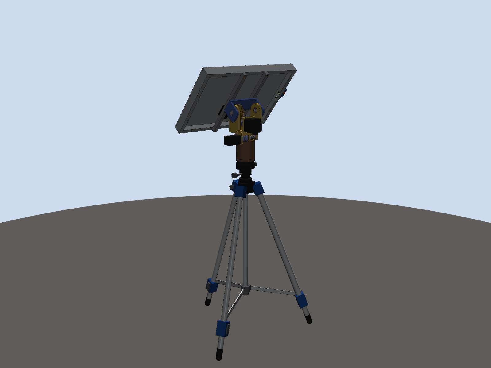 |
| 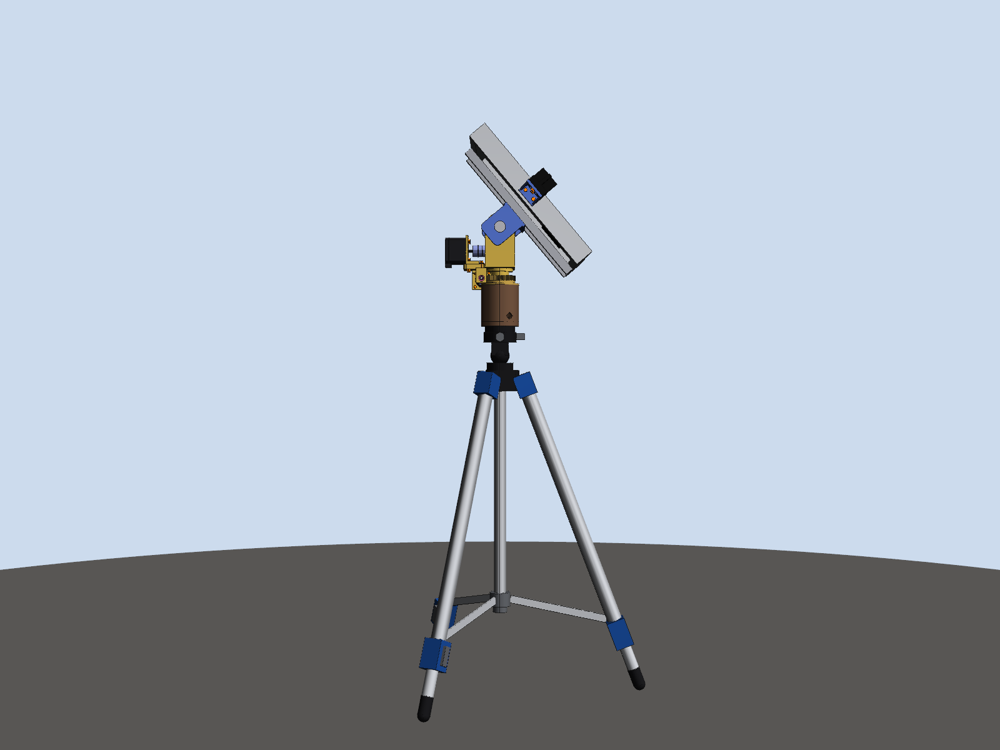 | 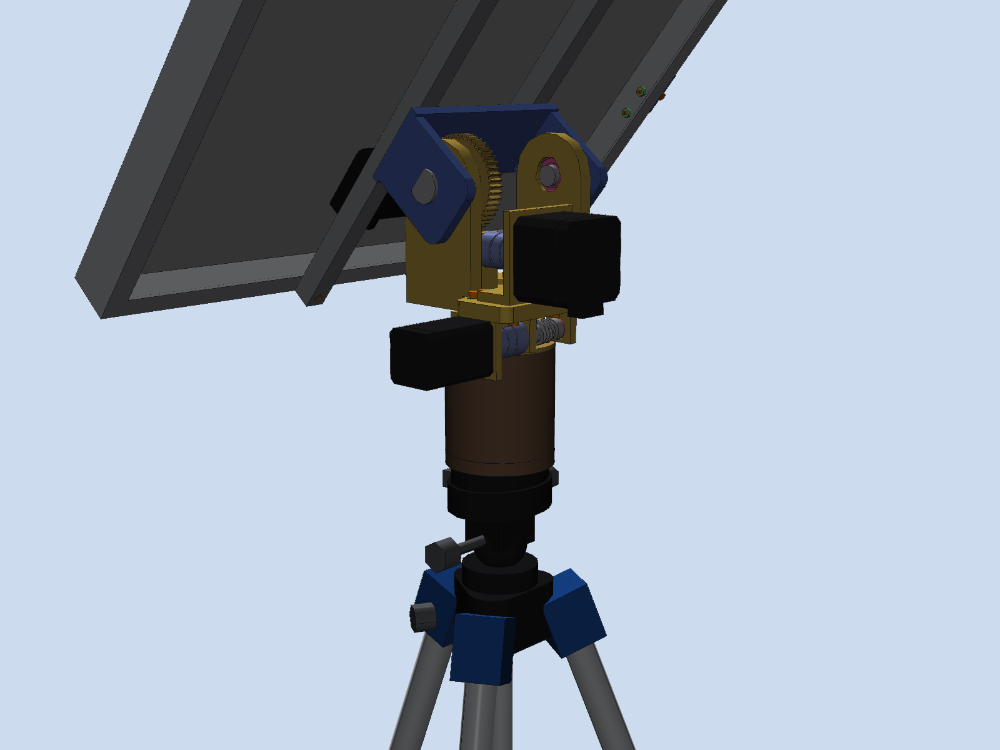 |

C'est **le modèle qu'on construit** : ce document donne tout ce qu'il faut pour le fabriquer,
de l'impression au boîtier électronique. La tête, le panneau, le capteur solaire et la
commande, communs aux deux modèles, sont décrits dans le [README principal](../../README.md).

**Sommaire**

1. [Du modèle lunaire au modèle terrestre : ce qui change](#1-du-modèle-lunaire-au-modèle-terrestre--ce-qui-change)
2. [Pièces à imprimer (`a_imprimer/`, déjà orientées sur le plateau)](#2-pièces-à-imprimer-a_imprimer-déjà-orientées-sur-le-plateau)
3. [Pièces à acheter](#3-pièces-à-acheter)
4. [Jeux d'ajustement et éprouvette](#4-jeux-dajustement-et-éprouvette)
5. [Ordre de montage](#5-ordre-de-montage)
6. [Commande : Heltec WiFi LoRa 32 V4](#6-commande--heltec-wifi-lora-32-v4)
7. [Capteur solaire de la démonstration](#7-capteur-solaire-de-la-démonstration)
8. [Sur un trépied photo grand public](#8-sur-un-trépied-photo-grand-public)
9. [Couples, marges et tenue de la version PETG](#9-couples-marges-et-tenue-de-la-version-petg)
10. [Fichiers de ce dossier et du boîtier électronique](#10-fichiers-de-ce-dossier-et-du-boîtier-électronique)

## 1. Du modèle lunaire au modèle terrestre : ce qui change

Pour la démonstration, toute la partie rotative est imprimée en PETG, **vis sans fin
comprises**. Restent en métal : le trépied, les deux rails du panneau, et les pièces du
commerce qu'on ne peut pas imprimer de façon fiable (roulements, arbres Ø5 des vis sans fin,
moteurs, vis). Les **pivots d'élévation sont imprimés** eux aussi.

Les fichiers sont dans **`CAO/Demo_Terre_PETG/`**. Ce sont les mêmes pièces que le cas réel,
générées avec le jeu de cotes `"petg"` : les trous et les dentures ont des jeux qui
compensent l'impression, et quelques formes sont adaptées pour s'imprimer sans support.
L'assemblage imprimé complet, avec roulements, arbres, moteurs et toutes les vis, a été vérifié
par le script :
* **aucune interférence** entre pièces, vis comprises ;
* chaque tête de vis a sa place, et aucune vis ne dépasse de son trou ;
* les vis et les roues **engrènent sans chevauchement** à −2°, 30° et 92° d'élévation et à
  plusieurs azimuts ;
* garde de 2 mm de la partie basculante sur toute la course.

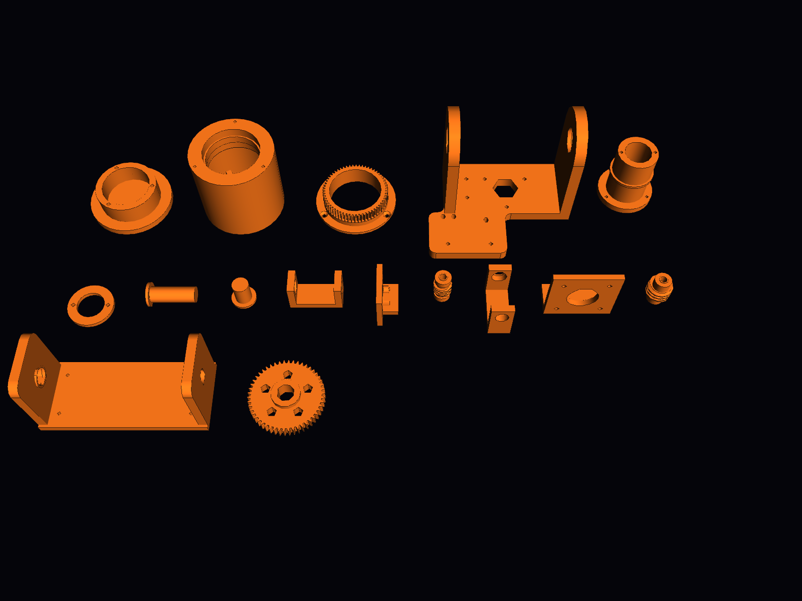

**Ce qui ne change pas** (voir le [README principal](../../README.md)) : l'architecture de la
tête (§ 2), les rapports 50:1 et 60:1, les moteurs, le panneau et sa fixation (§ 3), le capteur
solaire et son principe (§ 4), et le principe de la commande (§ 5).

**Ce qui change, pièce par pièce :**

| Élément | Cas réel (Lune) | Démonstration sur Terre |
|---|---|---|
| Socle, fond, chape, chapeau en U, paliers et supports de moteurs | Al 6061-T6 anodisé | **PETG imprimé** (le moyeu de la chape est imprimé à part) |
| Rondelle d'arrêt du moyeu | Inox 17-4PH | **PETG imprimé** |
| Roues des vis sans fin (azimut et élévation) | Bronze CuSn12 | **PETG imprimé** |
| Vis sans fin | Inox 17-4PH | **PETG imprimé** |
| Arbres des vis sans fin Ø5 | Inox 17-4PH | Acier, non imprimés : tige Ø5 rectifiée |
| Pivots d'élévation | Inox 17-4PH, Ø8 (dont un en D), sur 608 | **PETG imprimé**, Ø12 (l'entraîné en D), sur 6801 |
| Accouplements | Al 7075-T73 | Accouplements flexibles alu 5/5 du commerce |
| Roulements | 6806, 608, 685 **ZZ** en acier 440C, lubrification sèche (MoS₂) | 6806, **6801**, 685 **ZZ** (ou 2RS) en acier standard, graissés à vie d'origine |
| Lubrification des vis et des roues | MoS₂ sec | Graisse PTFE |
| Visserie | Inox ou titane | Vis CHC acier M3 et M2,5 |
| Moteurs | Version vide / spatiale (même taille) | NEMA 17 et NEMA 11 du commerce |
| Rails du panneau | Al 6061-T6 | Aluminium, non imprimés |
| Ferrures et colliers du trépied, axes, vis d'ancrage | Ti-6Al-4V | Non imprimés (métal) |
| Tubes de jambes, colonne, entretoises, patins | Al 7075-T73 anodisé dur | Non imprimés (aluminium) |
| Cadre du panneau | Al 6063-T5 | Al 6063-T5 (panneau du commerce) |
| Capteur solaire : boîtier à croix et équerre | Al 6061-T6 anodisé noir, fenêtre en silice fondue, photodiodes qualifiées pour le spatial | **PETG imprimé** (boîtier en PETG noir), photodiodes BPW34 du commerce |

Les chiffres côte à côte (masses, marges, courant du moteur d'élévation) sont dans le
[README principal](../../README.md), § 1.

## 2. Pièces à imprimer (`a_imprimer/`, déjà orientées sur le plateau)

| Pièce | Qté | Orientation (déjà appliquée) | Remarque |
|---|---|---|---|
| `Socle` | 1 | Debout, ouverture en bas | Cône à 45° sous le logement du 6806 bas : pas de support |
| `Fond_Socle` | 1 | Dessus sur le plateau | Se visse sur la vis 1/4" d'un trépied photo : écrou 1/4" pris dans un logement hexagonal |
| `Roue_Azimut_Fixe` | 1 | Dessous plat sur le plateau | Denture m0,8 : buse 0,25 mm conseillée (voir réglages) |
| `Chape` | 1 | Plaque sur le plateau, bras vers le haut | Plus grande pièce : 108 × 84 × 88 mm |
| `Moyeu_Chape` | 1 | Collerette sur le plateau | Imprimé à part pour que la chape tienne à plat ; vissé sous la chape (3 × M3) |
| `Bague_Arret_Moyeu` | 1 | À plat | |
| `Chapeau_U` | 1 | Plaque sur le plateau, flancs vers le haut | Alésage Ø12 en D côté roue ; un bossage Ø14,2 sur la face intérieure de chaque flanc |
| `Roue_Elevation` | 1 | À plat, moyeu en haut | Alésage Ø12 en D |
| `Pivot_Entraine` | 1 | Couché sur son méplat | Ø12 en D, 34 mm tête comprise ; porte la roue. 100 % de remplissage |
| `Pivot_Libre` | 1 | Debout, tête en bas | Ø12, 19 mm tête comprise. 100 % de remplissage |
| `Vis_Elevation`, `Vis_Azimut` | 1 + 1 | Debout, axe vertical | 100 % de remplissage ; bordure (brim) conseillée |
| `Palier_Vis_Elevation`, `Palier_Vis_Azimut` | 1 + 1 | Semelle sur le plateau | Lèvre de 1 mm côté extérieur de chaque joue : le 685 s'enfonce depuis l'intérieur du U |
| `Support_Moteur_Elevation`, `Support_Moteur_Azimut` | 1 + 1 | Semelle sur le plateau | |
| `Capteur_Solaire_Boitier` | 1 | Croix en haut | **PETG noir**, 100 % de remplissage : il doit être opaque (§ 7) |
| `Capteur_Solaire_Support` | 1 | Plaque sur le plateau, âme vers le haut | Équerre du capteur solaire, vissée sur le petit côté du cadre |

Environ 305 g de PETG pour la tête (406 g si tout était plein), plus 26 g pour le capteur
solaire.

**Réglages conseillés** :
* PETG, couches de 0,2 mm ;
* 4 périmètres, 40 % de remplissage gyroïde ;
* **100 %** pour les deux vis, les deux roues et les deux pivots ;
* compensation de la patte d'éléphant (≈ 0,2 mm) ;
* aucun support ;
* teinte claire de préférence : un PETG noir en plein soleil d'été peut approcher sa
  température de ramollissement (≈ 80 °C).

**Pour les quatre pièces dentées** : filet des vis de 0,95 mm (élévation) et 0,76 mm
(azimut) en tête, denture m0,8 de la roue d'azimut. Ça s'imprime avec une buse de 0,4 mm,
mais une **buse de 0,25 mm et des couches de 0,1 mm** donnent des dents nettement plus
justes.

## 3. Pièces à acheter

La liste complète, avec les noms à chercher sur les sites marchands, les quantités, les prix
indicatifs et l'électronique (Heltec V4, drivers, alimentation), est dans
**[`LISTE_ACHATS.md`](../../LISTE_ACHATS.md)**. En résumé, pour la mécanique :

| Article | Qté |
|---|---|
| Roulement **6806ZZ** (ISO 61806-2Z ; ou 6806-2RS), 30 × 42 × 7 mm | 2 |
| Roulement **6801ZZ** (ISO 61801-2Z ; ou 6801-2RS), 12 × 21 × 5 mm | 2 |
| Roulement **685ZZ** (ou 685-2RS), 5 × 11 × 5 mm — **pas le 685 ouvert, large de 3 mm** | 4 |
| Tige acier rectifiée Ø5, coupée à 52,5 mm (arbres des vis) : **le seul axe acier** | 2 |
| Accouplement flexible alu 5 mm / 5 mm, Ø19 × 25 mm (à chercher : `flexible shaft coupling 5mm x 5mm D19 L25`) | 2 |
| NEMA 17 34 mm (Usongshine 17HS3401, 0,34 N·m) et NEMA 11 45 mm (11HS18-0674S) | 1 + 1 |
| Vis CHC M3 : 6 × M3×8, 7 × M3×10, 11 × M3×12, 8 × M3×14 | 32 |
| Rondelle M3 (ISO 7089, 3,2 × 7 × 0,5), sous les vis d'azimut posées sur les lumières | 4 |
| Écrou 1/4"-20 UNC (filetage photo, 7/16" sur plats) | 1 |
| Écrou M3 (panneau sur les rails, équerre du capteur solaire) | 6 |
| Vis à tête fraisée M3×8 (roue d'azimut) | 3 |
| Vis CHC M2,5×6 (NEMA 11 : ses taraudages ne font que 2,5 mm) | 4 |
| Vis sans tête M3×4 (blocage des vis sans fin sur leur arbre) | 2 |
| Graisse PTFE (vis, roues) | 1 |
| Photodiodes BPW34, résistances de 1 kΩ, condensateurs de 100 nF, convertisseur ADS1115 (capteur solaire) | 4 + 4 + 4 + 1 |

Toute la visserie, à l'échelle et avec ses quantités : § 5, « Visserie en bref ».

Les deux pivots d'élévation sont **imprimés** (`Pivot_Entraine`, `Pivot_Libre`) : il n'y a
plus d'axe Ø8 à acheter. Ils passent à **Ø12** et les 608 deviennent des **6801** (12 × 21 × 5),
car un pivot PETG de Ø8 ne tiendrait pas le couple de la roue d'élévation (voir § 9).
Leur tête Ø18 de 2 mm sert d'épaulement contre le flanc du chapeau.

### Roulements de la démonstration

Ce sont ceux du modèle lunaire ([README du modèle lunaire](../Cas_Reel/README.md), § 1), en
acier standard, sauf à l'élévation : les pivots imprimés
Ø12 tournent dans des **6801** au lieu des 608.

| Réf. | Dimensions (Ø int. × Ø ext. × largeur) | Qté | Emplacement |
|---|---|---|---|
| **6801** (ISO 61801) | 12 × 21 × 5 mm | 2 | Élévation : dans les bras de la chape, sur les pivots imprimés Ø12. Appui sur la bague intérieure : bossage Ø14,2 du chapeau, à 0,25 mm. Appui sur la bague extérieure : alésage Ø19,5 du bras |

* Prendre de préférence des **ZZ**. Ils sont graissés à vie d'origine : ne pas les ouvrir ni
  les regraisser.
  * Les joints des 2RS frottent sur la bague intérieure. Les deux 6806-2RS freinent
    l'azimut d'environ 0,15 N·m (estimation), soit le tiers du couple du vent de 10 m/s.
  * Avec des 2RS, la marge de l'azimut au vent passe de ×2,3 à ×1,6 (vis graissée), et
    au-dessous de ×1 si la vis tourne à sec.
  * L'élévation n'est presque pas touchée : ×1,6 → ×1,5.
* **685** : prendre une version **protégée, ZZ ou 2RS**. Le 685 ouvert ne fait que 3 mm de
  large, alors que les paliers sont prévus pour 5 mm.
* **Montage** : enfoncer un roulement en poussant sur la bague qu'on emmanche. Dans un
  logement, c'est la bague extérieure : utiliser une douille de son diamètre, jamais un
  outil posé sur la flasque.

### Moteurs

Modèle retenu pour l'élévation : **Usongshine 17HS3401, 0,34 N·m à 1,0 A**, avec un
connecteur JST PH à 6 broches. Son plan est vérifié : taraudages M3 profonds de 4,5 mm au
moins, centrage Ø22 × 2, trous à 31 mm, axe Ø5 × 23,5. Un autre 17HS3401 convient s'il est
annoncé à **0,28 N·m au moins**. Certains vendeurs vendent sous la même référence une version
à 0,23 N·m, trop juste. En version PETG, régler le courant pour obtenir environ 0,20 N·m de
maintien (0,6 A pour ce moteur, § 9).

Pour l'azimut : **NEMA 11 de 45 mm, 11HS18-0674S** (0,10 N·m, 0,67 A). Ses taraudages ne
font qu'environ 2,5 mm de profondeur : vis M2,5×6, pas plus longues.

## 4. Jeux d'ajustement et éprouvette

| Ajustement | Cas réel | PETG | Pourquoi |
|---|---|---|---|
| Logements de roulements (608 / 6801, 685, 6806) | nominal | **+0,15 mm** | Les trous imprimés sortent plus petits ; on obtient un serrage léger du roulement |
| Alésage d'un axe (Ø5 acier des vis ; pivot Ø8 acier ou Ø12 PETG dans le chapeau et la roue) | nominal | **+0,10 mm**, en D côté roue (méplat à 5,25 mm de l'axe pour le Ø12) | Serré. Le méplat transmet le couple de la roue au chapeau, et une vis de pression bloque chaque vis sans fin |
| Pivots imprimés dans les 6801 | Ø8 acier | **Ø11,95** | Les diamètres extérieurs imprimés sortent un peu plus gros : serrage léger de la bague intérieure |
| Moyeu de la chape dans les 6806 | Ø30 | **Ø29,95** | Serrage léger de la bague intérieure |
| Fixation sur le trépied | Téton Ø45,5 dans la colonne Ø46 | **Écrou 1/4" captif**, logement de 11,4 mm sur plats (écrou de 11,1) | La vis du trépied tire l'écrou sur un plancher de 1,6 mm et serre le fond sur le plateau |
| Trous de passage M3 / M2,5 | 3,4 / 2,9 | **3,5 / 3,0** | |
| Avant-trous M3 | 2,5 (taraudés) | **2,8** | Vis auto-taraudées dans le PETG, 3,5 mm de prise au moins (vérifié par le script) |
| Centrage Ø22 des moteurs | 22,5 | **22,4** | |
| Jeu de denture des roues | 0,10 / 0,12 mm | **0,30 mm** | Imprécision des dents imprimées |
| Filet des vis | aminci de 0,15 m | **non aminci, tête raccourcie (0,85 m)** | Tout le jeu est pris sur la roue, et le filet reste assez épais pour l'impression |
| Entraxe vis / roue | nominal | **+0,15 mm**, puis réglé au montage | Lumières en azimut, cales en élévation |
| Bossages du chapeau sur les bagues intérieures des roulements de pivots | 0,10 mm par côté | **0,25 mm** par côté | Règlent le jeu axial du chapeau (0,5 mm en tout en PETG). Si le chapeau serre, poncer un bossage |
| Épaulements des moyeux des vis sur les 685 | 0,15 mm par côté | 0,15 mm par côté | Calage axial de la vis entre ses roulements |
| **Trous d'axe horizontal à l'impression** : logements des 6801 (bras de la chape) et des 685 (joues des paliers), alésages des pivots dans le chapeau, centrages des moteurs | cylindriques | **en goutte** | Le haut d'un trou horizontal imprimé s'affaisse : il sortirait ovale et trop petit. La goutte ajoute deux pans à 45° vers le haut, tronqués 0,6 mm au-dessus du cercle. Elle s'imprime sans support, et le roulement ou l'axe porte sur le reste du cercle. Les trous verticaux (6806, roues, vis) restent ronds |

**Imprimer d'abord l'éprouvette** `Eprouvette_Ajustements.stl`, avec les mêmes réglages
que les pièces :

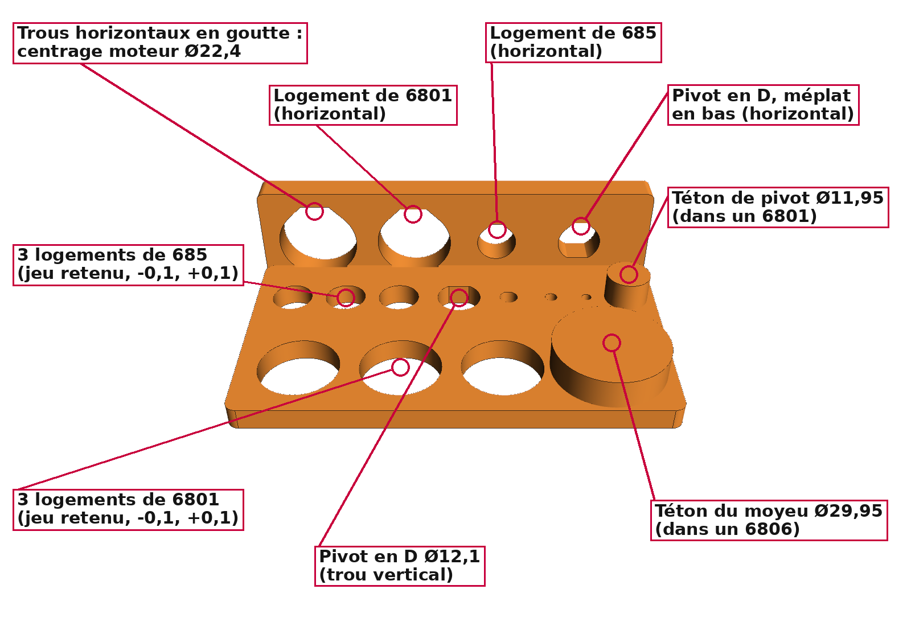

* trois logements de 6801 et trois de 685 : le jeu retenu, −0,1 mm et +0,1 mm ;
* un alésage Ø12 en D, un Ø5, un passage et un avant-trou M3 ;
* un téton Ø29,95 pour le 6806 et un téton Ø11,95 pour le 6801 (essayer un vrai roulement
  dessus : il doit entrer en forçant légèrement) ;
* sur la paroi debout, les **trous horizontaux en goutte**, imprimés comme sur les pièces :
  centrage moteur Ø22,4, logement de 6801, logement de 685, alésage de pivot en D (méplat
  en bas).

Ce qu'on doit obtenir :
* les roulements entrent **en forçant légèrement**, à la main ou avec un serre-joint, et ne
  ressortent pas tout seuls ;
* le centrage du moteur se pose sans forcer ;
* le pivot entre dans son alésage en D sans jeu, en poussant fort.

Un roulement qui tombe tout seul : le jeu est trop grand. Un roulement qui ne rentre pas même
au serre-joint : le jeu est trop petit.

Si ton imprimante préfère un autre logement :
1. change la valeur dans `AJUSTEMENTS["petg"]`, en tête de `scripts/generate_tracker.py` ;
2. relance `python scripts/generate_tete_vis_sans_fin.py`.

Toutes les pièces sont alors régénérées avec ce jeu.

**Retouches possibles au montage**, car une imprimante n'est jamais exacte au dixième près :
* la vis sans fin serre entre ses deux 685 : poncer légèrement l'épaulement Ø6,5 d'un moyeu ;
* le chapeau serre entre les bras de la chape : poncer un bossage ;
* un pivot entre trop dur dans le chapeau : passer un foret Ø12 à la main, sans perceuse ;
* engrènements : réglés au montage (lumières en azimut, cales en élévation), voir l'étape 9.

## 5. Ordre de montage

| Le palier d'une vis sans fin | La vis sans fin imprimée |
|---|---|
| 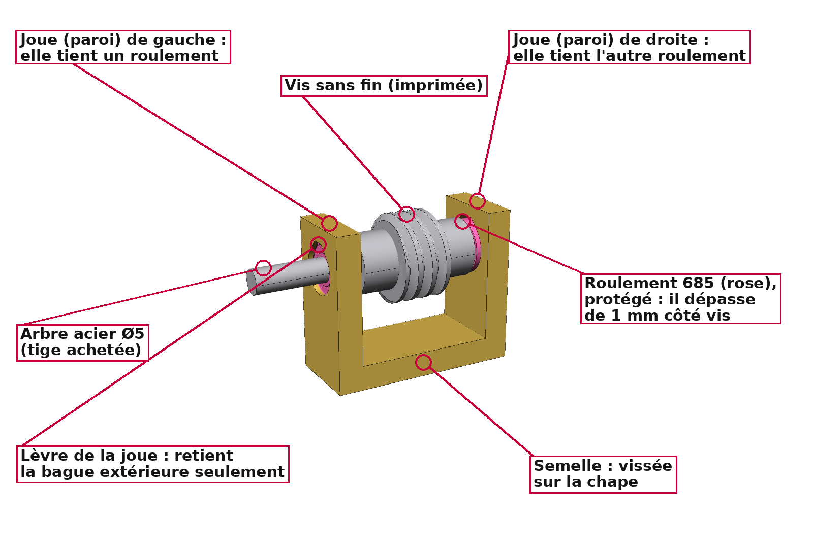 | 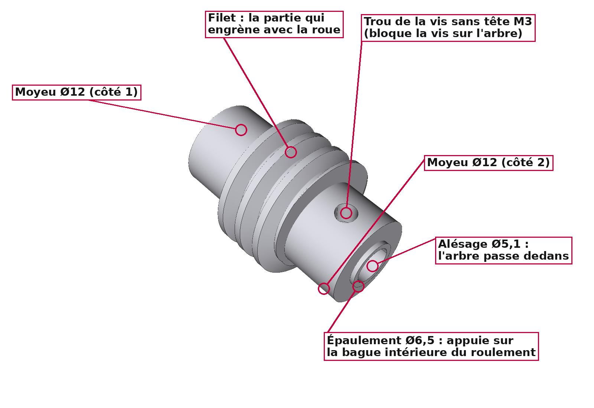 |

| L'axe d'élévation imprimé : pivots PETG Ø12, roulements 6801, roue |
|---|
| 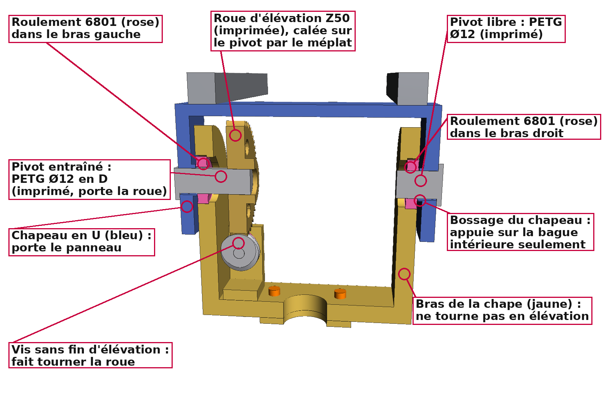 |

* **Le palier** est la pièce en U qui porte une vis sans fin. Ses deux parois sont les
  **joues** : chacune tient un roulement 685, et l'arbre acier Ø5 les traverse. Côté
  extérieur, une **lèvre** de 1 mm retient la bague extérieure du roulement : le 685
  s'enfonce depuis l'intérieur du U jusqu'à cette lèvre, et dépasse de 1 mm côté vis.
* **La vis sans fin imprimée** a, de chaque côté du filet, un **moyeu Ø12**. Les moyeux
  viennent en appui sur les bagues intérieures des 685 par un épaulement Ø6,5, qui ne
  touche pas la flasque. Ils calent la vis entre les joues.
  Une vis sans tête M3×4 dans un moyeu bloque la vis sans fin sur l'arbre.
* **L'accouplement flexible** relie l'axe du moteur à l'arbre :
  * 12,5 mm de chaque axe entrent dans l'accouplement, avec environ 1 mm d'écart entre les
    deux bouts ;
  * sa vis de serrage se serre sur le méplat de l'axe du moteur.

1. **Socle** : presser le 6806 bas par-dessous, jusqu'à l'épaulement, puis le 6806 haut
   par-dessus. Pousser sur la bague extérieure (douille ou tube de Ø40 à 42), jamais sur la
   flasque.
2. **Roue d'azimut** : la poser à plat sur le socle et la fixer par 3 vis fraisées M3×8, qui
   doivent affleurer : la vis d'azimut passe juste au-dessus.
3. **Moyeu** : l'enfiler par le haut, à travers la roue et les deux roulements. Visser la
   rondelle d'arrêt par-dessous (2 × M3×8).
4. **Fond** : poser l'écrou 1/4" dans son logement hexagonal, par le dessus. Visser ensuite
   le fond sous le socle avec 3 × M3×10, têtes noyées par-dessous : l'écrou est alors
   prisonnier. Poser la tête sur le trépied photo et la visser sur la vis 1/4" du plateau.
5. **Chape** : sur l'établi, presser les deux 6801 dans les bras, par l'extérieur, jusqu'à
   l'épaulement. Monter ensuite la
   chaîne d'élévation :
   * le palier avec ses deux 685 (enfoncés depuis l'intérieur du U jusqu'à la lèvre), la vis
     sur sa tige Ø5 et sa vis de pression ;
   * l'accouplement, le support et le NEMA 17.

   Ces pièces sont vissées par-dessous la chape.
6. **Chapeau** : le présenter sur la chape, mettre la roue d'élévation entre les bras, puis
   enfiler le pivot imprimé en D à travers le flanc, le 6801 et la roue, méplat aligné avec
   ceux du flanc et de la roue. Mettre le pivot libre de l'autre côté, à travers le flanc
   et le 6801. Les deux pivots sont serrés dans le chapeau : une goutte de colle
   cyanoacrylate sous la tête les empêche de ressortir. Les bossages des flancs viennent
   contre les bagues intérieures des 6801 : le chapeau doit tourner librement, avec un
   léger jeu axial.
7. **Chape sur le moyeu** : 3 × M3×12 par-dessus.
8. **Chaîne d'azimut** : glisser le palier d'azimut (685, vis, tige) sous la chape, la vis
   venant en prise radialement avec la roue fixe. Mettre ensuite le support, le NEMA 11 et
   l'accouplement. Ces 4 vis M3×12 se mettent par-dessus la chape, dans les lumières, chacune
   avec une rondelle M3 sous la tête.
9. **Réglage des engrènements** (vis et roues graissées) :
   * en azimut, rapprocher le palier dans ses lumières jusqu'à supprimer le jeu, sans
     point dur sur un tour complet ;
   * en élévation, caler le palier par des rondelles ou du clinquant de 0,1 à 0,3 mm
     s'il y a trop de jeu.
10. **Rails et panneau** : les rails se vissent par-dessus le chapeau (4 × M3×14, têtes
    noyées dans les rails). Poser ensuite le panneau sur les rails. Dans chaque bout de rail,
    passer une vis M3×14 par-dessous à travers le rail et l'aile arrière du cadre, puis
    serrer un écrou M3 posé dans le cadre. On l'atteint par le dos ouvert du panneau.
11. **Capteur solaire** (§ 7) : coller les 4 BPW34 dans le boîtier et les câbler, visser le
    boîtier sur son équerre (2 × M3×10 par-dessous), puis l'équerre contre le petit côté du
    cadre, côté du pivot libre (2 × M3×10, écrous M3 posés dans le cadre).

### Visserie en bref

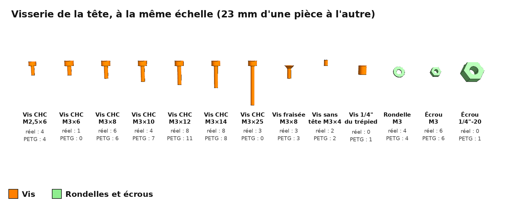

* Dans les fichiers 3D et les images, les **vis sont en orange**, les **rondelles et les
  écrous en vert clair**.
* Presque tout est en **vis CHC M3** (tête cylindrique à six pans creux), de 6 à 25 mm. S'y
  ajoutent 4 vis M2,5×6 pour le NEMA 11, 3 vis fraisées M3×8 sous la roue d'azimut et 2 vis
  sans tête M3×4 qui bloquent les vis sans fin sur leur arbre.
* Les 4 **rondelles M3** vont sous les vis posées sur les lumières de la chaîne d'azimut.
  Les 6 **écrous M3** sont dans le cadre du panneau (4 pour les rails, 2 pour le capteur
  solaire). L'**écrou 1/4"** de la démonstration est prisonnier dans le fond.
* Le détail étape par étape, avec des vues éclatées de chaque endroit :
  **[docs/visserie/](../../docs/visserie/README.md)**.

## 6. Commande : Heltec WiFi LoRa 32 V4

La carte de commande est un **Heltec WiFi LoRa 32 V4** : un ESP32-S3 avec une radio LoRa
SX1262 (863–870 MHz), un écran OLED et un port USB-C. Il pilote les deux moteurs, lit le
capteur solaire et les origines, mesure l'énergie produite par le panneau et consommée par le
tracker, et envoie toutes ces données en LoRa.

Le **schéma électrique complet** est un projet QElectroTech :
[`Electronique/Schema_Electrique.qet`](../../Electronique/Schema_Electrique.qet), avec son export
[`Electronique/Schema_Electrique.pdf`](../../Electronique/Schema_Electrique.pdf) (3 folios, à
imprimer en A3). Il est généré par `scripts/generate_schema_electrique.py`. Chaque fil y porte
sa section (AWG), et l'épaisseur du trait suit cette section.

| Folio 1 : schéma complet | Folio 2 : brochage et liaisons | Folio 3 : section des fils |
|---|---|---|
| 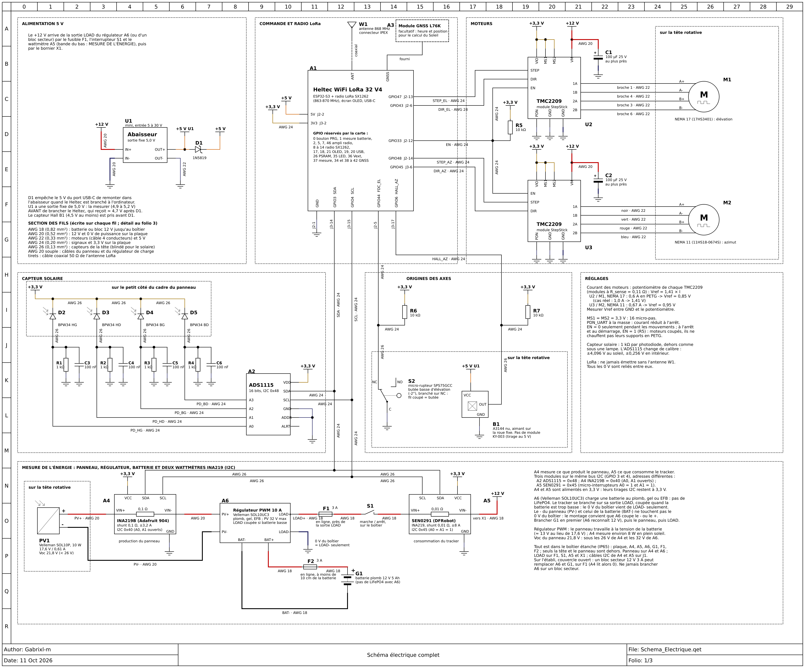 | 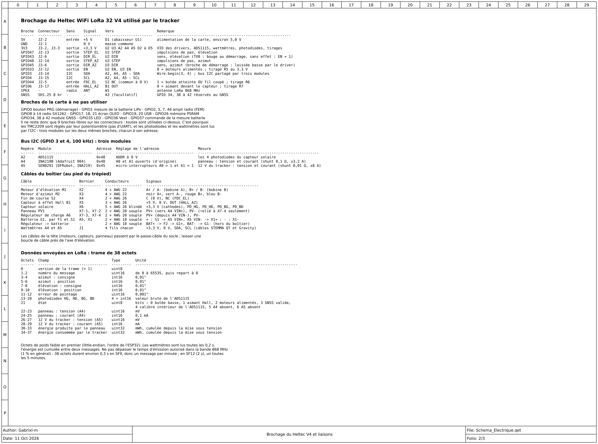 | 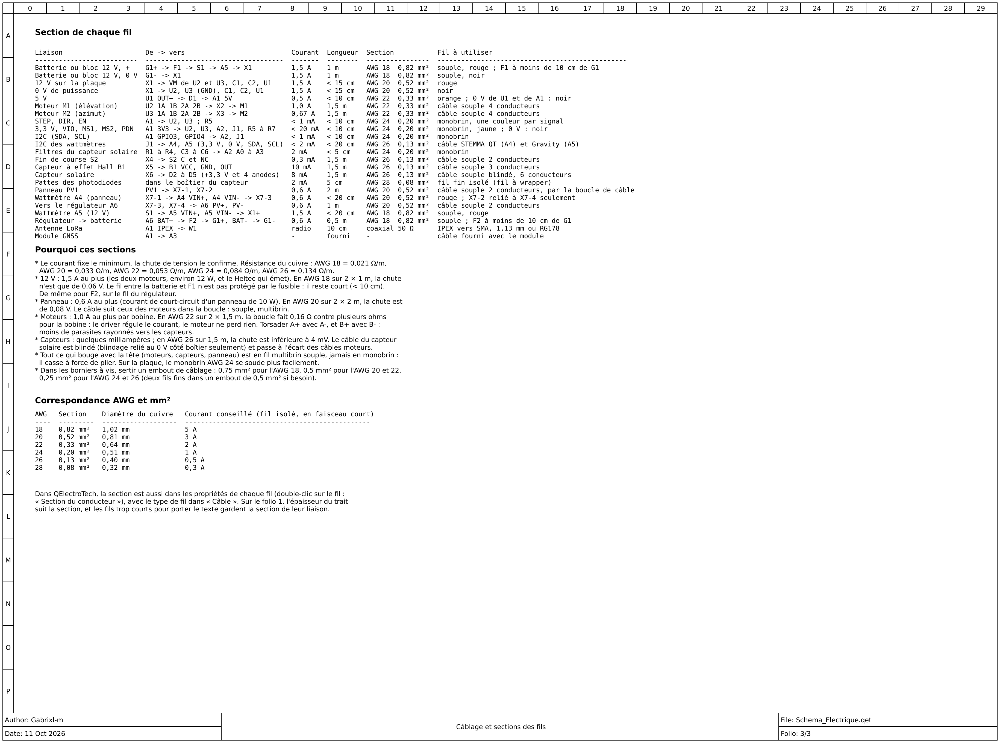 |

**Brochage.** Le Heltec V4 garde pour lui la plupart de ses GPIO : radio et son ampli (2, 5,
7, 8 à 14, 46), écran (17, 18, 21), USB (19, 20), mémoire (26), GNSS (34, 38 à 42), LED,
mesure de la batterie, bouton PRG. Il ne reste que **9 broches libres** sur ses connecteurs,
et le tracker les utilise toutes :

| GPIO | Connecteur | Signal | Vers |
|---|---|---|---|
| 47 | J2-13 | STEP_EL | U2 (TMC2209 d'élévation) STEP |
| 43 | J2-6 | DIR_EL | U2 DIR |
| 48 | J2-14 | STEP_AZ | U3 (TMC2209 d'azimut) STEP |
| 45 | J3-6 | DIR_AZ | U3 DIR |
| 33 | J2-12 | EN | EN de U2 et U3 ; 0 = moteurs alimentés, résistance de tirage R5 au 3,3 V |
| 3 | J3-14 | SDA | bus I²C : ADS1115 (capteur solaire), INA219B et SEN0291 (wattmètres) |
| 4 | J3-15 | SCL | bus I²C |
| 44 | J2-5 | FDC_EL | fin de course d'élévation (contact NC) ; tirage R6 |
| 6 | J3-17 | HALL_AZ | capteur à effet Hall d'azimut ; tirage R7 |

Faute de broches, deux choix découlent de ce brochage :
* **les TMC2209 fonctionnent sans UART** : courant réglé par leur potentiomètre, micro-pas
  par MS1 et MS2 ;
* **les 4 photodiodes sont lues par un ADS1115** (convertisseur 16 bits, 4 entrées, sur
  l'I²C) au lieu des entrées analogiques de l'ESP32. Il est plus précis, et son gain réglable
  évite de changer les résistances entre le soleil et une lampe (§ 7) ;
* **les deux wattmètres sont aussi sur l'I²C** : trois modules sur les deux mêmes broches,
  chacun à son adresse.

```cpp
// Heltec WiFi LoRa 32 V4 : broches du tracker
#define PIN_STEP_EL  47
#define PIN_DIR_EL   43   // U0TXD : bouge au démarrage, sans effet tant que EN = 1
#define PIN_STEP_AZ  48
#define PIN_DIR_AZ   45   // broche de démarrage : laissée basse par le driver
#define PIN_EN       33   // 0 = moteurs alimentés
#define PIN_SDA       3   // I2C : ADS1115 0x48, INA219B 0x40, SEN0291 0x45 ; Wire.begin(PIN_SDA, PIN_SCL)
#define PIN_SCL       4
#define PIN_FDC_EL   44   // U0RXD ; 1 = butée basse atteinte, ou fil coupé
#define PIN_HALL_AZ   6   // 0 = aimant devant le capteur
```

GPIO 43 et 44 sont l'UART0 de l'ESP32-S3. Le moniteur série passe par l'USB : dans l'IDE
Arduino, garder **« USB CDC On Boot : Enabled »**, et ne jamais appeler `Serial0.begin()`.
Prendre le **V4 « standard »** (ESP32-S3R2), pas la variante **V4-R8**, dont le brochage est
différent.

**Alimentation.**
* Le 12 V vient de la **sortie LOAD du régulateur solaire** A6 (Velleman SOL10UC3). Celui-ci
  charge une **batterie au plomb étanche de 12 V et 5 Ah** avec le panneau. Le courant passe ensuite par
  un **fusible de 3 A** et un **interrupteur** (F1, S1), puis par le wattmètre A5, qui mesure
  la consommation du tracker, avant d'arriver sur la plaque (X1). Sur l'établi, porte
  ouvert, un bloc secteur 12 V 3 A peut remplacer le régulateur et la batterie, sur F1.
* **F1 et F2 sont des porte-fusibles en ligne**, sertis sur les fils, **dans le boîtier** :
  * **F1 à la sortie LOAD** du régulateur : il protège les fils qui vont à la plaque ;
  * **F2 sur le fil entre la batterie et le régulateur, à moins de 10 cm du + de la
    batterie**. Le fil qui le précède n'est protégé par rien, et une batterie au plomb en
    court-circuit débite des centaines d'ampères : il doit rester le plus court possible.

  Un fusible ne protège que ce qui vient après lui : chacun est donc au plus près de sa
  source.
* Le 12 V va aux deux drivers, avec **100 µF au plus près de chacun**, et au mini abaisseur
  5 V (U1, environ 18 × 13 mm).
* U1 a une **sortie fixe de 5,0 V** : **la mesurer au multimètre (4,9 à 5,2 V) avant de
  brancher le Heltec**. Le 5 V passe ensuite par une diode Schottky 1N5819 (D1) : le Heltec
  reçoit environ 4,7 V, assez pour son régulateur 3,3 V, et le 5 V de l'USB-C ne remonte pas
  dans l'abaisseur quand la carte est branchée à l'ordinateur.
* Le **capteur Hall B1 est alimenté avant D1**, directement par U1 : l'A3144 demande 4,5 V au
  moins, et les 4,7 V d'après D1 seraient trop justes.
* Le 3,3 V du Heltec alimente la logique des drivers, l'ADS1115, les deux wattmètres, les
  photodiodes et les résistances de tirage. Tous les 0 V sont reliés, sauf le − du panneau
  (voir plus bas, « Mesure de l'énergie »).

**Drivers : 2 × TMC2209**, modules au format StepStick, logique en 3,3 V.
* **MS1 et MS2 au 3,3 V : 16 micro-pas.** PDN_UART à la masse : courant réduit à l'arrêt.
  StealthChop par défaut.
* **Courant de marche**, par le potentiomètre du module. Sur les modules à résistances de
  mesure de 0,11 Ω (les plus courants), Vref = 1,41 × I. Mesurer Vref entre GND et le
  potentiomètre, moteur débranché :

  | Moteur | Courant | Vref |
  |---|---|---|
  | NEMA 17, élévation, version PETG | 0,6 A, pour ne pas casser les dents si l'élévation bute | 0,85 V |
  | NEMA 17, cas réel | 1,0 A | 1,41 V |
  | NEMA 11, azimut | 0,67 A | 0,95 V |

* **À l'arrêt, EN = 1** : drivers coupés. R5 tient EN à 1 au démarrage et pendant un
  téléversement. Ne jamais laisser les moteurs alimentés en permanence : le NEMA 11 dissipe
  alors environ 6 W et le NEMA 17 environ 2 W, assez pour ramollir leurs supports en PETG.

**Moteurs.**
* **NEMA 17 (Usongshine 17HS3401)** : connecteur JST PH à 6 broches. Une bobine relie les
  broches 1 et 4, l'autre les broches 3 et 6. Vérifier au multimètre : faible résistance
  entre les deux fils d'une même bobine, circuit ouvert entre les deux bobines.
* **NEMA 11 (11HS18-0674S)** : bobine A = noir (A+) et vert (A−), bobine B = rouge (B+) et
  bleu (B−), vers 1A, 1B, 2A et 2B du TMC2209. Au multimètre, environ 6,8 Ω entre les deux
  fils d'une même bobine.
* Si un moteur tourne à l'envers, inverser son sens dans le programme.

**Origines.**
* **Fin de course S2** (micro-rupteur SPS75GCC) en butée basse d'élévation (−2°). Son commun
  va au 0 V, son contact **NC** au GPIO 44, avec une résistance de tirage de 10 kΩ. Si un fil
  se coupe, l'ESP32 lit « butée atteinte » et arrête le moteur, au lieu de laisser le
  panneau taper en bout de course.
* **Capteur à effet Hall B1** (A3144) et un aimant sur la roue fixe pour l'azimut. Il est
  alimenté en 5 V, et sa sortie (collecteur ouvert) est tirée au 3,3 V par 10 kΩ. Prendre un
  **A3144 nu** : le module KY-003 tire sa sortie au 5 V, trop pour l'ESP32.
* La détection de calage sans capteur (StallGuard) n'est pas fiable à basse vitesse,
  surtout derrière une vis sans fin.

**Mesure de l'énergie : deux wattmètres INA219.** Les deux modules mesurent chacun une
tension et un courant. L'ESP32 en tire la puissance, et l'énergie en wattheures. Ils
partagent le bus I²C de l'ADS1115 : aucune broche en plus.

| Repère | Module | Branché sur | Shunt, calibre | Adresse I²C |
|---|---|---|---|---|
| A4 | **INA219B d'Adafruit** (904) | le + du panneau, entre le panneau et le régulateur de charge : **ce que produit le panneau** | 0,1 Ω, ±3,2 A | 0x40 (A0 et A1 ouverts, réglage d'origine) |
| A5 | **SEN0291 de DFRobot** (INA219) | le + de la batterie, après F1 et S1 : **ce que consomme tout le tracker** (moteurs, Heltec, capteurs) | 0,01 Ω, ±8 A | 0x45 : mettre ses deux micro-interrupteurs A0 et A1 sur 1 |

* **Pourquoi cette répartition.** Le panneau débite 0,6 A au plus. Le shunt de 0,1 Ω de
  l'INA219B mesure ce courant dix fois plus finement que celui de 0,01 Ω (0,1 mA au lieu de
  1 mA). Le 12 V du tracker monte à 1,5 A, et le fusible F1 est de 3 A : le SEN0291, prévu
  pour 8 A, garde de la marge.
* **Câblage** (bande « Mesure de l'énergie » du folio 1 du schéma) :
  * **A5** : le fil qui vient de S1 arrive sur IN+. Un fil AWG 18 relie IN− à X1+, l'entrée
    12 V de la plaque. GND va au 0 V.
  * **A4** : le + du panneau arrive directement sur le bornier VIN+ de A4, et VIN− va au PV+
    du régulateur. **Le − du panneau va directement au PV− du régulateur**, jamais au 0 V du
    boîtier. Certains régulateurs coupent le −, d'autres le + : ainsi, le montage convient
    aux deux. A4 lit la tension du panneau avec un
    régulateur à « masse négative commune », celle de la batterie avec les autres.
  * Les deux modules sont alimentés en **3,3 V** par le Heltec, par la barrette J1 (3V3, GND,
    SDA, SCL) : un câble STEMMA QT pour A4, le câble Gravity pour A5. Leurs résistances de
    tirage I²C tirent alors au 3,3 V. L'ESP32 ne supporte pas 5 V sur ses broches.
* **Tension du panneau.** L'INA219 supporte 26 V au plus. Le panneau SOL10P fait 21,8 V à
  vide : c'est bon. Un panneau « 24 V » (Voc ≈ 43 V) détruirait A4.
* **Pour que le panneau débite, il lui faut une charge.** En extérieur, c'est le
  **régulateur de charge PWM Velleman SOL10UC3** (A6, Gotronic réf. 27118). Il recharge la
  batterie, et le tracker se branche sur sa sortie LOAD : le tracker devient autonome.
  * **Il ne charge que les batteries au plomb, gel ou EFB, pas les LiFePO4.** La batterie
    fournie, au plomb étanche de 12 V et 5 Ah (88 × 70 × 100 mm), convient. Le panneau la
    charge à 0,6 A au plus, soit un huitième de sa capacité : bien en dessous du quart que
    supporte une batterie au plomb.
  * Sa sortie LOAD est **coupée quand la batterie est trop basse** : le régulateur protège
    ainsi la batterie au plomb, qu'une décharge profonde abîme. Les vis sans fin tiennent le
    panneau en place, moteurs coupés. Quand la batterie remonte, le Heltec redémarre : les
    énergies cumulées et le numéro de message repartent de 0.
  * **Le 0 V du boîtier vient de LOAD− seulement.** Le − du panneau va au PV− du régulateur,
    celui de la batterie à BAT−, sans toucher le 0 V du boîtier. Certains régulateurs
    coupent le −, d'autres le + : ainsi, le montage convient aux deux, et la coupure de
    LOAD reste active.
  * **Ordre de branchement : la batterie d'abord** (le régulateur reconnaît alors 12 V et
    non 24 V), puis le panneau, puis la sortie LOAD. Débrancher dans l'ordre inverse.
  * Le régulateur a son propre fusible, **F2, à moins de 10 cm de la batterie**. Son port
    USB (5 V, 1,2 A) n'est pas utilisé.
  * Sur l'établi, avec un bloc secteur à la place du régulateur et de la batterie, A4 lit
    0 A. **Ne jamais brancher un régulateur de charge sur un bloc secteur.** En intérieur,
    la batterie chargée tient 1,5 à 6 jours.
* **Ce que lit A4.**
  * Un régulateur PWM relie le panneau à la batterie. Le panneau travaille alors à la
    tension de la batterie, environ 13 V, au lieu de ses 17,6 V : il donne ses 0,6 A, soit
    environ **8 W au lieu de 10 W** en plein soleil.
  * Quand la batterie est pleine, le régulateur hache puis coupe le courant du panneau. A4
    lit alors moins, voire 0 A, même en plein soleil : le panneau ne donne que ce que la
    batterie accepte. La moyenne de l'INA219 (68 ms) et le cumul toutes les 0,2 s lissent
    ce hachage.
* **Ordre de grandeur du bilan** (à confirmer avec A4 et A5) :
  * le panneau produit environ 30 Wh par jour de beau temps (8 W pendant 4 heures
    équivalentes de plein soleil) ;
  * le tracker consomme surtout par le Heltec, en continu : quelques dixièmes de watt,
    soit 5 à 20 Wh par jour. Les moteurs ne tournent que 1 % du temps ;
  * la batterie de 12 V et 5 Ah stocke 60 Wh. On n'en utilise que la moitié pour ne pas
    l'abîmer, soit 30 Wh : le tracker tient **1,5 à 6 jours sans soleil** selon ce que
    consomme le Heltec (1,5 jour au pire). Une journée de beau temps (≈ 30 Wh) remplit cette
    moitié. Pour tenir plus longtemps, il faut réduire la consommation du Heltec : WiFi coupé
    hors des mises à jour, écran éteint, sommeil léger entre deux corrections.
* **Étalonnage.** DFRobot demande d'étalonner le courant du SEN0291 :
  1. mettre un multimètre en série (calibre 10 A) pendant un mouvement des moteurs ;
  2. diviser le courant du multimètre par celui que lit A5 ;
  3. mettre ce rapport dans le programme (`kTracker` ci-dessous).

  Faire de même pour A4 au soleil (`kPanneau`).

```cpp
#include <Wire.h>
#include <DFRobot_INA219.h>

DFRobot_INA219_IIC inaPanneau(&Wire, INA219_I2C_ADDRESS1);  // A4 : INA219B Adafruit, 0x40
DFRobot_INA219_IIC inaTracker(&Wire, INA219_I2C_ADDRESS4);  // A5 : SEN0291, 0x45
const float R_PANNEAU = 0.1, R_TRACKER = 0.01;  // shunts (ohms)
float kPanneau = 1.0, kTracker = 1.0;           // étalonnage au multimètre

bool initWattmetre(DFRobot_INA219_IIC &ina) {
  if (!ina.begin()) return false;               // absent : signalé dans la trame LoRa
  ina.setBRNG(eIna219BusVolRange_32V);
  ina.setPGA(eIna219PGABits_8);                 // ±320 mV sur le shunt
  ina.setBADC(eIna219AdcBits_12, eIna219AdcSample_128);
  ina.setSADC(eIna219AdcBits_12, eIna219AdcSample_128);   // moyenne sur 68 ms : lisse le découpage des drivers
  ina.setMode(eIna219SAndBVolCon);
  return true;
}

// toutes les 0,2 s : courant = tension du shunt / résistance du shunt, énergie cumulée
float mA(DFRobot_INA219_IIC &ina, float r, float k) { return k * ina.getShuntVoltage_mV() / r; }
// energie_mWh += ina.getBusVoltage_V() * mA(...) * 0.2 / 3600;
```

Le même calcul sert pour les deux modules : seule la valeur du shunt change. On évite ainsi
le réglage de calibration propre à chaque bibliothèque.

**LoRa.**
* L'**antenne 868 MHz** fournie se visse sur le connecteur IPEX. **Ne jamais émettre sans
  elle** : l'étage de sortie peut griller.
* Les données partent dans une **trame de 38 octets**, octets de poids faible en premier
  (l'ordre de l'ESP32). Elle est aussi au folio 2 du schéma.

  | Octets | Champ | Type | Unité |
  |---|---|---|---|
  | 0 | version de la trame (= 1) | uint8 | |
  | 1–2 | numéro du message | uint16 | de 0 à 65 535, puis repart à 0 |
  | 3–6 | azimut : consigne, position | 2 × int16 | 0,01° |
  | 7–10 | élévation : consigne, position | 2 × int16 | 0,01° |
  | 11–12 | erreur de pointage | uint16 | 0,001° |
  | 13–20 | photodiodes HG, HD, BG, BD | 4 × int16 | valeur brute de l'ADS1115 |
  | 21 | état | uint8 | bits : 0 butée basse, 1 aimant Hall, 2 moteurs alimentés, 3 GNSS valide, 4 calibre intérieur de l'ADS1115, 5 A4 absent, 6 A5 absent |
  | 22–23 | panneau : tension (A4) | uint16 | mV |
  | 24–25 | panneau : courant (A4) | int16 | 0,1 mA |
  | 26–27 | 12 V du tracker : tension (A5) | uint16 | mV |
  | 28–29 | 12 V du tracker : courant (A5) | int16 | mA |
  | 30–33 | énergie produite par le panneau | uint32 | mWh, cumulée depuis la mise sous tension |
  | 34–37 | énergie consommée par le tracker | uint32 | mWh, cumulée depuis la mise sous tension |

  Le récepteur obtient la puissance (tension × courant), et l'énergie d'une journée par
  différence entre deux messages. La comparaison des deux énergies montre si le panneau
  couvre la consommation du tracker.
* Dans la bande 868 MHz, chaque émetteur ne doit occuper le canal que 1 % du temps en
  général. 38 octets durent environ 0,3 s en SF9 : un message par minute. En SF12 (2 s), un
  message toutes les 5 minutes.
* La réception se fait sur un second module LoRa, ou par LoRaWAN (The Things Network) si une
  passerelle est à portée.

**GNSS (facultatif).** Le module L76K de Heltec se branche sur le connecteur GNSS de la carte.
Il donne l'heure et la position pour le calcul de la position du Soleil (§ 7).

**Bibliothèques Arduino.**
* `FastAccelStepper` : impulsions STEP générées en matériel, avec rampes d'accélération.
* `Adafruit_ADS1X15` : lecture de l'ADS1115.
* `DFRobot_INA219` : lecture des deux wattmètres (elle règle aussi leur moyenne).
* La bibliothèque Heltec (« Heltec ESP32 Dev-Boards ») ou `RadioLib` pour la radio. Sur le
  V4, l'ampli de sortie se commande par les GPIO 7, 2 et 46 : partir des exemples Heltec.
* `TinyGPSPlus` pour le GNSS.
* `ArduinoOTA` (fournie avec le cœur ESP32) : mise à jour du programme par le WiFi, sans
  ouvrir le boîtier étanche.

**Câbles : section de chaque fil** (détail au folio 3 du schéma). La section dépend du
courant et de la longueur. Elle est écrite sur chaque fil du schéma, et dans ses propriétés
QElectroTech (« Section du conducteur »).

| Liaison | Courant | Longueur | Section | Fil |
|---|---|---|---|---|
| Sortie LOAD du régulateur (ou bloc 12 V) → F1 → S1 → A5 → X1, et 0 V | 1,5 A | < 30 cm | **AWG 18** (0,82 mm²) | souple, rouge et noir, dans le boîtier |
| 12 V et 0 V de puissance sur la plaque (VM des drivers, C1, C2, U1) | 1,5 A | < 15 cm | **AWG 20** (0,52 mm²) | rouge et noir |
| 5 V : U1 → D1 → Heltec, U1 → capteur Hall (X5), et leur 0 V | 0,5 A | < 10 cm | **AWG 22** (0,33 mm²) | orange et noir |
| Moteurs M1 et M2 (U2, U3 → X2, X3 → moteur) | 1 A | 1,5 m | **AWG 22** (0,33 mm²) | câble souple 4 conducteurs, par moteur |
| STEP, DIR, EN, 3,3 V, I²C, filtres du capteur | < 20 mA | < 10 cm | **AWG 24** (0,20 mm²) | monobrin |
| Fin de course S2 (X4) et capteur Hall B1 (X5) | 10 mA | 1,5 m | **AWG 26** (0,13 mm²) | câble souple 2 et 3 conducteurs |
| Capteur solaire (X6) | 8 mA | 1,5 m | **AWG 26** (0,13 mm²) | câble souple **blindé** 6 conducteurs |
| Pattes des photodiodes, dans le boîtier du capteur | 2 mA | 5 cm | **AWG 28** (0,08 mm²) | fil fin isolé (fil à wrapper) |
| Panneau → A4 (le +) et régulateur (le −) | 0,6 A | 2 m | **AWG 20** (0,52 mm²) | câble souple 2 conducteurs, par la boucle de câble |
| A4 (VIN−) → régulateur de charge (PV+) | 0,6 A | < 20 cm | **AWG 20** (0,52 mm²) | rouge, dans le boîtier |
| Régulateur → F2 → batterie | 0,6 A | < 20 cm | **AWG 18** (0,82 mm²) | souple, rouge et noir, dans le boîtier ; F2 à moins de 10 cm de la batterie |
| I²C des wattmètres (J1 → A4, A5) | < 2 mA | < 20 cm | **AWG 26** (0,13 mm²) | câble STEMMA QT (A4) et câble Gravity (A5) |
| Antenne LoRa | radio | 10 cm | coaxial 50 Ω | IPEX vers SMA (1,13 mm ou RG178) |

* En AWG 18, la chute de tension sur l'aller-retour du 12 V (2 × 1 m, 1,5 A) n'est que de
  0,06 V. En AWG 22, la boucle d'une bobine de moteur (2 × 1,5 m) fait 0,16 Ω, à côté de
  plusieurs ohms pour la bobine : le driver régule le courant, le moteur ne perd rien.
* **Tout ce qui va vers la tête est en multibrin souple** (câble du panneau compris), jamais
  en monobrin, qui casse à force de plier dans la boucle de câble.
* Torsader les fils de chaque bobine (A+ avec A−, B+ avec B−) : ils rayonnent moins de
  parasites vers les capteurs.
* Le câble du capteur solaire passe à l'écart des câbles moteurs. Son blindage est relié au
  0 V **côté boîtier seulement**.
* Dans les borniers à vis, sertir un **embout de câblage** : 0,75 mm² pour l'AWG 18,
  0,5 mm² pour l'AWG 20 et 22, 0,25 mm² pour l'AWG 24 et 26.

**Installation.** Tout ce qui ne tourne pas avec la tête est dans **un seul boîtier
étanche (IP65)**, au pied du trépied : plaque, wattmètres, régulateur, batterie et fusibles.
Seuls restent dehors la tête (moteurs, fin de course, capteur Hall, capteur solaire) et le
panneau. Leurs câbles descendent par le passe-câble du socle et entrent dans le boîtier par
des presse-étoupes (folio 2 du schéma : nombre de conducteurs par câble).

### Implantation du boîtier électronique

L'électronique tient sur une **plaque à pastilles de 7 × 9 cm** (24 × 30 trous utilisés : une
plaque d'essais ECS1/2 en époxy, coupée à 28 × 34 trous, voir la liste d'achats), tassée au
plus près. Le même boîtier étanche reçoit aussi les deux wattmètres, la batterie, les
fusibles et le régulateur de charge, vissé sous la porte. L'implantation est dessinée à
l'échelle dans Fritzing :
[`Electronique/Implantation_Boitier.fzz`](../../Electronique/Implantation_Boitier.fzz), à ouvrir dans
Fritzing (gratuit), vue « Platine d'essai ». Le fichier est généré par
`scripts/generate_implantation_fritzing.py`.

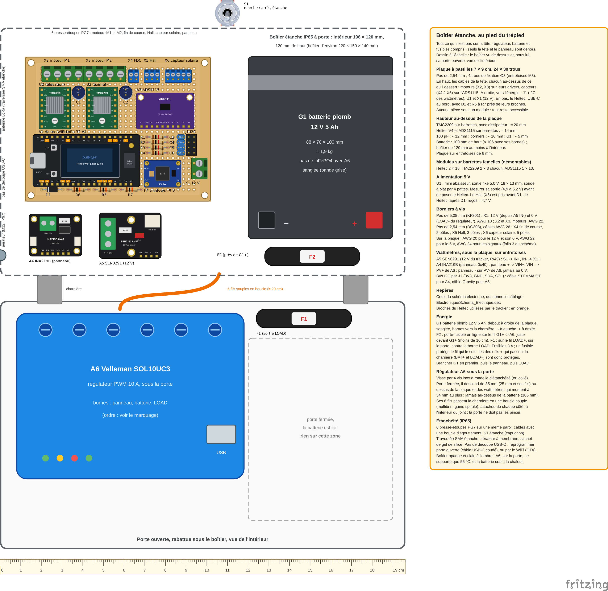

| La plaque à pastilles, de plus près |
|---|
| 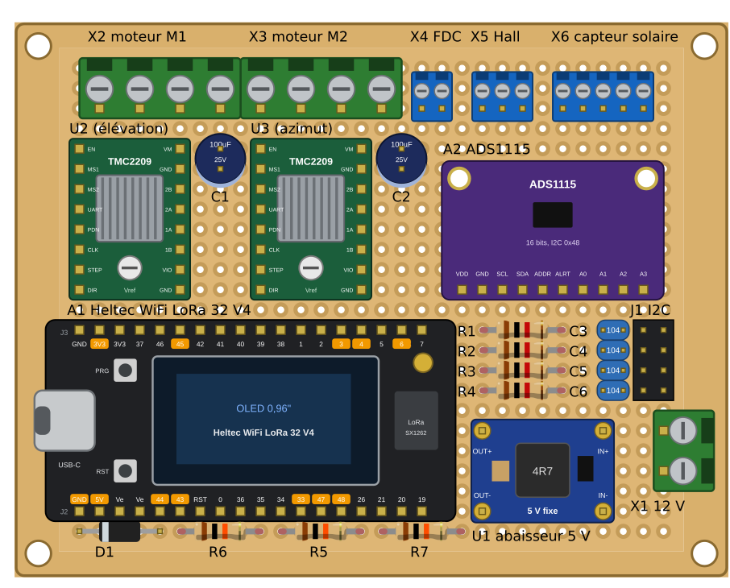 |

* **Organisation de la plaque** : chaque pièce est à côté de ce qu'elle dessert, ce qui
  raccourcit les fils.
  * **En haut**, les borniers des câbles de la tête : ceux des moteurs (X2, X3) au-dessus de
    leurs drivers, ceux des capteurs (X4 à X6) au-dessus de l'ADS1115. Les 4 photodiodes de X6
    tombent droit sur les entrées A0 à A3.
  * **Au milieu**, les deux TMC2209, chacun avec son 100 µF contre VM et GND, et l'ADS1115 avec
    ses filtres juste dessous (R1 à R4, C3 à C6).
  * **En bas**, le Heltec, USB-C au bord gauche. D1 et les résistances de tirage R5 à R7 sont le
    long du bas, près des broches qu'elles desservent.
  * **Au bord droit**, vers l'énergie : J1 (bus I²C des wattmètres), le mini abaisseur U1 et X1
    (12 V, fils entrant par la droite).
  * Aucune pièce n'est cachée sous un module : tout reste visible, mesurable et réparable.
* **Modules sur barrettes femelles**, pour pouvoir les retirer : Heltec V4 (2 × 18 broches),
  TMC2209 (2 × 8 chacun), ADS1115 (1 × 10). Les résistances, les condensateurs et la diode
  sont soudés. U1 est posé à plat, tenu par 4 pattes (des chutes de pattes de résistance)
  soudées dans ses pastilles et dans la plaque.
* **Wattmètres A4 et A5 sous la plaque**, sur entretoises (M2,5 pour l'INA219B, M3 pour le
  SEN0291). Leur bus I²C arrive par la **barrette mâle J1** (2 × 4 broches : 3V3, GND, SDA, SCL
  pour chacun).
* **Batterie G1 couchée** à droite de la plaque : vue de face (porte ouverte), elle fait
  100 mm de large et 88 mm de haut, et seulement **70 mm dans la profondeur** du boîtier. Ses
  bornes sortent de la face gauche, le − au-dessus du +, dans le couloir de câblage. Tenue par
  une sangle (ou des équerres) : 1,9 kg ne doivent pas se promener dans le boîtier.
  * Couchée, elle doit être **étanche (AGM, « VRLA », sans entretien)** : c'est le cas des
    batteries au plomb 12 V 5 Ah de ce format, qui marchent dans toutes les positions sauf
    **tête en bas**. Pas de batterie à bouchons (plomb ouvert, électrolyte liquide).
* Le fusible en ligne **F2**, entre le + de la batterie et le régulateur, est sous la batterie :
  moins de 10 cm de fil depuis le +.
* **Couloir de câblage** de 18 mm entre la plaque et la batterie : on y range les fils, et les
  bornes de la batterie y sortent.
* **Régulateur A6 vissé sous la porte**, comme sur les stations solaires de terrain : il ne
  prend plus de place au fond du boîtier.
  * **Fixation** : 4 vis inox dans ses trous de fixation, avec une **rondelle d'étanchéité**
    (EPDM ou joint torique) sous chaque tête, côté extérieur, et un écrou frein à l'intérieur.
    Sans elles, chaque trou laisserait entrer l'eau. À défaut, le coller avec un adhésif double
    face pour l'extérieur (type VHB) : la porte reste sans trou.
  * **Place** : porte fermée, il avance d'environ 35 mm (25 mm d'épaisseur, plus ses fils)
    devant la plaque et les wattmètres, qui n'avancent que de 35 mm au plus : 70 mm sur les
    80 mm de profondeur. Il ne doit **jamais** être devant la batterie : 70 mm de batterie +
    35 mm de régulateur dépassent les 80 mm du boîtier. Le dessin montre la porte ouverte,
    avec la zone à laisser libre.
  * **Ses 6 fils passent par la charnière** : fil multibrin souple (jamais de monobrin, qui
    casse à force de plier), réunis dans une gaine spirale. Laisser une **boucle d'environ
    20 cm** pour que la porte s'ouvre en grand sans tirer. Attacher la boucle de chaque côté de
    la charnière (colliers sur embases adhésives), **à l'intérieur du joint** : la porte ne
    doit pas pincer les fils en se fermant.
  * **F1** est posé sur la porte, contre la borne LOAD : un fusible protège le fil qui le suit.
    Les deux fils + qui passent la charnière (BAT+ après F2, LOAD+ après F1) sont donc
    protégés.
  * Ses voyants font face à l'intérieur : on les voit porte ouverte. Les mesures de A4 et A5
    arrivent de toute façon par LoRa.
* **Interrupteur S1** sur la paroi des presse-étoupes.
* **USB-C du Heltec au bord de la plaque, sans découpe** (elle casserait l'étanchéité). Il reste
  environ 14 mm jusqu'à la paroi : on reprogramme porte ouverte avec un câble USB-C coudé,
  ou sans rien ouvrir par le WiFi (mise à jour OTA).
* **Borniers à vis** au bord de la plaque : au pas de 5,08 mm (KF301) pour le 12 V et les
  moteurs, au pas de 2,54 mm (DG308, fils AWG 26 à 18) pour les capteurs, deux fois moins
  larges.

  | Bornier | Pôles | Pas | Câble |
  |---|---|---|---|
  | X1 | 2 | 5,08 mm | 12 V (depuis A5 IN−) et 0 V (depuis LOAD− du régulateur) |
  | X2 | 4 | 5,08 mm | moteur M1 (élévation) |
  | X3 | 4 | 5,08 mm | moteur M2 (azimut) |
  | X4 | 2 | 2,54 mm | fin de course S2 |
  | X5 | 3 | 2,54 mm | capteur à effet Hall B1 (+5 V pris avant D1) |
  | X6 | 5 | 2,54 mm | capteur solaire |

  Le panneau n'a pas de bornier sur la plaque : il se branche directement sur A4 et sur le
  régulateur.
* **Hauteur au-dessus de la plaque** : ≈ 20 mm pour les TMC2209 sur barrettes avec leur
  dissipateur, ≈ 14 mm pour le Heltec et l'ADS1115, ≈ 12 mm pour les 100 µF, ≈ 10 mm pour les
  borniers, ≈ 5 mm pour U1.
* **Boîtier** : **étanche IP65, à porte sur charnières**, au moins 226 × 120 mm à l'intérieur
  (vu de face) et **80 mm de profondeur** intérieure, de la porte fermée au fond : la batterie
  couchée y prend 70 mm, la plaque 35 mm plus les 35 mm du régulateur de la porte. Soit un
  boîtier d'environ 250 × 150 × 100 mm, ou plus grand. La porte doit faire au moins 110 × 80 mm à l'intérieur pour recevoir le
  régulateur. Vérifier les cotes intérieures : les vis et les charnières prennent de la place
  dans les coins. **Porte opaque et de couleur claire** : un couvercle transparent n'apporte
  plus rien (le régulateur cache l'écran du Heltec et tourne ses voyants vers l'intérieur), et
  il chauffe plus au soleil. La plaque est posée sur 4 entretoises M3 de 6 mm, dans ses trous
  de fixation. Avec la batterie, l'ensemble pèse environ 3 kg.
* **Traversées du boîtier**, toutes étanches :
  * **6 presse-étoupes PG7**, sur une même paroi : moteurs M1 et M2, fin de course, capteur
    Hall, capteur solaire, panneau. Faire faire à chaque câble une **boucle d'égouttement**
    (un U plus bas que le presse-étoupe) : l'eau qui coule le long du câble tombe avant
    d'arriver au boîtier ;
  * l'**interrupteur S1, étanche** (à bascule avec capuchon en silicone, ou à levier avec
    soufflet) ;
  * l'antenne LoRa à l'extérieur, par un câble IPEX vers une **traversée SMA étanche** (avec
    joint) : une antenne enfermée dans le boîtier porte moins loin. Une antenne articulée se
    redresse verticalement ;
  * un **aérateur à membrane** (M12, IP67) : il laisse passer l'air mais pas l'eau. Le boîtier
    chauffe le jour et refroidit la nuit : sans lui, il aspire de l'air humide par les joints,
    et l'eau se condense dedans. Il laisse aussi sortir les traces de gaz qu'une batterie au
    plomb peut dégager en fin de charge. Ajouter un sachet de gel de silice.
* **Chaleur** : un boîtier clair, à l'ombre (sous le trépied, par exemple). En plein soleil, un
  boîtier fermé dépasse vite 50 °C : la batterie s'use bien plus vite au chaud, et le
  régulateur, sur la porte, est prévu pour 55 °C au plus.
* **Lest** : suspendu sous la colonne, juste au-dessus du sol, le boîtier sert aussi de lest
  contre le vent (§ 8). Laisser alors du mou aux câbles.

## 7. Capteur solaire de la démonstration

Le capteur est celui du [README principal](../../README.md) (§ 4) : même boîtier, même croix,
mêmes photodiodes BPW34. Pour la
démonstration, le boîtier et son équerre sont imprimés.

| Pièce | Impression |
|---|---|
| `Capteur_Solaire_Boitier` | **PETG noir**, croix en haut, **100 %** de remplissage (18 g). Un PETG clair laisse passer la lumière à travers les murs et fausse la mesure. À défaut, le peindre en noir mat, intérieur des logements compris. Il chauffe au soleil comme tout objet noir, mais ne porte aucune charge |
| `Capteur_Solaire_Support` | N'importe quelle couleur, plaque sur le plateau (8 g). Les trous de l'âme sont en goutte |

1. Repérer la cathode de chaque BPW34 au multimètre, en position diode. Quand l'appareil
   affiche environ 0,5 V, la pointe rouge est sur l'anode et la noire sur la cathode.
2. Glisser chaque BPW34 dans son logement **par en dessous**, face transparente vers le
   haut, jusqu'au plancher. La pousser contre le coin du logement **du côté de la croix**, de
   la même façon pour les quatre, puis la bloquer par un point de colle chaude par-dessous.
3. Relier les 4 cathodes au fil du 3,3 V, et souder un fil sur chaque anode. Isoler les
   soudures (gaine thermorétractable ou colle chaude).
4. Faire passer le câble (5 fils : 3,3 V et les 4 signaux) par le passage carré de
   l'équerre, puis le long d'un rail et avec les câbles des moteurs. Laisser une boucle près
   de l'axe d'élévation.

**Branchement**, identique pour chacune des 4 photodiodes (folio 1 du schéma électrique,
§ 6). Les résistances, les condensateurs et l'ADS1115 sont dans le boîtier électronique,
pas dans le capteur :

```
3,3 V ──────── cathode   BPW34   anode ──┬───────┬──────► ADS1115 : A0 (HG), A1 (HD),
                                         │       │                  A2 (BG), A3 (BD)
                                       1 kΩ    100 nF
                                         │       │
GND ─────────────────────────────────────┴───────┘
```

**La résistance : 1 kΩ, à couche métallique, ±1 %, 1/4 W.**
* En plein soleil (≈ 1000 W/m²), la fenêtre de 2,2 × 2,2 mm reçoit environ 4,8 mW. La BPW34
  en tire environ 0,3 A/W sur le spectre solaire, soit **≈ 1,5 mA**, entre 1,2 et 2 mA selon
  le ciel et l'exemplaire.
* Avec 1 kΩ, cela fait **≈ 1,5 V** sur l'entrée, entre 1,2 et 2 V. L'ADS1115, réglé sur son
  calibre ±4,096 V, le lit à environ 12 000 points, et une erreur de 0,1° change le signal
  d'environ 190 points. Sur la Lune, le Soleil plus fort (1361 W/m²) donnerait environ 2 V :
  encore dans le calibre.
* La photodiode garde au moins 1,3 V de polarisation inverse (3,3 V − 2 V) : sa réponse reste
  linéaire. La résistance ne dissipe que ≈ 2 mW.
* ±1 % et couche métallique : les 4 résistances restent égales et varient peu avec la
  température, ce qui compte puisque le programme compare les 4 signaux. L'étalonnage au
  papier calque (README principal, § 4) corrige ce qui reste.
* **En intérieur, sous une lampe**, la lumière est 10 à 50 fois plus faible : 30 à 150 mV.
  On garde les mêmes 1 kΩ. Le programme passe l'ADS1115 sur un calibre plus petit
  (±0,256 V, 7,8 µV par point), ce qui donne encore 4 000 à 19 000 points. Règle simple :
  si le signal le plus fort dépasse 90 % du calibre, prendre le calibre au-dessus ; s'il
  tombe sous 20 %, celui en dessous.
* Le **condensateur de 100 nF** (céramique, 50 V) en parallèle sur chaque résistance filtre le
  bruit : avec 1 kΩ, il lisse au-delà d'environ 1,6 kHz, bien plus vite que le Soleil ne bouge.
* Lecture : 128 mesures par seconde (réglage par défaut), les 4 entrées l'une après l'autre,
  moyenne de 8 à 16 tours.

### Stratégie de suivi sur Terre : le calcul et les photodiodes ensemble

1. **Le calcul fait le gros du pointage.** Avec l'heure et la position données par le GPS du
   Heltec V4 (ou réglées à la main), l'ESP32 calcule l'azimut et la hauteur du Soleil. Le
   calcul marche le matin, sous les nuages, et permet de revenir vers l'est la nuit. Mais il
   ne connaît pas l'orientation de la tête : où est le nord, et si le trépied est de niveau.
2. **Les photodiodes corrigent l'erreur restante** dès que le Soleil est assez fort. L'ESP32
   **retient l'écart** entre les angles calculés et les angles où le capteur a centré le
   Soleil. Quand un nuage passe, le calcul seul reste juste.

### Cadence du suivi : une petite correction toutes les 2 minutes

Le panneau ne suit pas le Soleil en continu. Il le rattrape **par petites corrections**,
avec les moteurs coupés entre deux corrections :

1. **Toutes les 10 secondes**, l'ESP32 lit les 4 photodiodes et recalcule la position du
   Soleil.
2. **Tant que l'écart reste sous 0,25°**, il ne bouge pas.
3. **Dès qu'il atteint 0,25°**, il tourne l'axe concerné de **0,5°**. Le panneau se place
   ainsi 0,25° en avance : le Soleil le rattrape, le dépasse, et l'écart revient à 0,25°
   environ **2 minutes plus tard** (le Soleil avance de 15° par heure, soit 0,25° par minute).
4. Chaque axe se corrige seul, quand c'est nécessaire. La cadence varie dans la journée :
   l'élévation s'arrête presque vers midi, alors que l'azimut accélère vers midi en été.
5. Si le ciel est couvert (signal trop faible), le panneau suit la position calculée, avec
   la même règle.
6. Le soir, il revient vers l'est pour le lever du lendemain, en un seul mouvement à vitesse
   rapide (14°/s, soit une quinzaine de secondes pour un demi-tour).

**Une correction n'est pas un à-coup.**
* 0,5°, c'est le diamètre apparent du Soleil. Cela représente environ 250 micro-pas au
  panneau, d'environ 0,002° chacun (16 micro-pas par pas, réduction 50:1 ou 60:1).
* Le mouvement se fait à **0,5°/s**, avec une rampe d'accélération et de freinage
  (FastAccelStepper) : il dure environ une seconde et glisse sans saut.
* Le mode StealthChop des TMC2209 rend les moteurs presque silencieux.
* Le driver est alimenté (EN = 0) seulement pendant ce mouvement. Comme la vis sans fin bloque
  le moteur quand il est coupé, il repart exactement de là où il s'était arrêté.

**Pourquoi pas un suivi continu.** Il faudrait garder les moteurs alimentés en permanence :
environ 12 W, plus que ce que produit le panneau (environ 10 W crête). Le NEMA 11 chaufferait
assez pour ramollir ses supports en PETG. Avec la cadence ci-dessus, les moteurs sont
alimentés moins de 1 % du temps, et l'écart de pointage ne dépasse jamais 0,25°, soit
0,001 % de puissance perdue.

**Pour une vidéo en accéléré** (time-lapse), on peut descendre le seuil à 0,05° et la
correction à 0,1° : le panneau se recale alors toutes les 25 secondes environ, et le
mouvement paraît continu à l'écran. La consommation reste de quelques dizaines de mW.

## 8. Sur un trépied photo grand public

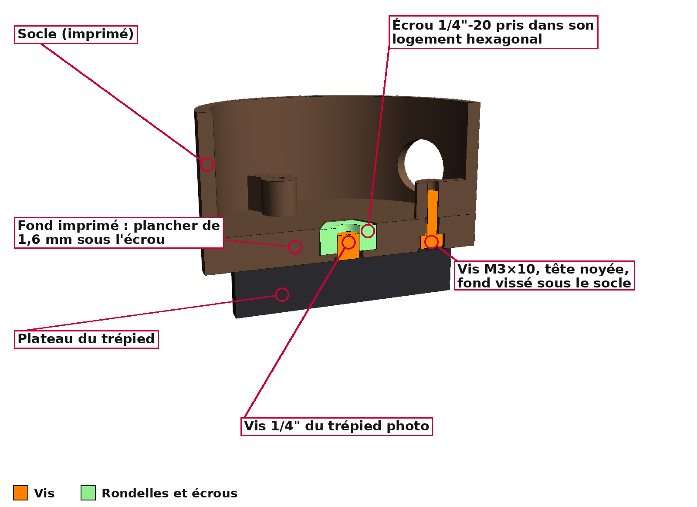

La version PETG se visse directement sur la **vis 1/4" du plateau d'un trépied photo**.
Le fond contient un écrou 1/4"-20 pris dans un logement hexagonal. Les câbles sortent
par le passe-câble du socle, puisque le centre est occupé par la vis. Le cas réel garde sa
colonne Ø50.

* **Serrer fermement** la tête sur la vis. C'est ce serrage qui empêche la tête de tourner
  sur le trépied quand le moteur d'azimut force : il lui faut environ 0,5 N·m dans le vent,
  et au plus 1,7 N·m s'il bute. Un serrage à la main, ferme, sur le caoutchouc du plateau,
  en tient plusieurs N·m.
* La vis du trépied doit dépasser du plateau d'au moins **4,5 mm**. Au-delà de 7 mm, elle
  dépasse simplement dans le socle, sans gêner.
* **Bloquer la rotule** du trépied (panoramique et inclinaison) et la mettre **de niveau**.
  La tête et le panneau pèsent 2,4 kg : vérifier la charge maximale du trépied.
* **Stabilité** : un trépied photo léger bascule bien plus tôt que le trépied du projet.
  Le calcul est fait ci-dessous pour un trépied photo courant.

### Le trépied modélisé : dimensions et stabilité

Les images de la démonstration montée sur ce trépied sont en tête de ce document.

L'assemblage complet est dans **`CAO/Demo_Terre_PETG/Demo_Trepied.step`** : tête
PETG, panneau, capteur solaire et trépied, posé sur le sol en y = 0. Il est généré par
`scripts/generate_demo_trepied.py`.

Le trépied y est modélisé simplement, à partir de deux cotes mesurées :
* le dessus du plateau est à **600 mm** du sol (sans la vis 1/4" qui dépasse) ;
* les pointes des pieds sont à **230 mm** de l'axe, au sol.

Le reste (tubes, corps, rotule) est estimé sur les photos.

**Ce que ça donne :**
* l'axe d'élévation est à **758 mm** du sol. Panneau vertical, son bord haut est à environ
  0,89 m, et son point le plus bas à environ 0,63 m ;
* **aucune interférence**. Le panneau passe à 33 mm au plus près du plateau du trépied (panneau
  vertical) : les molettes de la rotule restent en dessous ;
* charge sur la rotule : tête et panneau font **2,4 kg**. Leur centre de gravité s'écarte
  jusqu'à 29 mm de l'axe, ce qui fait 0,7 N·m que les blocages de la rotule doivent tenir ;
* masse du trépied estimée à 0,9 kg (à peser : plus lourd, il serait un peu plus stable).

**Stabilité.** C'est le point faible : les pieds ne sont qu'à 23 cm de l'axe. Les bords du
triangle d'appui sont donc à 11,5 cm du centre, alors que l'axe est à 76 cm du sol et que le
panneau déporte son centre de gravité. Calcul fait dans toutes les orientations du panneau, avec
un vent perpendiculaire au panneau (Cx 1,2, vent sur le trépied négligé) :

| Lest suspendu sous le trépied | Pire orientation : pente de basculement | Pire orientation : vent de basculement | Panneau tourné vers une jambe |
|---|---|---|---|
| Aucun | 8,6° | **7,9 m/s (28 km/h)** | 9,2° ; 9,4 m/s (34 km/h) |
| 2 kg | 14,0° | 10,4 m/s (37 km/h) | 14,6° ; 11,6 m/s (42 km/h) |
| 3 kg | 16,5° | **11,4 m/s (41 km/h)** | 17,1° ; 12,6 m/s (45 km/h) |

* **En intérieur, sans lest** : ça tient, sur un sol à peu près plat.
* **Dehors, un lest de 2 à 3 kg est indispensable** : un sac de sable ou une bouteille d'eau,
  suspendu sous la colonne, juste au-dessus du sol. Sans lest, une brise de 28 km/h suffit à
  le renverser.
* **Orienter une jambe vers le sud**, vers le Soleil de midi. Le panneau regarde alors vers
  cette jambe la plus grande partie de la journée, et un vent de dos le pousse vers elle :
  c'est l'orientation la plus favorable (colonne de droite).
* Au-dessus d'environ 10 m/s de vent, ou en partant, mettre le panneau à plat (élévation 90°).
* **Rotule** : serrer fermement les deux blocages (panoramique et inclinaison), mettre le
  plateau de niveau avec la bulle, et vérifier que le clip du plateau est bien verrouillé. Si
  la rotule se dévisse du trépied et que le filetage dessous est un 1/4", la tête PETG peut s'y
  visser directement : plus rigide, et 7 cm plus bas.

## 9. Couples, marges et tenue de la version PETG

Calculés par `scripts/generate_tete_vis_sans_fin.py`, avec la partie qui bascule de la
démonstration : 1,50 kg, centre de gravité à 62,0 mm de l'axe. Vis et roues graissées,
roulements ZZ :

| Marge = disponible / besoin | Terre, intérieur | Terre, extérieur (vent 10 m/s) |
|---|---|---|
| Élévation, moteur limité à 0,6 A (2,08 N·m disponibles) | ×2,3 | **×1,6** |
| Azimut (1,22 N·m disponibles) | ×41 | **×2,3** |

| Ce qu'on regarde | Version PETG | Verdict |
|---|---|---|
| Part du couple moteur utilisée, élévation | 61 % dehors (vent 10 m/s), 44 % dedans, à 0,6 A | Bien dimensionné dehors |
| Part du couple moteur utilisée, azimut | 43 % dehors, 2 % dedans | Dimensionné par le vent |
| Dents en PETG, élévation | 16 MPa en marche dehors, 37 MPa moteur calé | C'est la vraie limite : d'où le courant limité à 0,6 A |
| Dents en PETG, azimut | 7 MPa en marche dehors, 22 MPa moteur calé | Large |
| Pivot entraîné Ø12 en PETG | 4 MPa en marche, 9 MPa moteur calé | ×3 au calage, ×8 en marche |

* **Le cas qui dimensionne est la démonstration dehors, avec 10 m/s de vent.** Les marges y
  sont de ×1,6 (élévation, à 0,6 A) à ×2,3 (azimut). Pour un moteur pas à pas, on vise ×1,5
  à ×2 : l'élévation de la version PETG est donc au bas de la plage, pas au-dessus.
* **Énergie** : alimentés, les moteurs consomment environ 2 W (NEMA 17 à 0,6 A) et 6 W
  (NEMA 11). Les drivers sont coupés entre deux corrections : quelques dizaines de mW en
  moyenne au lieu de 8 W.

### Ce que change le PETG en fonctionnement

* **Couples** : les vis et roues en PETG doivent être **graissées**.
  * Graissées (μ ≈ 0,15) : ×1,6 en élévation (moteur limité à 0,6 A, voir plus bas) et
    ×2,3 en azimut avec un vent de 10 m/s ; ×2,3 et ×40 en intérieur.
  * À sec (μ ≈ 0,30), l'élévation ne suit plus dans le vent (×1,0) et n'a plus que ×1,3 en
    intérieur : **graisser**.
  * Ces marges sont celles des roulements **ZZ**. Avec des 2RS, les joints freinent : en
    azimut, ×1,6 graissé et moins de ×1 à sec (voir § 3).
* **Tenue moteurs coupés** : encore plus sûre qu'avec acier et bronze, car le frottement du
  PETG est plus élevé. Les deux vis sont irréversibles, même avec des vibrations.
* **Dents en PETG** : limiter le courant du moteur d'élévation à **0,6 A** (au lieu de
  1,0 A) avec le moteur Usongshine de 0,34 N·m.
  * Si l'élévation se bloque (butée, fin de course raté), le moteur calé donne alors au plus
    3,0 N·m à la roue. Cela fait environ 37 MPa en pied de dent, soit 74 % de la résistance
    du PETG.
  * La marge au vent de 10 m/s reste de ×1,6, et de ×2,3 en intérieur.
  * À 1,0 A, ce moteur pousserait jusqu'à 5 N·m sur la roue en cas de blocage : environ
    60 MPa, les dents casseraient.
  * Le NEMA 11 d'azimut peut rester à 0,67 A : en butée, sa roue voit au plus 22 MPa.
* **Pivots imprimés Ø12** : le pivot entraîné transmet le couple de la roue au chapeau.
  * En marche (poids du panneau et vent de 10 m/s, ≈ 1,3 N·m), il travaille à environ
    4 MPa en torsion. Moteur calé à 0,6 A (3,0 N·m), environ 9 MPa : le tiers de la
    résistance au cisaillement du PETG (≈ 30 MPa).
  * Un pivot PETG de Ø8 monterait à 28 MPa, à la limite de la rupture : d'où le Ø12 et
    les roulements 6801.
  * Il s'imprime **couché**, pour que les couches suivent l'axe. Imprimé debout, il
    casserait en torsion entre deux couches.
  * Le pivot libre ne porte que la moitié du poids de la partie basculante (≈ 7 N) : il
    peut s'imprimer debout.
* **Fluage** : sous une charge permanente, le PETG se déforme lentement. Entre deux
  démonstrations, garer le panneau **à plat (élévation 90°)**, où la pesanteur ne charge
  presque plus la denture.

## 10. Fichiers de ce dossier et du boîtier électronique

| Fichier | Contenu |
|---|---|
| `CAO/Demo_Terre_PETG/a_imprimer/*.stl` (et `.step`) | Les 18 pièces à imprimer (16 pour la tête, 2 pour le capteur solaire), déjà orientées et posées sur le plateau |
| `CAO/Demo_Terre_PETG/Tete_Rotative_PETG.step` | L'assemblage de la tête imprimée (avec roulements, arbres Ø5, moteurs et vis), pour vérifier le montage |
| `CAO/Demo_Terre_PETG/Eprouvette_Ajustements.stl` | Éprouvette à imprimer en premier pour régler les ajustements sur ton imprimante |
| `CAO/Demo_Terre_PETG/Demo_Trepied.step` | La démonstration complète sur un trépied photo grand public : tête PETG, panneau, capteur solaire et trépied (§ 8) |
| **[`Electronique/Schema_Electrique.qet`](../../Electronique/Schema_Electrique.qet)** | **Schéma électrique** de la démonstration, projet QElectroTech (3 folios : schéma complet avec la section de chaque fil et la mesure de l'énergie ; brochage du Heltec V4, bus I²C, câbles et trame LoRa ; câblage et sections des fils) |
| [`Electronique/Schema_Electrique.pdf`](../../Electronique/Schema_Electrique.pdf) | Le même schéma en PDF, à imprimer en A3 ; images dans `docs/electronique/` |
| **[`Electronique/Implantation_Boitier.fzz`](../../Electronique/Implantation_Boitier.fzz)** | **Implantation du boîtier électronique**, à l'échelle, dans Fritzing (vue « Platine d'essai ») : plaque à pastilles 7 × 9 cm, modules, borniers, wattmètres, régulateur, batterie, contour du boîtier ; images dans `docs/electronique/implantation_boitier.png` et `docs/electronique/plaque_pastilles.png` |
| **[`LISTE_ACHATS.md`](../../LISTE_ACHATS.md)** | **Liste d'achats** de la démonstration sur Terre : roulements, accouplements, arbres Ø5 des vis sans fin, moteurs, électronique, visserie, consommables, avec les noms à chercher et les quantités |
| `docs/explications/*.png` | Images annotées pour le montage : palier d'une vis sans fin (joues, roulements, arbre), vis sans fin imprimée (filet, moyeux, vis de blocage) axe d'élévation imprimé (pivots, roulements 6801, roue), éprouvette de réglage des ajustements, fond sur trépied photo, capteur solaire (vue et coupe) |

Arborescence de l'assemblage de la tête dans SolidWorks : celle du modèle lunaire
([README du modèle lunaire](../Cas_Reel/README.md), § 10), sans trépied ni unité au sol, avec des
`Roulement_6801` à la place des `Roulement_608`.
