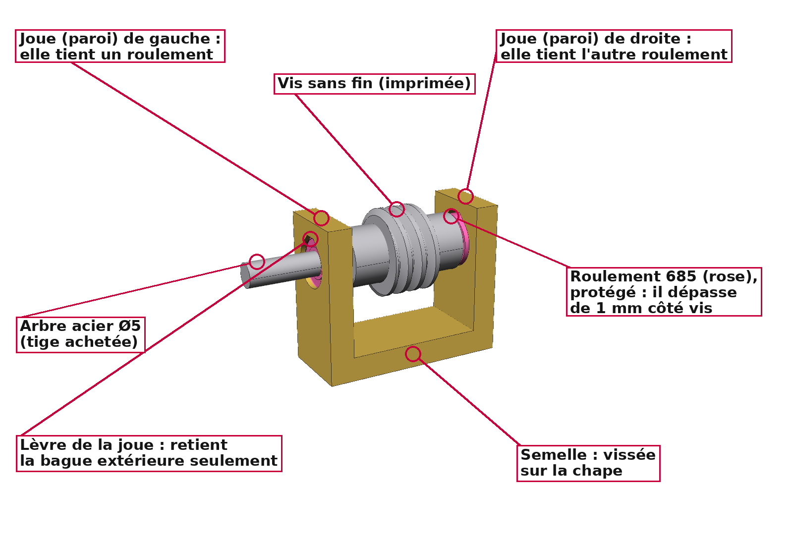
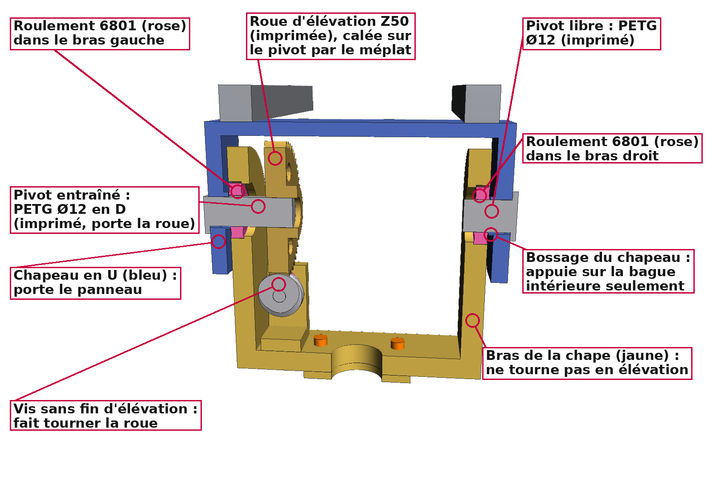

# Liste d'achats — démonstration sur Terre (tête imprimée en PETG)

Tout ce qu'il faut acheter pour **une tête rotative à vis sans fin** en version PETG et son
**capteur solaire** (4 photodiodes sous une croix d'ombre, README § 3 et § 17), en plus des
pièces imprimées de `CAO/Demo_Terre_PETG/a_imprimer/` (voir README, Partie B, § 12).
Les deux pivots d'élévation sont **imprimés** : le seul axe en acier à acheter est la tige Ø5
des arbres des vis sans fin.

* La colonne « À chercher » donne le nom à taper sur les sites marchands (AliExpress,
  Amazon, etc.), où ces pièces sont presque toujours vendues sous leur nom anglais.
* Les prix sont **indicatifs** (ordre de grandeur, par article).
* Les roulements sont en **rose** dans les fichiers 3D. Ils sont tous **protégés** : prendre
  de préférence la version **ZZ** (flasques métalliques), sinon 2RS (joints caoutchouc).

| Palier d'une vis sans fin | Axe d'élévation imprimé |
|---|---|
|  |  |

---

## 1. Mécanique

| Article | Caractéristiques | Qté | À chercher | Où il va | ≈ Prix |
|---|---|---|---|---|---|
| **Roulement 6806ZZ** (ISO 61806-2Z) | 30 × 42 × 7 mm | 2 | `6806ZZ bearing 30x42x7` (ou `61806ZZ`) | Azimut : dans le socle, autour du moyeu de la chape | 3 € |
| **Roulement 6801ZZ** (ISO 61801-2Z) | 12 × 21 × 5 mm | 2 | `6801ZZ bearing 12x21x5` (ou `61801ZZ`) | Élévation : dans les bras de la chape, sur les pivots imprimés Ø12 | 1–2 € |
| **Roulement 685ZZ** | 5 × 11 × **5** mm | 4 | `685ZZ bearing 5x11x5` | Deux par vis sans fin, dans les joues des paliers | 1 € |
| **Accouplement flexible 5 mm / 5 mm** | Alésages Ø5 des deux côtés, Ø19 × 25 mm, alu | 2 | `flexible shaft coupling 5mm x 5mm D19 L25` | Relie l'axe de chaque moteur à l'arbre de sa vis sans fin (la pièce bleue) | 2–4 € |
| **Tige acier rectifiée Ø5** | Ø5 mm, au moins 110 mm | 1 | `linear shaft 5mm 150mm` (ou `5mm chrome steel rod`) | À couper en **2 × 52,5 mm** : les arbres des deux vis sans fin | 3–5 € |
| *ou* **Rond plein acier Ø5** (en magasin) | Acier laminé à chaud, Ø5 mm, 1 m (par exemple STANDERS chez Leroy Merlin) | 1 | `rond plein acier 5 mm` | Moins précis : voir « Pièges à éviter » | 4–5 € |

**Pièges à éviter** :
* **Arbres des vis** : une tige **lisse et pleine, en acier, Ø5**. Pas de tige filetée : les
  roulements porteraient sur les sommets du filet. Pas de tube, ni d'aluminium. Avec un rond
  plein laminé à chaud plutôt qu'une tige rectifiée :
  * le mesurer au pied à coulisse et garder les deux morceaux les plus réguliers ;
  * enlever le vernis là où vont les roulements, la vis sans fin et l'accouplement ;
  * entre 4,90 et 4,98 mm, coller les bagues intérieures des roulements à la colle à
    roulements ;
  * au-dessus de 5,00 mm, le poncer en le faisant tourner dans une perceuse (grain 400 à
    600) ;
  * limer un petit méplat sous la vis sans tête.
* **ZZ plutôt que 2RS** : les deux versions ont les mêmes cotes et vont toutes les deux
  dans les pièces. Mais les joints caoutchouc des 2RS frottent :
  * les deux 6806-2RS freinent l'azimut d'environ 0,15 N·m ;
  * la marge du moteur d'azimut au vent de 10 m/s passe alors de ×2,3 à ×1,6.

  Si tu as déjà des 2RS, ça marche, à condition de bien graisser les vis sans fin.
* **685** : prendre une version protégée, **ZZ** (ou 2RS). Le 685 « ouvert » ne fait que
  3 mm de large, alors que les joues sont prévues pour 5 mm.
* **Accouplement** : bien **5 mm des deux côtés**. Les modèles 5 mm / 8 mm, très courants,
  sont faits pour les vis trapézoïdales d'imprimante 3D.
* **6801** : c'est un roulement fin (5 mm de large), à ne pas confondre avec le 6001
  (12 × 28 × 8), plus gros. Vérifier **12 × 21 × 5** dans l'annonce.
* **Pas d'axe Ø8** : les pivots d'élévation sont les pièces imprimées `Pivot_Entraine`
  et `Pivot_Libre`, en Ø12. Un pivot PETG de Ø8 casserait sous le couple de la roue.

## 2. Moteurs et électronique

| Article | Caractéristiques | Qté | À chercher | Rôle | ≈ Prix |
|---|---|---|---|---|---|
| **Moteur pas à pas NEMA 17, 34 mm** (Usongshine 17HS3401) | 42 × 42 × 34 mm, **0,34 N·m (34 N·cm)**, 1,0 A, axe Ø5 × 23,5 à méplat, connecteur JST PH 6 broches | 1 | `Usongshine 17HS3401 34N.cm` | Élévation. **À régler à 0,6 A** en version PETG | 10–15 € |
| **Moteur pas à pas NEMA 11, 45 mm** | 28 × 28 × 45 mm, 0,095–0,10 N·m, 0,67 A, axe Ø5 | 1 | `11HS18-0674S nema 11 stepper` | Azimut | 15–25 € |
| **Driver TMC2209** | Module UART, 3,3 V logique | 2 | `TMC2209 stepper driver UART` | Un par moteur | 4–6 € |
| **Heltec WiFi LoRa 32 V4**, version 863–870 MHz | ESP32-S3R2 + radio LoRa SX1262, écran OLED, USB-C, antenne LoRa 868 MHz fournie (IPEX). Prendre le V4 standard, **pas la variante V4-R8** (brochage différent) | 1 | `Heltec WiFi LoRa 32 V4 868MHz` | Commande des moteurs, lecture des capteurs, envoi des données en LoRa | 20–30 € |
| Module GNSS L76K pour Heltec V4 (facultatif) | Se branche sur le connecteur GNSS de la carte | 1 | `Heltec V4 GNSS L76K` | Heure et position pour le calcul du Soleil | 8–12 € |
| **Convertisseur ADS1115** (module) | 16 bits, 4 entrées, I²C (adresse 0x48), résistances de tirage I²C sur le module | 1 | `ADS1115 module 16 bit I2C` | Lit les 4 photodiodes du capteur solaire | 2–4 € |
| **Wattmètre INA219B d'Adafruit** (904, STEMMA QT) — **déjà en stock** | Shunt 0,1 Ω, ±3,2 A, 26 V au plus, I²C 0x40 ; 25,6 × 20,4 mm | 1 | `Adafruit 904 INA219` | A4 : ce que produit le panneau (README § 16) | 13 € |
| **Wattmètre SEN0291 de DFRobot** (INA219) — **déjà en stock** | Shunt 0,01 Ω, ±8 A, 26 V au plus, I²C 0x40 à 0x45 par micro-interrupteurs (**mettre 0x45**) ; 30 × 22 mm, câble Gravity fourni | 1 | `DFRobot SEN0291` | A5 : ce que consomme le tracker sur le 12 V | 8 € |
| Câble STEMMA QT / Qwiic vers broches femelles | JST SH 4 broches vers 4 fiches femelles au pas de 2,54 mm, 15 cm environ | 1 | `STEMMA QT to female socket cable` | Relie A4 à la barrette J1 de la plaque | 1 € |
| Bloc secteur 12 V 3 A (facultatif) | Pour l'établi seulement, couvercle ouvert : branché sur F1 à la place du régulateur et de la batterie. En intérieur, la batterie chargée suffit pour plusieurs jours | 1 | `12V 3A power supply` | Essais sur l'établi | 10 € |
| **Batterie 12 V, en extérieur** | **Plomb AGM étanche**, 12 V, 7 Ah (84 Wh, environ 2,2 kg). **Pas de LiFePO4** : le régulateur SOL10UC3 ne charge que le plomb, le gel et l'EFB | 1 | `12V 7Ah AGM battery` | Stocke l'énergie du panneau ; le tracker tient environ 2 jours sans soleil | 20–25 € |
| **Régulateur de charge PWM 10 A Velleman SOL10UC3** (Gotronic, réf. 27118) | Batteries 12 ou 24 V (reconnues au branchement), plomb, gel ou EFB ; panneau 32 V au plus ; sortie LOAD coupée quand la batterie est basse ; port USB 5 V 1,2 A ; consommation < 6 mA ; 80 × 110 × 25 mm | 1 | `Velleman SOL10UC3` | A6 : le panneau recharge la batterie, le tracker se branche sur la sortie LOAD ; A4 mesure ce que produit le panneau | 35,80 € |
| **Fusible 3 A** et porte-fusible **en ligne** | Fusible 5 × 20 mm rapide ; porte-fusible pour fil AWG 18 | 2 (F1 près de la sortie LOAD ; F2 entre le régulateur et la batterie, **à moins de 10 cm de la batterie**) + 2 fusibles de rechange | `inline fuse holder 5x20 18AWG`, `fuse 3A 5x20` | Protège tout le câblage (une batterie au plomb débite des centaines d'ampères en court-circuit) | 4 € |
| **Interrupteur étanche** marche / arrêt | IP65 au moins : à bascule avec capuchon en silicone, ou à levier avec soufflet ; 12 V continu, 3 A au moins | 1 | `waterproof rocker switch IP65 12V` | S1, sur la paroi du boîtier : coupe tout | 3 € |
| **Abaisseur 12 V → 5 V** | Module à découpage, 1 A au moins, **réglé à 5,3 V** avant de brancher le Heltec | 1 | `LM2596 buck converter` (ou `MP1584`) | Alimente le Heltec et le capteur Hall | 2 € |
| **Diode Schottky 1N5819** | 1 A, 40 V | 1 | `1N5819` | Entre l'abaisseur et le Heltec : le 5 V de l'USB-C ne remonte pas dans l'abaisseur | 0,2 € |
| **Condensateur 100 µF 25 V** | Électrolytique | 2 | `100uF 25V capacitor` | Un au plus près de chaque driver | 0,2 € |
| **Fin de course** | Micro-rupteur à levier SPS75GCC (Gotronic), ou KW12. Branché sur son contact NC | 2 (1 de rechange) | `SPS75GCC`, `KW12 micro limit switch` | Origine de l'élévation, en butée basse | 3 € |
| **Capteur à effet Hall + aimant** | Capteur **A3144 nu** + aimant néodyme 5 × 2 mm. Pas de module KY-003 : il tire sa sortie au 5 V, trop pour l'ESP32 | 1 + 1 | `A3144 hall sensor`, `neodymium magnet 5x2mm` | Origine de l'azimut | 2 € |
| **Résistance 10 kΩ**, 1/4 W | Résistances de tirage au 3,3 V | 3 | `10k ohm resistor 1/4W` | EN des drivers (R5), fin de course (R6), capteur Hall (R7) | 0,1 € |
| **Fil souple AWG 18** (0,82 mm²), rouge et noir | Multibrin, isolant PVC ou silicone | 1 m de chaque | `18AWG silicone wire red black` | Dans le boîtier : sortie LOAD → F1 → S1 → A5 → X1 ; régulateur → F2 → batterie | 3 € |
| **Câble souple 2 conducteurs AWG 20** (0,52 mm²) | Multibrin, rouge et noir, gaine extérieure ronde (pour le presse-étoupe) | 2 m | `2 core 20AWG flexible cable` | Panneau → bornier X7, par la boucle de câble ; à souder sur les cosses du panneau | 2 € |
| **Fil AWG 20** (0,52 mm²), rouge et noir | Pour souder sur la plaque | 0,5 m de chaque | `20AWG hook up wire` | 12 V et 0 V de puissance sur la plaque (VM des drivers, C1, C2, LM2596) | 2 € |
| **Fil AWG 22** (0,33 mm²), orange et noir | Pour souder sur la plaque | 0,5 m de chaque | `22AWG hook up wire` | 5 V : LM2596 → D1 → Heltec | 2 € |
| **Fil de câblage monobrin AWG 24** (0,20 mm²) | Coffret de plusieurs couleurs | 1 coffret | `24AWG solid hook up wire kit` | Signaux et 3,3 V sur la plaque (STEP, DIR, EN, I²C, filtres) | 6 € |
| **Câble souple 4 conducteurs AWG 22** | Câble pour moteur pas à pas, multibrin | 2 × 1,5 m | `4 core 22AWG stepper motor cable` | Moteurs M1 et M2, des borniers X2 et X3 aux moteurs | 5 € |
| **Câble souple 4 conducteurs AWG 26** | Multibrin (on n'utilise que 2 ou 3 conducteurs) | 2 × 1,5 m | `4 core 26AWG flexible cable` | Fin de course (X4, 2 fils) et capteur Hall (X5, 3 fils) | 3 € |
| Fil à wrapper AWG 28 ou 30 | Fil fin isolé | quelques dizaines de cm | `30AWG wire wrap` | Pattes des photodiodes, dans le boîtier du capteur | 2 € |
| **Embouts de câblage** et pince à sertir | Coffret 0,25 / 0,5 / 0,75 mm² | 1 | `ferrule kit crimping tool` | Bouts des fils dans les borniers à vis | 10–15 € |
| **Photodiode BPW34** (Vishay ou Osram) | Photodiode PIN au silicium, boîtier 5,4 × 4,3 × 3,2 mm, surface sensible 7,5 mm² | 4 + 1 de rechange | `BPW34` (Gotronic : réf. 03472) | Capteur solaire, une par coin de la croix | 1 € |
| **Résistance 1 kΩ**, couche métallique, ±1 %, 1/4 W, 50 ppm/°C | Environ 1,5 V en plein soleil ; la même valeur sert en intérieur, l'ADS1115 changeant de calibre | 4 + 2 de rechange | `1k ohm metal film resistor 1% 1/4W` | Une par photodiode, de l'anode à la masse, à côté de l'ADS1115 | 0,1 € |
| **Condensateur céramique 100 nF**, 50 V, X7R | Filtre le bruit (constante de temps 0,1 ms avec 1 kΩ) | 4 | `100nF ceramic capacitor 50V` | Un par photodiode, en parallèle sur sa résistance | 0,1 € |
| **Câble souple blindé 6 conducteurs AWG 26** | Multibrin, avec blindage (tresse ou feuillard) relié au 0 V côté boîtier seulement. À défaut : câble réseau blindé F/UTP multibrin | 1,5 m | `6 core 26AWG shielded cable` | Du capteur solaire au bornier X6 : 3,3 V et les 4 signaux | 3 € |
| Gaine thermorétractable fine | Ø1,5 à 2,5 mm | quelques cm | `heat shrink tube 2mm` | Isole les soudures des pattes des photodiodes | 1 € |

**Montage du boîtier électronique** (implantation au README, § 16, et dans
`Electronique/Implantation_Boitier.fzz`) :

| Article | Caractéristiques | Qté | À chercher | Rôle | ≈ Prix |
|---|---|---|---|---|---|
| **Plaque à pastilles 8 × 12 cm** | Pastilles séparées, pas de 2,54 mm, double face de préférence | 1 | `perfboard 8x12cm double sided` | Reçoit toute l'électronique du boîtier | 2 € |
| **Barrettes femelles** au pas de 2,54 mm | Barrettes de 40 broches, à couper : 2 × 18 (Heltec), 4 × 8 (TMC2209), 1 × 10 (ADS1115) | 3 barrettes de 40 | `female header 2.54mm 40 pin` | Modules démontables | 2 € |
| **Barrette mâle** au pas de 2,54 mm, double rangée | À couper : 2 × 4 broches | 1 | `male header 2x40 2.54mm` | J1 : bus I²C des deux wattmètres (3V3, GND, SDA, SCL pour chacun) | 1 € |
| **Borniers à vis KF301**, pas de 5,08 mm, emboîtables | 9 de 2 pôles et 2 de 3 pôles. On les emboîte : 4 pôles = 2 + 2, 5 pôles = 2 + 3 | 9 + 2 | `KF301 2P 5.08mm`, `KF301 3P 5.08mm` | Branchement des câbles (X1 à X7) | 3 € |
| **Boîtier étanche IP65** | ABS ou polycarbonate, au moins 280 × 185 mm à l'intérieur et **110 mm de haut** (batterie de 94 mm) ; par exemple 300 × 200 × 130 mm. **Couvercle transparent** conseillé (voyants du régulateur, écran du Heltec). De couleur claire | 1 | `ABS enclosure 300x200x130 IP65 transparent lid` | Reçoit tout ce qui ne tourne pas avec la tête : plaque, wattmètres, régulateur, batterie, fusibles | 20–30 € |
| **Presse-étoupes PG7** étanches (IP68) | Pour câbles de Ø3 à 6,5 mm | 6 + 1 de rechange | `PG7 cable gland IP68` | Câbles de la tête : moteurs M1 et M2, fin de course, Hall, capteur solaire, panneau | 4 € |
| **Entretoises M3** de 6 mm et vis M3 × 6 | Nylon ou laiton | 6 + 12 | `M3 standoff 6mm` | Fixent la plaque (4) et le SEN0291 (2) au fond du boîtier | 2 € |
| **Aérateur à membrane** M12, IP67 | Laisse passer l'air, pas l'eau | 1 | `M12 vent plug IP67 breathable` | Évite la condensation dans le boîtier fermé ; laisse sortir les gaz de la batterie | 2 € |
| Sangle de batterie ou deux équerres, et sachet de gel de silice | Sangle à boucle de 25 mm, ou équerres vissées au fond | 1 + 1 | `battery hold down strap`, `silica gel pack` | Tient la batterie (2,2 kg) ; absorbe l'humidité | 4 € |
| **Entretoises M2,5** de 6 mm et vis M2,5 × 6 | Nylon ou laiton | 4 + 8 | `M2.5 standoff 6mm` | Fixent l'INA219B d'Adafruit (trous de 2,5 mm) | 2 € |
| Câble IPEX (U.FL) vers **traversée SMA femelle étanche** (avec joint), et antenne 868 MHz articulée à connecteur SMA | Environ 10 cm | 1 + 1 | `IPEX to SMA female bulkhead waterproof`, `868MHz SMA antenna` | Sort l'antenne du boîtier fermé (elle porte plus loin) | 6 € |

Le câblage complet est sur le **schéma électrique**
([`Electronique/Schema_Electrique.pdf`](Electronique/Schema_Electrique.pdf), projet QElectroTech
`Electronique/Schema_Electrique.qet`). Le brochage du Heltec V4, le réglage des TMC2209 et les
bibliothèques sont décrits dans le README, § 16. Le branchement du capteur solaire est au § 17.

## 3. Visserie

Toute la visserie est **métrique à pas standard** (M3 × 0,5 et M2,5 × 0,45), sauf l'écrou du
trépied photo (1/4"-20 UNC). Prendre de l'**inox A2-70** (il ne rouille pas dehors), sinon de
l'acier zingué classe 8.8.

La longueur d'une vis CHC se mesure sous la tête ; celle d'une vis fraisée, hors tout. Chaque
longueur a été vérifiée dans la CAO par `scripts/generate_tete_vis_sans_fin.py` : la vis traverse
les pièces et mord dans la dernière sur la longueur indiquée (« prise »), sans toucher le fond
de son avant-trou ni dépasser là où quelque chose tourne.

**Vis**

| Vis (norme) | Qté | Où | Traverse | Se visse dans | Prise | Clé |
|---|---|---|---|---|---|---|
| **CHC M3 × 8** (ISO 4762 / DIN 912) | 2 | Rondelle d'arrêt sous le moyeu, par-dessous | Rondelle d'arrêt (3 mm) | Moyeu de la chape (avant-trou Ø2,8) | 5 mm | 2,5 mm |
| **CHC M3 × 8** | 4 | NEMA 17 sur son support | Support (4 mm) | Taraudages du moteur (4,5 mm de profondeur) | 4 mm | 2,5 mm |
| **CHC M3 × 10** | 3 | Fond sous le socle, par-dessous, têtes noyées | Fond (3,9 mm sous le lamage) | Socle | 6 mm | 2,5 mm |
| **CHC M3 × 10** | 2 | Équerre du capteur solaire contre le petit côté du cadre | Équerre (4 mm) + paroi du cadre (1,5 mm) | Écrou M3 posé dans le cadre | Écrou complet, dépasse de 2 mm | 2,5 mm |
| **CHC M3 × 10** | 2 | Boîtier du capteur sur son équerre, par-dessous | Équerre (4 mm) | Boîtier du capteur | 6 mm | 2,5 mm |
| **CHC M3 × 12** | 3 | Chape sur le moyeu, par-dessus | Chape (8 mm) | Moyeu de la chape | 4 mm | 2,5 mm |
| **CHC M3 × 12** | 4 | Palier et support moteur d'élévation, par-dessous la chape | Chape (8 mm) | Palier / support | 4 mm | 2,5 mm |
| **CHC M3 × 12** + rondelle | 4 | Palier et support moteur d'azimut, par-dessus la chape, dans les **lumières** | Rondelle (0,5 mm) + chape (8 mm) | Palier / support | 3,5 mm | 2,5 mm |
| **CHC M3 × 14** | 4 | Rails sur le chapeau, par-dessus, têtes noyées dans les rails | Rail (9,5 mm sous le lamage) | Chapeau en U | 4,5 mm | 2,5 mm |
| **CHC M3 × 14** | 4 | Cadre du panneau sur les rails, par-dessous, têtes noyées | Bout du rail (9,5 mm) + aile du cadre (1,5 mm) | Écrou M3 posé dans le cadre | Écrou complet, dépasse de 0,6 mm | 2,5 mm |
| **Tête fraisée M3 × 8** (ISO 10642 / DIN 7991) | 3 | Roue d'azimut sur le socle : elles doivent affleurer | Roue (fraisure) | Socle | 5,5 mm | 2 mm |
| **CHC M2,5 × 6** (ISO 4762) | 4 | NEMA 11 sur son support. Pas plus longues : ses taraudages ne font que 2,5 mm | Support (4 mm) | Taraudages du moteur | 2 mm | 2 mm |
| **Sans tête M3 × 4, bout plat** (ISO 4026 / DIN 913) | 2 | Une par vis sans fin, dans le trou radial du moyeu, serrée sur le méplat de l'arbre Ø5 | — | Moyeu de la vis sans fin | — | 1,5 mm |

Les vis de serrage des accouplements flexibles sont fournies avec eux.

**Écrous et rondelles**

| Article (norme) | Dimensions | Qté | Où |
|---|---|---|---|
| **Écrou hexagonal M3** (ISO 4032 / DIN 934) | 5,5 mm sur plats, 2,4 mm d'épaisseur | 6 | Posés dans le cadre du panneau : sur l'aile arrière, un par vis des rails (4) ; contre le petit côté, pour l'équerre du capteur (2) |
| **Écrou hexagonal 1/4"-20 UNC** (filetage photo) | 7/16" = 11,1 mm sur plats, 7/32" = 5,6 mm d'épaisseur (un contre-écrou de 4 mm convient aussi) | 1 | Pris dans le fond : la tête se visse sur la vis 1/4" du trépied photo. Ce n'est pas un écrou M6 : le pas est différent |
| **Rondelle plate M3** (ISO 7089 / DIN 125-A) | 3,2 × 7 × 0,5 mm | 4 | Sous la tête des 4 vis d'azimut posées sur les lumières de la chape. Sans elle, la tête Ø5,5 ne porterait que sur 0,4 mm aux deux bouts d'une lumière de 4,7 mm et s'enfoncerait dans le PETG |
| Rondelle plate M3 (ISO 7089), en plus | 3,2 × 7 × 0,5 mm | 8 | **Seulement si les rails sont en barre de 12 × 12** au lieu de 12 × 13 : deux rondelles empilées (1 mm) sous chaque vis, entre le rail et le chapeau |

**Pas d'autre rondelle** : ailleurs, les têtes sont noyées dans des lamages (Ø6,2 et Ø6,5, trop
étroits pour une rondelle) ou portent sur un trou rond, et les écrous du cadre portent sur
l'aluminium. Pas de rondelle fendue (Grower) : elle marquerait le PETG.

**Serrage**

* **Dans le PETG** (avant-trous Ø2,8, sans taraudage) : la vis taille son filet la première fois.
  Visser doucement, en revenant d'un demi-tour à chaque tour pour dégager, et s'arrêter dès que
  la tête touche, plus 1/8 de tour. Environ 0,3 à 0,4 N·m : la clé Allen tenue par le petit
  bras, entre deux doigts. Trop serrer arrache le filet.
* **Dans un écrou ou dans un moteur** : M3 environ 0,8 N·m (petit bras de la clé, serré
  fermement à la main) ; M2,5 environ 0,4 N·m.
* **Frein-filet** (Loctite 243, moyen, facultatif) : une goutte sur les 2 vis sans tête, qui
  vibrent avec les vis sans fin. Jamais dans le PETG.

**Clés Allen** : 1,5 mm (vis sans tête), 2 mm (M2,5 et vis fraisées M3), 2,5 mm (vis CHC M3).

**Récapitulatif à acheter** : CHC M3 × 8 : 6 ; M3 × 10 : 7 ; M3 × 12 : 11 ; M3 × 14 : 8 ;
fraisées M3 × 8 : 3 ; CHC M2,5 × 6 : 4 ; sans tête M3 × 4 : 2 ; écrous M3 : 6 ; écrou
1/4"-20 UNC : 1 ; rondelles M3 : 4 (12 avec des rails en 12 × 12). Prendre quelques vis de
rechange de chaque taille.

Le plus simple est d'acheter des coffrets en inox A2 :
* **vis CHC M3** (`M3 socket head screw assortment A2`), avec au moins 11 vis de 12 mm ;
* **vis CHC M2,5** (`M2.5 socket head screw`) ;
* **vis fraisées M3 × 8** (`M3x8 countersunk screw ISO 10642`) ;
* **vis sans tête M3 × 4** (`M3x4 set screw flat point`) ;
* **écrous M3** (`M3 hex nut DIN 934`) et **rondelles M3** (`M3 washer DIN 125`) ;
* un **écrou 1/4"-20 UNC** (`1/4-20 UNC hex nut`).

Compter 10 à 15 € en tout.

## 4. Pièces métalliques non imprimées

| Article | Caractéristiques | Qté | À chercher | Remarque |
|---|---|---|---|---|
| **Rails du panneau** | Barre alu 12 × 12 mm, 2 × 253 mm | 2 | `aluminium square bar 12mm` | Le modèle prévoit 12 × 13 mm : avec une barre de 12 × 12, mettre deux rondelles M3 (ISO 7089, 0,5 mm) sous chaque vis, entre le rail et le chapeau (voir § 3). Percer 4 trous Ø3,4 par rail : 2 à 14 mm de part et d'autre du milieu (vis du chapeau, lamage Ø6 × 3,5 dessus) et 1 à 6 mm de chaque bout (vis du panneau, lamage Ø6 × 3,5 dessous) |
| **Cadre du panneau** (celui du panneau acheté) | — | — | — | Percer 4 trous Ø3,4 dans l'aile arrière des deux grands côtés, au droit des rails : à 44 mm de part et d'autre du milieu, et à 6 mm du bord extérieur. L'aile doit faire au moins 10 mm de large. Pour le capteur solaire, percer aussi 2 trous Ø3,4 dans un **petit côté** (celui du pivot libre, à l'opposé de la roue d'élévation) : à 9 mm de part et d'autre du milieu et à 12 mm du dos du cadre, sous le laminé |

## 5. Consommables

| Article | Qté | À chercher | ≈ Prix |
|---|---|---|---|
| **Filament PETG 1,75 mm** (teinte claire de préférence) | 1 bobine de 1 kg (environ 300 g utilisés) | `PETG filament 1.75mm 1kg` | 20 € |
| **PETG noir** pour le boîtier du capteur solaire, qui doit être opaque | Environ 20 g : un reste de bobine suffit. À défaut, imprimer en clair et peindre en noir mat, intérieur des logements compris | `black PETG filament` | — |
| Colle chaude ou colle époxy (bloque les photodiodes dans leurs logements) | 1 | `hot glue` | 3 € |
| **Graisse PTFE** (vis sans fin et roues : obligatoire en PETG ; pas les roulements, graissés d'origine) | 1 tube | `PTFE grease` | 8 € |
| Colle cyanoacrylate (optionnel : vis sans fin sur leur arbre, pivots imprimés dans le chapeau) | 1 | `super glue` | 3 € |
| Colle à roulements, type Loctite 641 (seulement si les arbres font moins de 4,98 mm) | 1 | `Loctite 641` | 8–12 € |

## 6. Optionnel

| Article | Qté | Pour quoi |
|---|---|---|
| Lest de 2 à 3 kg (sac de sable, bouteille d'eau) | 1 | Démonstration en extérieur, contre le vent. Le boîtier avec sa batterie (≈ 3,5 kg), suspendu sous la colonne, peut en tenir lieu |

---

Le panneau est un **Velleman SOL10P** (Gotronic, réf. 27128, 36,50 €) : 10 W, 17,6 V et
0,61 A au point de puissance maximale, 21,8 V à vide, 356 × 253 × 30 mm, 1,16 kg. C'est celui
de la CAO. Sa sortie est sur cosses à souder : souder le câble souple 2 × AWG 20.

**Ordre de grandeur total** : environ **100 à 150 €** avec une alimentation secteur, capteur
solaire compris (environ 8 €), sans compter le trépied, le panneau, ni les deux wattmètres
(déjà en stock). Pour la démonstration en extérieur, il faut ajouter environ 25 € pour une
batterie au plomb AGM et 36 € pour le régulateur SOL10UC3.
