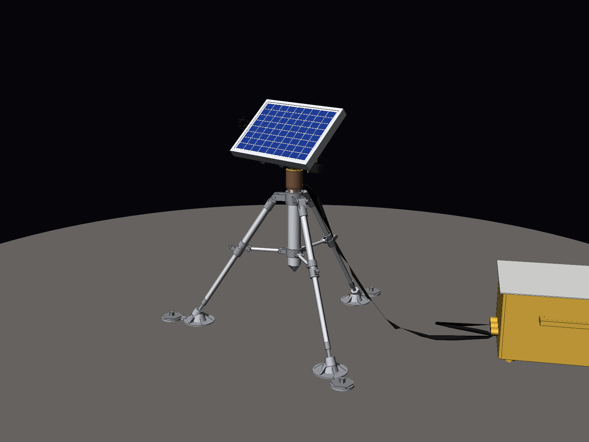
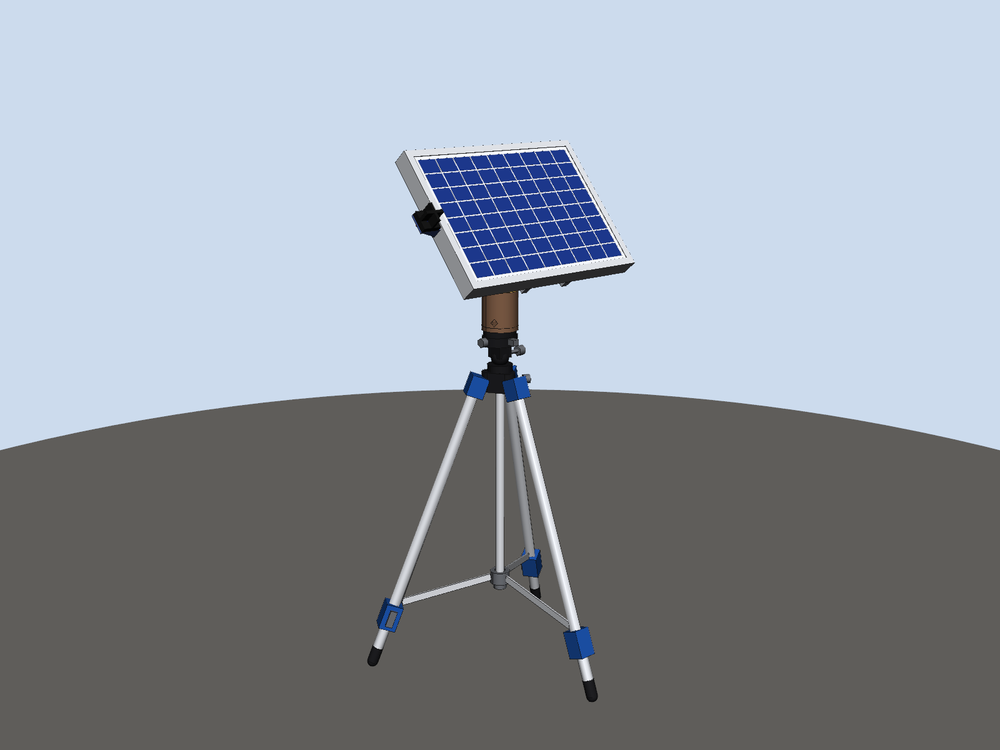
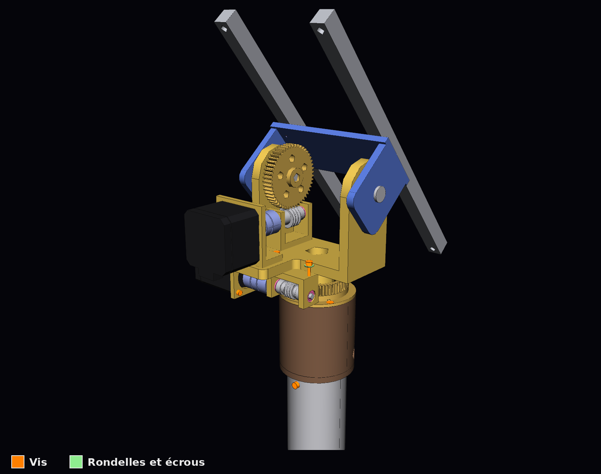
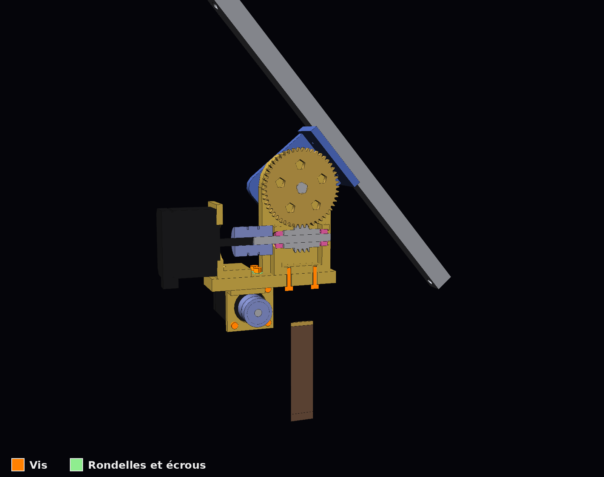
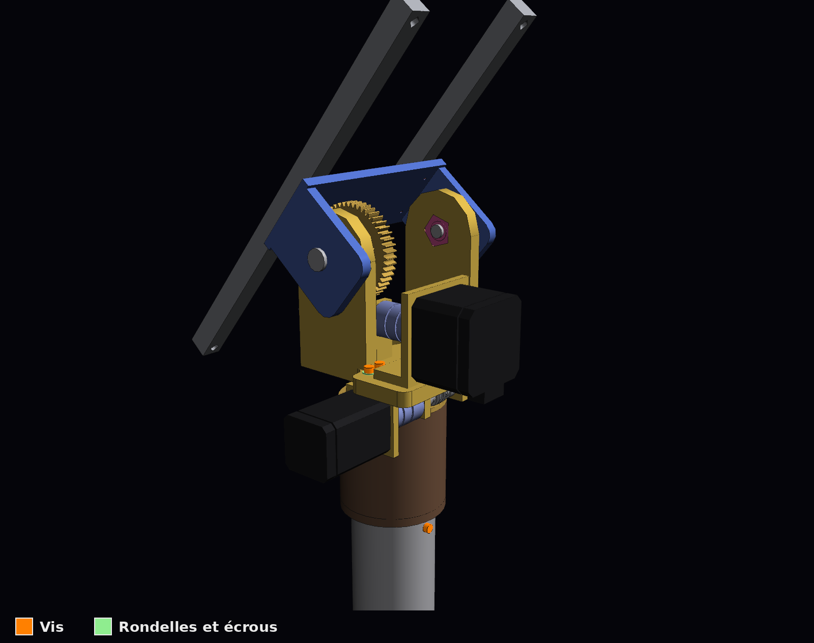
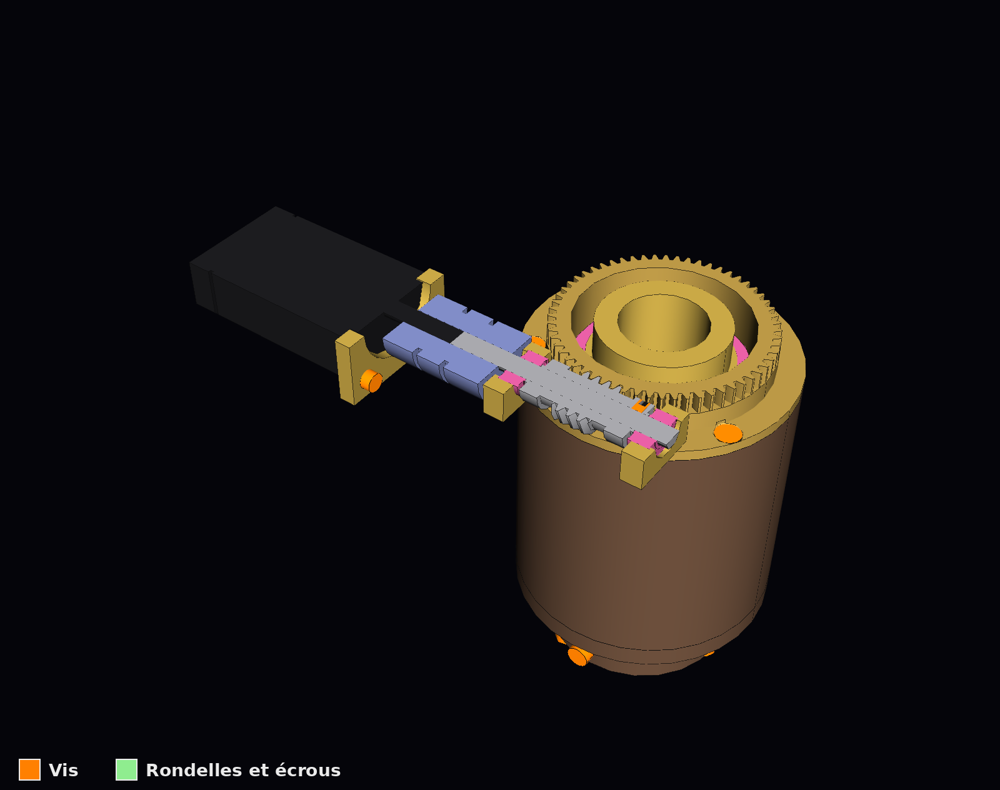
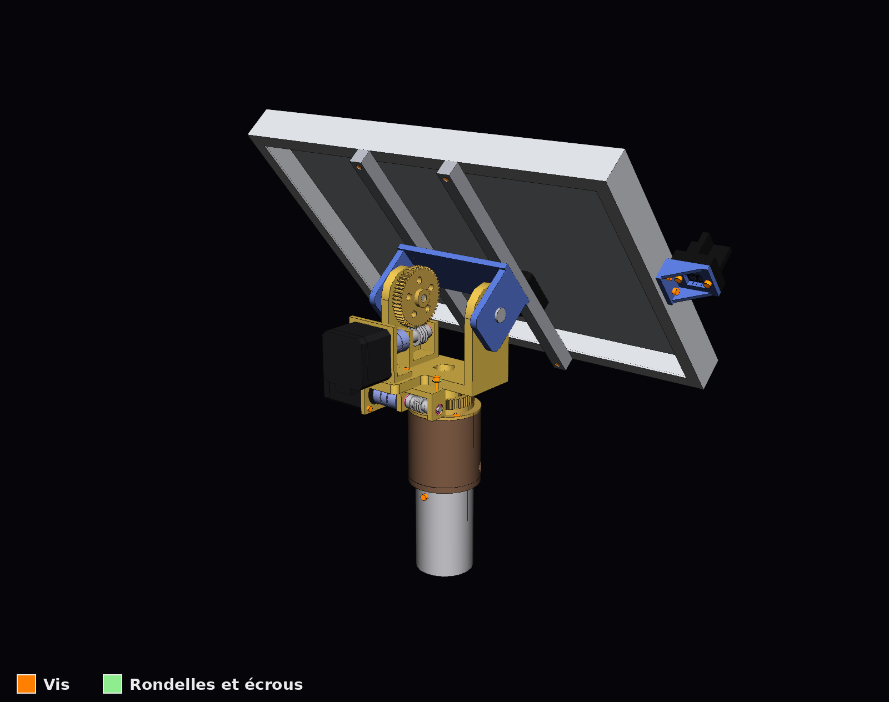
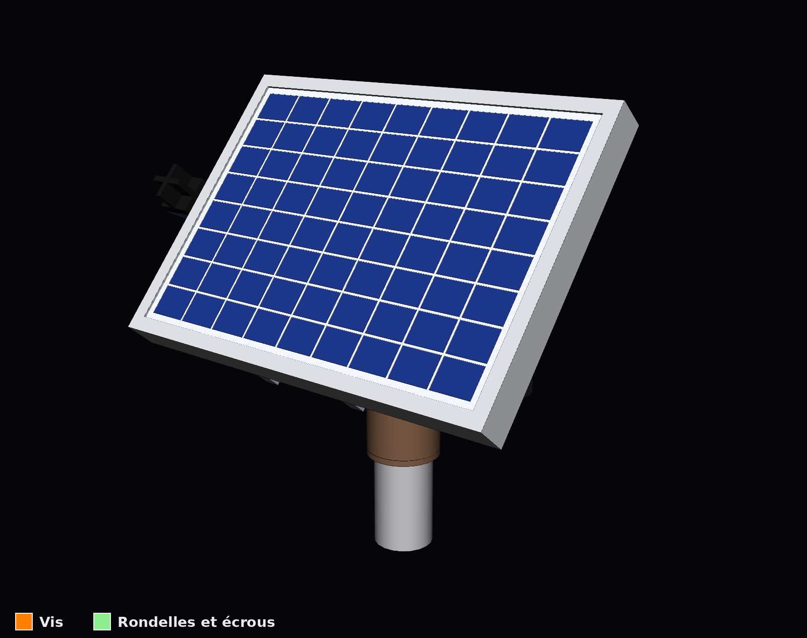
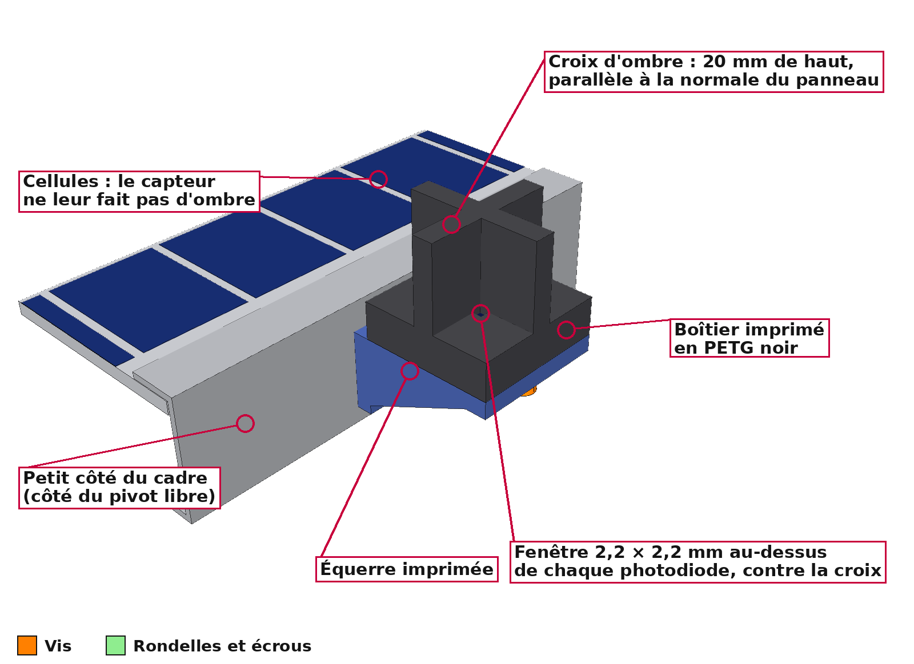
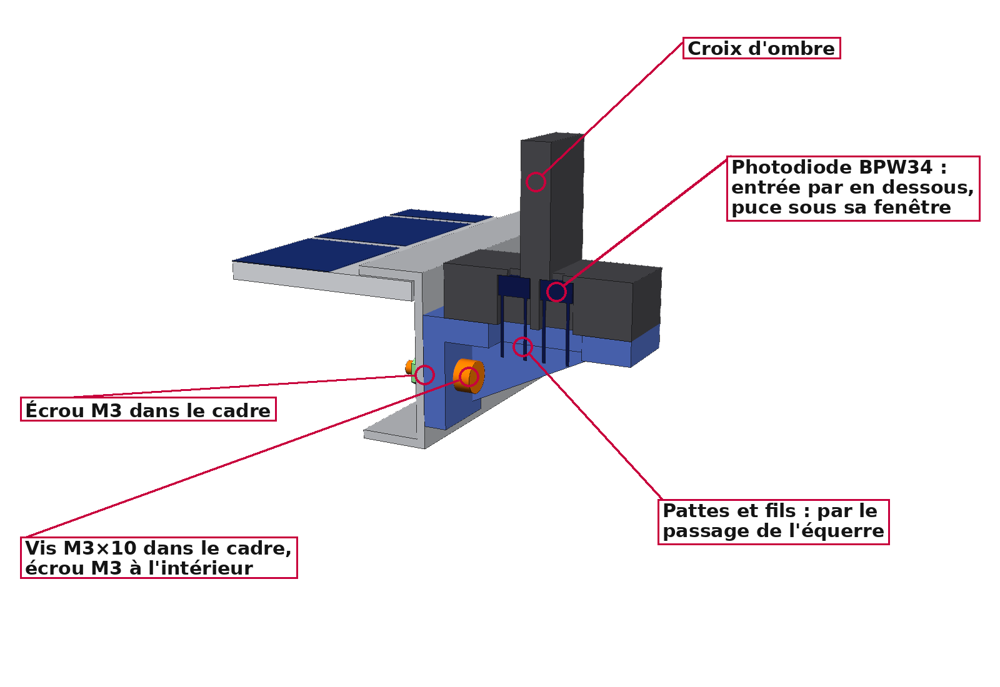

# Tracker solaire lunaire deux axes — maquette 3D à l'échelle 1:1

**➜ [Modèle lunaire](CAO/Cas_Reel/README.md) · [Modèle terrestre, à construire](CAO/Demo_Terre_PETG/README.md) ·
[Liste d'achats](LISTE_ACHATS.md)**

Un **tracker solaire à deux axes** : une tête rotative oriente un panneau photovoltaïque vers le
Soleil, en azimut et en élévation, grâce à deux petits moteurs pas à pas et à un **capteur
solaire** (4 photodiodes sous une croix d'ombre). Le projet a été conçu pour la **surface de la
Lune**, puis décliné en une **maquette à construire sur Terre**, imprimée en 3D.

Le cœur du projet est la **tête à vis sans fin** : ses deux vis sont **irréversibles**, si bien
qu'elle tient le panneau dans toutes les positions **moteurs coupés**, sans contrepoids, sur
Terre comme sur la Lune. Toutes les cotes sont en **millimètres, à taille réelle**.

**Licence : [CC BY-NC-SA 4.0](LICENSE).** Libre pour un usage personnel, scolaire ou associatif,
en citant l'auteur ; **usage commercial interdit** (§ 6).

| Modèle lunaire (panneau à 40°) | Modèle terrestre, sur un trépied photo |
|---|---|
|  |  |

## 1. Deux modèles : choisir le sien

Les deux modèles partagent la même tête, le même panneau, le même capteur solaire et la
même commande (§ 2 à 5 ci-dessous). Chacun a ensuite son propre document. Dans tout le projet,
le **« cas réel »** désigne le modèle lunaire (dossier `CAO/Cas_Reel/`), et la
**« démonstration »** le modèle terrestre.

| | 🌙 **Modèle lunaire** (cas réel) | 🌍 **Modèle terrestre** (démonstration en PETG) |
|---|---|---|
| **Ce que c'est** | L'étude de conception du tracker pour la Lune : pôle Sud (programme Artemis) ou sites Apollo | La même tête, imprimée en PETG, vissée sur un trépied photo grand public : **c'est celui qu'on construit** |
| **Matériaux** | Aluminium, bronze, inox, titane ; roulements secs (MoS₂) pour le vide | PETG imprimé, roulements et visserie du commerce |
| **Support** | Trépied déployable du projet, axe d'élévation à 700 mm | Trépied photo (vis 1/4"), axe à 758 mm |
| **On y trouve** | Conditions lunaires, choix de l'angle, trépied, matériaux, couples et marges, vérifications, limites | Pièces à imprimer et à acheter, réglages, montage pas à pas, électronique complète, boîtier étanche, énergie, LoRa |
| **Fichiers** | `CAO/Cas_Reel/` (STEP) | `CAO/Demo_Terre_PETG/` (STL et STEP), `Electronique/`, `LISTE_ACHATS.md` |
| **Documentation** | **➜ [README du modèle lunaire](CAO/Cas_Reel/README.md)** | **➜ [README du modèle terrestre](CAO/Demo_Terre_PETG/README.md)** |

**Les chiffres, côte à côte :**

| Grandeur | Modèle lunaire | Modèle terrestre |
|---|---|---|
| Pivots d'élévation | Inox Ø8 sur roulements 608 | PETG Ø12 sur roulements 6801 |
| Masse de la tête (hors panneau) | 1,86 kg | 1,20 kg |
| Partie qui bascule (panneau, chapeau, roue, rails, capteur) | 1,73 kg, centre de gravité à 55,7 mm de l'axe | 1,50 kg, centre de gravité à 62,0 mm de l'axe |
| Courant du moteur d'élévation | 1,0 A | 0,6 A, pour ménager les dents en PETG |
| Marge d'élévation, vent de 10 m/s | ×2,7 | ×1,6 |
| Marge d'azimut, vent de 10 m/s | ×2,3 | ×2,3 |
| Lubrification des vis et des roues | MoS₂ sec | Graisse PTFE (obligatoire) |
| Roulements | Acier 440C, ZZ, MoS₂ | Acier standard, ZZ (ou 2RS), graissés d'origine |

---

## 2. La tête rotative à vis sans fin (commune aux deux modèles)

| Tête seule | Coupe : vis et roue d'élévation |
|---|---|
|  |  |
|  |  |
|  |  |

### Architecture

La tête est un **mécanisme de pointage bi-axe azimut-élévation (AE)** : un axe vertical pour
tourner (azimut), un axe horizontal porté par lui pour incliner (élévation), et une fourche
(la chape) qui porte le panneau. Le choix de ce schéma est expliqué dans la bibliographie,
à la fin, avec l'article qui l'a guidé.

| Élément | Choix |
|---|---|
| **Socle** (brun) | Cylindre Ø62 posé sur la colonne du trépied, centré dedans par le fond et bloqué en rotation par une vis M3 radiale à travers la colonne. Il porte deux **roulements 6806** (Ø30/Ø42 × 7) et la **roue d'azimut, fixe**, posée à plat sur le socle et tenue par 3 vis M3 fraisées affleurantes, sous le passage de la vis d'azimut. Un passe-câble est orienté vers l'unité au sol |
| **Chape en U** (jaune) | Tourne en azimut sur les deux 6806. Sa plaque porte les **deux moteurs** et les deux vis. Ses bras portent les roulements de l'axe d'élévation (608), à 156 mm au-dessus de la colonne (700 mm du sol) |
| **Chapeau en U renversé** (bleu) | Coiffe la chape. Il pivote sur deux pivots dans les roulements des bras et porte les deux rails du panneau. Axes inox Ø8 sur roulements 608. Un **bossage** sur chaque flanc appuie sur la bague intérieure du roulement et règle le jeu axial |
| **Azimut (axe Y)** | **NEMA 11 de 45 mm** + vis sans fin m0,8 Ø12 sur la **roue bronze Z60 fixée sur le socle** : **60:1**. La vis roule autour de la roue, comme sur une tourelle. Le moteur tourne donc avec le panneau et ne se trouve jamais sur son chemin |
| **Élévation (axe X)** | **NEMA 17 de 34 mm** + vis sans fin m1 Ø16 sur la **roue bronze Z50** calée sur le pivot gauche du chapeau : **50:1**. Le moteur est à l'arrière de la chape, du côté opposé au panneau |
| **Vis** | Chaque vis tourne sur son arbre Ø5, porté par deux roulements 685. Ses deux moyeux appuient sur les bagues intérieures des 685, et une **lèvre** de chaque joue du palier retient leur bague extérieure : la poussée axiale de la vis va au palier. Un accouplement flexible la relie au moteur, si bien que le moteur ne reçoit pas cette poussée |
| **Liaison au panneau** | Deux rails 12 × 13 vissés sur le dessus du chapeau (4 × M3, par-dessus) et sur l'aile arrière du cadre (4 × M3 par-dessous, écrous dans le cadre). Le dos du cadre est à 46 mm de l'axe d'élévation |
| **Passage des câbles** | Les câbles descendent par le moyeu creux de la chape, font une boucle dans le socle et sortent par le passe-câble |
| **Fixations** | Vis CHC M3 (M2,5 pour le NEMA 11), toutes modélisées. Chaque tête de vis est accessible, et aucune n'est sur le passage d'une pièce mobile. Le palier et le support du moteur d'azimut sont vissés à travers des **lumières** de la chape, avec une rondelle sous chaque tête : on règle l'engrènement de la vis d'azimut en les faisant glisser |

Le modèle terrestre reprend exactement cette architecture, imprimée en PETG. Seuls changent les
pivots d'élévation (PETG Ø12 sur roulements **6801**, au lieu d'inox Ø8 sur **608**) et la
fixation du socle, vissé sur la vis 1/4" d'un trépied photo
([README du modèle terrestre](CAO/Demo_Terre_PETG/README.md)).

**Roulements** : deux **6806** en azimut, deux **608** (lunaire) ou **6801** (terrestre) en
élévation, quatre **685** sur les arbres des vis. Tous sont protégés (**ZZ**), et aucune pièce
ne touche leurs flasques : le détail est dans chaque README de modèle.

**Pourquoi une vis sans fin.** Sans contrepoids, le panneau est forcément décentré : il doit
passer devant la chape pour devenir vertical. Son poids crée donc un couple sur l'axe
d'élévation, jusqu'à 0,95 N·m sur Terre. La vis sans fin est **irréversible** :
* le moteur fait tourner la roue ;
* la roue ne peut pas faire tourner la vis, parce que la pente du filet (3,6°) est plus
  faible que l'angle de frottement (environ 6°). C'est le principe du cric de voiture à vis.

Le panneau tient donc seul dans toutes les positions, même dans le vent et même en cas de
coupure de courant. Les moteurs ne sont alimentés que pendant les mouvements.

### Moteurs

| Axe | Moteur | Caractéristiques |
|---|---|---|
| Élévation | **NEMA 17, 42 × 42 × 34 mm** (type 17HS3401) | 0,34 N·m, 1,0 A, axe Ø5 × 23,5 à méplat, ≈ 0,22 kg |
| Azimut | **NEMA 11, 28 × 28 × 45 mm** (type 11HS18-0674S) | 0,10 N·m (0,095 retenu dans les calculs, par prudence), 0,67 A, 6,8 Ω, 0,18 kg, axe Ø5 × 20 à méplat |

Ce sont des moteurs du commerce : ils donnent la taille et le couple de référence. Pour le
vol, il faut leur équivalent en version vide ou spatiale, de même taille
([README du modèle lunaire](CAO/Cas_Reel/README.md), § 9).

### Résolution et vitesses (moteurs à 200 pas/tour, 1/16 de pas)

| | Élévation | Azimut |
|---|---|---|
| Pas entier au panneau | 0,036° | 0,030° |
| Micro-pas (1/16) | 0,0023° | 0,0019° |
| Vitesse conseillée | 14°/s (moteur à 120 tr/min) | 12°/s |
| Vitesse des corrections de suivi | 0,5°/s | 0,5°/s |

Le Soleil se déplace d'environ 0,5°/h sur la Lune et 15°/h sur Terre : un retour à plat ou
une remise en position prend quelques secondes.

**Plages de mouvement** :
* élévation de −2° à +92° (butées). Le panneau peut ainsi passer à la verticale au lever et
  au coucher du Soleil, et en permanence au pôle Sud ;
* azimut limité à ±180° par la boucle de câble, puis retour en arrière. Au pôle Sud, il faut
  un tour complet par jour lunaire : on revient en arrière une fois par jour, ou l'on monte
  un collecteur tournant dans le moyeu.

## 3. Le panneau photovoltaïque

* **Velleman SOL10P** (Gotronic, réf. 27128) : silicium polycristallin, **10 W** ; **17,6 V
  et 0,61 A** au point de puissance maximale, **21,8 V à vide** (Voc). La fiche compte 36
  cellules (4 × 9) ; on en voit 72 (9 × 8) sur la face avant.
* **356 × 253 × 30 mm** : cadre aluminium en C (rebord avant et aile arrière de 12 mm),
  laminé verre 3,2 mm + EVA + face arrière, boîte de jonction au dos, sortie sur cosses à
  souder.
* Monté en **format paysage** : l'axe d'élévation est parallèle au côté de 356 mm.
* **Masse : 1,16 kg (pesée)**. Le modèle en tient compte (`P["pan_masse"]` dans
  `scripts/generate_tracker.py`) : couples, stabilité et angle des jambes sont calculés avec.
* **Fixation** : 4 vis M3×14 par-dessous traversent les bouts des rails (têtes noyées) et
  l'aile arrière du cadre, avec un écrou M3 posé dans le cadre. Il faut percer 4 trous Ø3,4
  dans l'aile arrière des grands côtés : à 44 mm de part et d'autre du milieu, à 6 mm du bord
  extérieur. Vérifier que l'aile arrière du vrai cadre fait au moins 10 mm.
* **Capteur solaire** sur le petit côté du pivot libre (§ 4) : percer 2 trous Ø3,4 dans ce
  petit côté, à 9 mm de part et d'autre du milieu et à 12 mm du dos du cadre.
* **Électricité** : un câble souple 2 × AWG 20, soudé sur les cosses de la boîte de jonction,
  descend par la boucle de câble jusqu'au boîtier. Son + passe par le wattmètre A4, qui mesure
  ce que produit le panneau, puis va au régulateur de charge ; son − va droit au régulateur
  ([README du modèle terrestre](CAO/Demo_Terre_PETG/README.md), § 6). Ses 21,8 V à vide
  restent sous les 26 V que supporte A4.
* Le dos du cadre est à **46 mm de l'axe d'élévation**. Ce décalage permet au panneau de
  passer à la verticale devant la chape. Son point le plus bas (≈ 571 mm du sol, à −2°)
  passe à côté du socle et de la roue d'azimut, et reste au-dessus de tout le trépied.
* Les coins en plastique noir visibles sur la photo du panneau sont des protections
  d'emballage. Ils ne sont pas modélisés.

## 4. Le capteur solaire

| Le capteur sur le petit côté du cadre | Coupe par deux photodiodes |
|---|---|
|  |  |

### Principe : 4 photodiodes et une croix d'ombre

Quatre photodiodes **BPW34** sont placées aux quatre coins d'une **croix opaque de 20 mm de
haut**, parallèle à la normale du panneau.
* Quand le panneau vise exactement le Soleil, la croix ne fait d'ombre sur aucune
  photodiode : les quatre reçoivent la même lumière.
* Dès qu'il s'en écarte, l'ombre d'un mur de la croix couvre une partie des deux photodiodes
  du côté opposé au Soleil : 0,37 mm d'ombre pour 1° d'écart.
* Chaque photodiode voit le ciel par une **fenêtre de 2,2 × 2,2 mm**, un peu plus petite
  que sa puce (environ 2,7 mm de côté). Le bord intérieur de la fenêtre prolonge la face
  du mur : l'ombre mord sur la fenêtre dès le moindre écart. Il n'y a **pas de zone
  morte** autour du pointage parfait.
* **Réponse** : le rapport des signaux (plus bas) varie d'environ **9 % par degré**, de façon
  linéaire jusqu'à ±6°. Au-delà, il sature mais garde son signe : tant que le Soleil est
  devant le panneau, le capteur indique dans quel sens tourner.

Les photodiodes sont repérées **HG, HD, BG, BD** :
* **haut / bas** (H, B) le long du côté de 253 mm, celui qui bascule en élévation. Le
  « haut » est le côté du bord supérieur du panneau quand il est incliné ;
* **gauche / droite** (G, D) le long du côté de 356 mm, parallèle à l'axe d'élévation.

### Montage sur le cadre

* Le capteur est au milieu du **petit côté du cadre, côté du pivot libre**, à l'opposé de la
  roue d'élévation. Il tourne avec le panneau et mesure donc l'erreur du panneau lui-même.
* Il est **à côté des cellules**, pas au-dessus. Pour qu'il leur fasse de l'ombre, il faudrait
  que le Soleil soit à plus de 40° de l'axe du panneau, ce qui n'arrive pas en suivi.
* Les photodiodes sont 1 mm au-dessus du rebord avant du cadre : le cadre ne leur fait pas
  d'ombre non plus.
* L'**équerre** se visse contre le petit côté avec 2 vis M3×10. Leurs écrous M3 sont
  posés à l'intérieur du cadre, sous le laminé, et on les atteint par le dos ouvert du panneau,
  comme ceux des rails. Il faut percer 2 trous Ø3,4 dans le petit côté : à 9 mm de part et
  d'autre du milieu et à 12 mm du dos du cadre.
* Le **boîtier** se visse sur l'équerre par-dessous (2 vis M3×10 dans des avant-trous).
* La croix est alors parallèle à la normale du panneau, à l'impression près. Inutile de
  régler plus finement : un défaut de 1° ne coûte que 0,015 % de puissance (plus bas).

### Ce que fait le programme

```
H = HG + HD    B = BG + BD    G = HG + BG    D = HD + BD    S = H + B
erreur d'élévation = (H − B) / S      environ 0,087 par degré
erreur d'azimut    = (G − D) / S
```

* Les rapports ne dépendent pas de la force du Soleil. Un voile léger ou une poussière
  uniforme sur le capteur ne déplacent pas leur zéro.
* **Étalonnage, une seule fois** : poser une feuille de papier calque sur la croix, au soleil.
  Les 4 photodiodes reçoivent alors la même lumière. Noter les 4 valeurs, et en déduire un
  coefficient par photodiode (moyenne des 4 / sa valeur), pour corriger leurs petites
  différences.
* Si S est trop faible (nuage, nuit), ignorer le capteur et rester sur la position calculée.
* Si l'erreur est sous 0,022 (≈ 0,25°), ne pas bouger, pour que le panneau n'oscille pas.
  Au-delà, corriger de 0,5° : le panneau se place 0,25° **en avance** sur le Soleil, qui le
  rattrape puis le dépasse. Sur Terre, cela fait une correction toutes les 2 minutes environ
  (cadence détaillée au [README du modèle terrestre](CAO/Demo_Terre_PETG/README.md), § 7).
* En azimut, diviser l'erreur par cos(élévation) avant de la convertir en pas : près du
  zénith, l'azimut doit beaucoup tourner pour corriger une petite erreur (voir la
  bibliographie).
* Au premier essai, vérifier le **sens** de chaque correction et l'inverser dans le programme
  s'il le faut. Le sens dépend du câblage, et du sens dans lequel le boîtier est vissé.

Il n'est pas utile de viser plus juste : une erreur de 1° ne fait perdre que 0,015 % de la
puissance du panneau, et 5° seulement 0,4 %.

La **stratégie de suivi** diffère d'un modèle à l'autre :
* **sur la Lune**, les photodiodes pilotent et le calcul sert de secours
  ([README du modèle lunaire](CAO/Cas_Reel/README.md)) ;
* **sur Terre**, le calcul fait le gros du pointage et les photodiodes corrigent ; la cadence
  des corrections, la fabrication et le branchement du capteur sont dans le
  [README du modèle terrestre](CAO/Demo_Terre_PETG/README.md).

## 5. La commande

* **Électronique** : un ESP32 et deux drivers **TMC2209** (16 micro-pas, StealthChop), dans
  l'unité de contrôle au sol, avec la batterie. Pour le vol, il faudrait leurs équivalents
  résistants aux rayonnements.
* **Courants de marche** : 1,0 A pour le NEMA 17, 0,67 A pour le NEMA 11.
* **À l'arrêt, les drivers sont coupés** : les vis tiennent seules, donc ni courant ni
  échauffement entre deux mouvements.
* **Origines** :
  * un micro-switch en butée basse d'élévation (−2°) ;
  * un capteur à effet Hall et un aimant sur la roue fixe pour l'azimut.

  La détection de calage sans capteur (StallGuard) n'est pas fiable à basse vitesse,
  surtout derrière une vis sans fin.
* **Suivi du Soleil** : capteur solaire et calcul de la position du Soleil (§ 4).

Le câblage détaillé (carte Heltec, brochage, réglages, boîtier étanche, énergie, LoRa) est
dans le [README du modèle terrestre](CAO/Demo_Terre_PETG/README.md), § 6. Le modèle lunaire reprend
le même principe.

## 6. Fichiers, scripts et licence

### Organisation du dépôt

```
CAO/Cas_Reel/          modèle lunaire : assemblages et pièces seules (STEP), et son README
CAO/Demo_Terre_PETG/   modèle terrestre : pièces à imprimer (STL + STEP), assemblages, et son README
docs/                  rendus, images annotées, guide de la visserie, bilan de masse, optimisation des jambes
Electronique/          schéma électrique (QElectroTech, PDF) et implantation du boîtier (Fritzing)
scripts/               scripts Python qui génèrent la CAO, les contrôles et les rendus
LISTE_ACHATS.md        liste d'achats du modèle terrestre
requirements.txt       dépendances Python
LICENSE                licence CC BY-NC-SA 4.0
```

Le détail des fichiers de chaque modèle est à la fin de son README. Fichiers communs :

| Fichier | Contenu |
|---|---|
| `docs/bilan_masse.csv` | Bilan de masse pièce par pièce (séparateur `;`, s'ouvre dans Excel) |
| `docs/apercu_*.png`, `docs/tete_vis_sans_fin_*.png`, `docs/demo_trepied_photo_*.png` | Rendus du tracker (iso, face, profil, arrière, détails), de la tête seule (dont deux coupes) et de la démonstration sur trépied photo |
| **`docs/visserie/`** | **Guide de la visserie** (`README.md`) : planche de tous les modèles à l'échelle avec leurs quantités, puis vues éclatées de la tête, du panneau, du capteur solaire et du fond de la démonstration, étape par étape (vis en orange, rondelles et écrous en vert clair) |
| `docs/optimisation_angle_jambes.md` | Optimisation de l'angle φ des jambes : exigences, résultats angle par angle, sensibilité |
| `scripts/generate_tracker.py` | Script paramétrique qui génère toute la CAO, le bilan de masse et les contrôles |
| `scripts/generate_tete_vis_sans_fin.py` | Exporte la tête seule, cale les vis, calcule les couples et la tenue moteurs coupés |
| `scripts/generate_demo_trepied.py` | Monte la tête PETG sur un trépied photo grand public, vérifie les interférences et calcule la stabilité (basculement, vent) |
| `scripts/optimisation_angle.py` | Calcule l'angle φ optimal des jambes à partir des masses de la CAO |
| `scripts/generate_schema_electrique.py` | Écrit le schéma électrique au format QElectroTech (symboles, composants, fils) |
| `scripts/generate_implantation_fritzing.py` | Écrit l'implantation du boîtier au format Fritzing (Heltec V4, TMC2209, ADS1115 et borniers dessinés à l'échelle) |
| `scripts/render_apercu.py`, `scripts/render_tete_vis_sans_fin.py`, `scripts/render_explications.py`, `scripts/render_visserie.py` | Génèrent les rendus PNG, les images annotées et les vues de la visserie |
| `requirements.txt` | Dépendances Python (CadQuery) |
| `LICENSE` | Licence du projet : CC BY-NC-SA 4.0 (voir plus bas) |

### Ouvrir dans SolidWorks

Un fichier SolidWorks natif (`.SLDASM` / `.SLDPRT`) ne peut être écrit que par SolidWorks
lui-même. Le format STEP AP214 fourni s'ouvre directement comme un assemblage complet,
avec les noms des pièces, les sous-assemblages et les couleurs.

Code couleur de la visserie dans les assemblages (`Tracker_Lunaire_*.step`,
`Tete_Rotative_*.step`, `Demo_Trepied.step`) :
* **orange** : toutes les vis (CHC et FHC M3, vis sans tête M3×4 de blocage des vis sans
  fin, vis 1/4"-20 du plateau du trépied photo) ;
* **vert clair** : les rondelles et les écrous qui vont avec (rondelles M3, écrous M3,
  écrou 1/4"-20).

Les rendus PNG suivent le même code. La visserie y est éclairée plus fort et cernée de noir,
et un bandeau en bas de l'image rappelle les deux couleurs.

Les autres pièces qui étaient orange ont changé de teinte pour éviter la confusion : bague
de blocage et ancrages en gris titane, molettes et clips du trépied photo en gris. Les
fichiers de pièces seules (`pieces/*.step`) n'ont pas de couleur. Si les couleurs
n'apparaissent pas, cocher l'import des couleurs dans les options d'import STEP de
SolidWorks.

1. **Fichier › Ouvrir**, type *STEP AP203/214/242 (\*.step; \*.stp)*, puis choisir
   `CAO/Cas_Reel/Tracker_Lunaire_PoleSud.step`.
2. Si SolidWorks demande un modèle de document, prendre l'assemblage et la pièce **en mm**.
3. **Fichier › Enregistrer sous › Assemblage (\*.sldasm)**. Au premier enregistrement,
   SolidWorks crée les fichiers `.SLDPRT` de chaque pièce.
   Pour tout regrouper dans un dossier, utiliser **Fichier › Pack and Go**.

Repère : **Y vertical**, c'est-à-dire que le plan de dessus de SolidWorks correspond au sol.
* L'origine est au sol, sur l'axe d'azimut (**axe Y**).
* L'axe d'élévation est horizontal (**axe X** dans la pose de référence), à Y = 700 mm.
  Le sommet de la colonne, sur lequel repose la tête, est à Y = 544 mm.
* Les pièces arrivent fixes, sans contraintes. Pour animer le tracker :
  * libérer `SA_Tete_Orientable` et ajouter une contrainte coaxiale entre le moyeu de la `Chape` et les `Roulement_6806` ;
  * libérer `SA_Panneau` et ajouter une contrainte coaxiale entre les pivots (`Pivot_Entraine`, `Pivot_Libre`) et les `Roulement_608` (`Roulement_6801` dans la version PETG) ;
  * ajouter des contraintes d'engrenage entre `Vis_Azimut` et `Roue_Azimut_Fixe` (rapport 1:60), puis entre `Vis_Elevation` et `Roue_Elevation` (1:50).

L'arborescence des assemblages est dans chaque README de modèle.

### Régénérer ou modifier la CAO

Les scripts sont dans `scripts/` et se lancent depuis la racine du dépôt. Tous les
paramètres sont regroupés en tête de `scripts/generate_tracker.py` :
* dans le dictionnaire `P` : dimensions du panneau, hauteur d'axe, décalage du panneau,
  angle et exigences du trépied ;
* dans `POSES` : les deux poses exportées ;
* dans les constantes de la tête : `Z_T`, `VIS_EL`, `VIS_AZ`, `MOT_EL`, `MOT_AZ`, et `PHASES`
  (calage des vis, donné par `scripts/generate_tete_vis_sans_fin.py`) ;
* dans `AJUSTEMENTS` : les deux jeux de cotes de la tête, `"reel"` et `"petg"` (modèle terrestre).

Les cas de charge (`VENT_EL`, `VENT_AZ`, `K_RUN`, `MU_REPOS`…) sont en tête de
`scripts/generate_tete_vis_sans_fin.py`. Ceux du trépied photo (`TREPIED_DEMO`, lests) sont en tête
de `scripts/generate_demo_trepied.py`.

```bash
pip install -r requirements.txt
python scripts/generate_tracker.py                    # STEP + bilan de masse + contrôle d'interférences
python scripts/generate_tracker.py --balayage         # + garde sur toute la plage az/él
python scripts/generate_tete_vis_sans_fin.py          # tête seule (réel + PETG), fichiers à imprimer, couples, contrôles
python scripts/generate_demo_trepied.py               # démonstration sur trépied photo : STEP, contrôles, stabilité
xvfb-run -a python scripts/generate_demo_trepied.py --rendus   # ses rendus
python scripts/optimisation_angle.py                  # angle φ optimal des jambes (à reporter dans P["leg_angle"])
python scripts/generate_schema_electrique.py          # schéma électrique (Electronique/*.qet) ; PDF et PNG : Fichier > Exporter dans QElectroTech
python scripts/generate_implantation_fritzing.py      # implantation du boîtier (Electronique/*.fzz) ; image : fritzing -svg Electronique
xvfb-run -a python scripts/render_apercu.py           # rendus du tracker (xvfb-run seulement sans écran)
xvfb-run -a python scripts/render_tete_vis_sans_fin.py             # rendus de la tête seule
xvfb-run -a python scripts/render_tete_vis_sans_fin.py --plateau   # pièces à imprimer sur le plateau
xvfb-run -a python scripts/render_explications.py                  # images annotées (docs/explications/)
xvfb-run -a python scripts/render_visserie.py                      # visserie : planche et vues éclatées (docs/visserie/)
```

### Licence

Tout le projet (fichiers CAO STEP et STL, images, documents et scripts) est sous licence
**Creative Commons Attribution - Pas d'utilisation commerciale - Partage dans les mêmes
conditions 4.0 International (CC BY-NC-SA 4.0)**. Le texte complet est dans
[`LICENSE`](LICENSE).

| Autorisé | Interdit |
|---|---|
| Consulter, télécharger, imprimer les pièces, construire le tracker pour soi, pour un projet scolaire ou un club | Vendre les fichiers, les pièces imprimées ou un tracker construit d'après le projet |
| Modifier et améliorer le projet, et partager ces modifications | Utiliser le projet dans un produit ou un service payant |
| Le présenter (exposé, démonstration, salon) | Republier une version modifiée sous une autre licence, ou sans citer l'auteur |

**Pour réutiliser le projet**, il faut citer l'auteur et la licence, par exemple :
« Tracker solaire lunaire deux axes, par Gabrixl-m, sous licence CC BY-NC-SA 4.0 », avec un
lien vers ce dépôt. Pour un usage commercial, il faut une autorisation écrite de l'auteur :
le contacter par GitHub.

Les marques et références de produits citées (moteurs, roulements, photodiodes, magasins)
appartiennent à leurs propriétaires. Les logiciels utilisés par les scripts, comme CadQuery
(licence Apache 2.0), ne sont pas inclus dans ce dépôt et gardent leur propre licence.

---

# Bibliographie

## Choix du mode de rotation : le schéma azimut-élévation (AE)

**[1]** P. Garner, N. Phillips, A. Cawthorne, A. da Silva Curiel, P. Davies, L. Boland
(Surrey Satellite Technology Ltd, SSTL), *« Follow that Ground Station! And double the data
throughput using polarization diversity »*, 23rd Annual AIAA/USU Conference on Small
Satellites, Logan (Utah), 2009, article SSC09-VI-8.

Je me suis appuyé sur cet article pour choisir le mode de rotation du tracker. Il décrit le
développement par SSTL d'un mécanisme de pointage d'antenne à deux axes (APM) pour le
satellite d'observation NigeriaSat-2. Ce n'est pas un tracker solaire, mais le problème est
le même : orienter un objet plat vers une cible qui se déplace dans le ciel, avec un
mécanisme léger, peu coûteux et sobre en énergie.

**Ce que montre l'article :**
* **Orientation mécanique plutôt qu'électronique.** SSTL écarte les antennes à balayage
  électronique (complexes, chères, gourmandes, débattement limité) au profit d'un mécanisme
  orientable : faible consommation, grand débattement, facile à agrandir. L'article note
  même qu'un seul axe du mécanisme pourrait servir d'entraînement de panneau solaire (SADM).
* **Trois architectures à deux axes comparées** : X-Y, azimut-élévation (AE) et plateau
  oscillant (« swashplate »).
  * Le schéma **X-Y est rejeté**, car son débattement est insuffisant.
  * Les deux autres sont construits en modèles d'ingénierie et testés en endurance.
  * La conception finale retenue est **azimut-élévation**, avec les modules d'entraînement
    (moteurs, roulements, engrenages) mis au point sur le plateau oscillant.
* **Le résultat, l'APM AE-90**, est qualifié en vibrations et en vide thermique, et a dépassé
  100 000 cycles. Il pointe à mieux que 1°, sur ±270° en azimut et ±114,7° en élévation. Il
  pèse 2,7 kg et consomme environ 3,4 W quand les deux axes bougent.
* **Autres choix de conception** :
  * composants du commerce (COTS) pour réduire le coût ;
  * passage des câbles par l'axe d'azimut grâce à une boucle de câble (jusqu'à 540°),
    plutôt que par un collecteur tournant ;
  * axes équilibrés pour éviter un verrou de lancement.

**Ce que j'en ai repris :**

| Choix de l'article [1] | Dans ce tracker |
|---|---|
| Schéma **azimut-élévation** plutôt que X-Y, pour le débattement | Azimut sur ±180° et élévation de −2° à +92° : tout le ciel est couvert. Au pôle Sud lunaire, le Soleil fait le tour de l'horizon en un jour lunaire : l'azimut le suit naturellement |
| Un axe par coordonnée de la cible | Les deux coordonnées du Soleil (azimut, hauteur), calculées par l'ESP32, donnent directement les angles des deux moteurs : commande simple. Les deux erreurs du capteur solaire (haut / bas, gauche / droite) corrigent chacune un moteur (§ 4) |
| Boucle de câble plutôt qu'un collecteur tournant | Câbles par le moyeu creux de la chape, boucle dans le socle, azimut limité à ±180° puis retour |
| Composants du commerce | Moteurs NEMA 17 et 11, roulements standard (6806, 6801, 685), accouplements, ESP32 |
| Même module d'entraînement sur les deux axes | Chaque axe : moteur, accouplement, vis sans fin sur 2 roulements 685 dans un palier, roue |
| Orientation mécanique pour la faible consommation | Moteurs coupés entre deux corrections |

**Ce qui diffère, et pourquoi :**
* **La vitesse.** L'APM suit le passage d'un satellite à plus de 20°/s. Le Soleil avance de
  15°/h sur Terre et de 0,5°/h sur la Lune. J'ai donc choisi des **vis sans fin
  irréversibles** (50:1 et 60:1) plutôt que des axes équilibrés : elles tiennent le panneau
  moteurs coupés, sans contrepoids (voir § 2).
* **Le verrou de lancement.** SSTL équilibre ses deux axes pour s'en passer. Ici, le
  panneau n'est pas équilibré : une version lunaire réelle aura besoin d'un verrou de
  lancement ([README du modèle lunaire](CAO/Cas_Reel/README.md), § 9).
* **La limite connue du schéma AE : le zénith.** Quand la cible passe près de la verticale,
  l'azimut doit tourner très vite pour la suivre.
  * Au pôle Sud lunaire, le Soleil reste à quelques degrés de l'horizon : le cas ne se
    présente jamais.
  * À La Réunion (21° S, sous les tropiques), le Soleil passe presque au zénith vers midi en
    été. Mais près du zénith, un retard d'azimut ne compte presque pas : 30° de retard à 88°
    de hauteur ne font qu'environ 1° d'erreur de pointage, soit moins de 0,02 % de perte.
