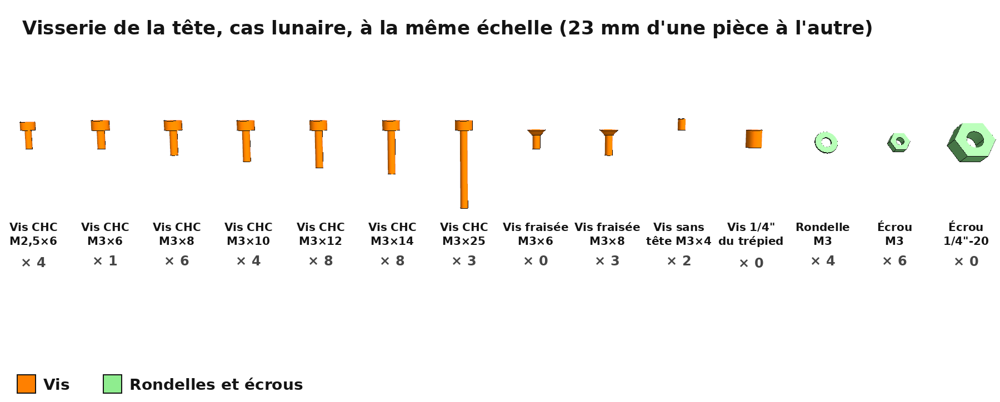
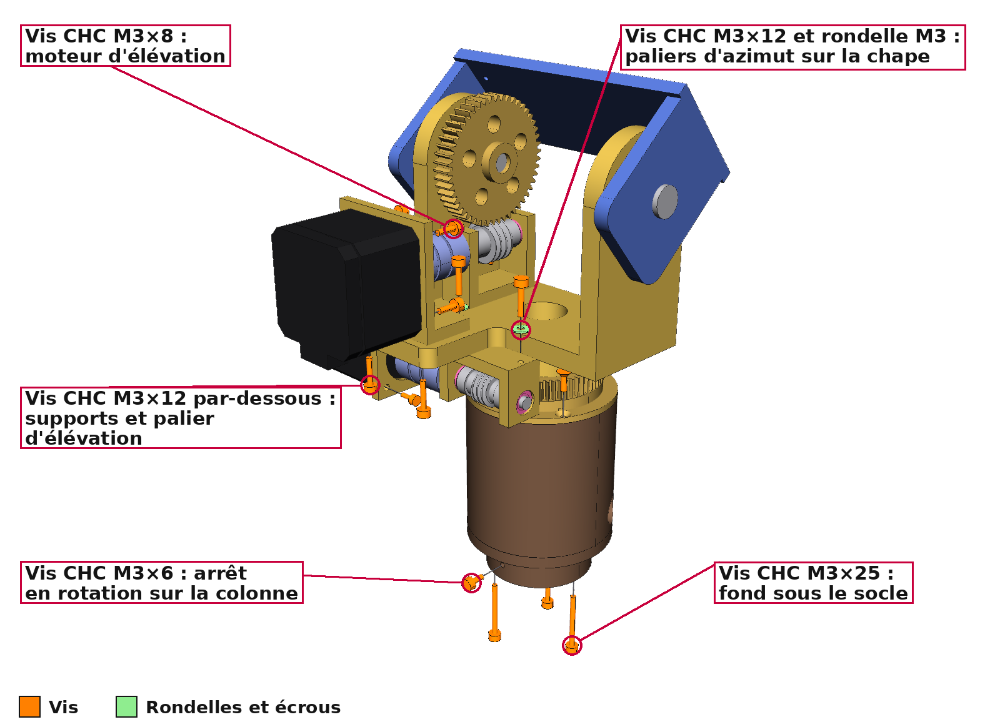
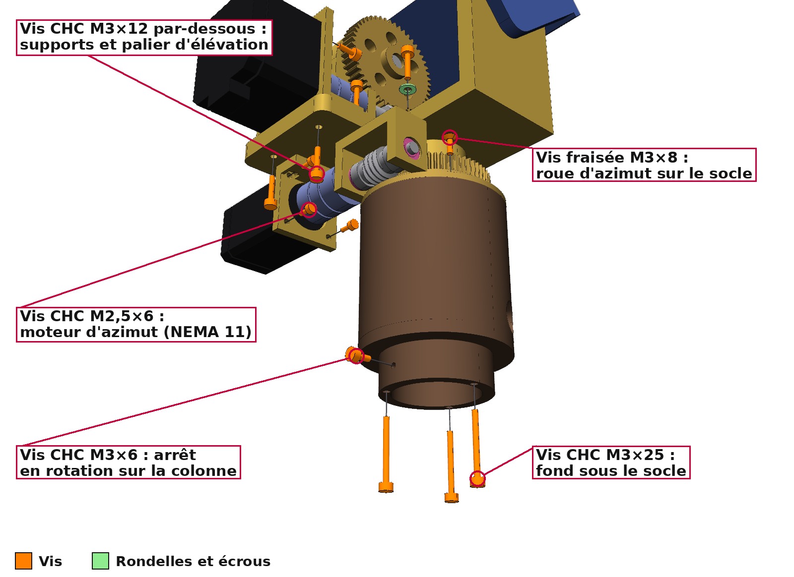
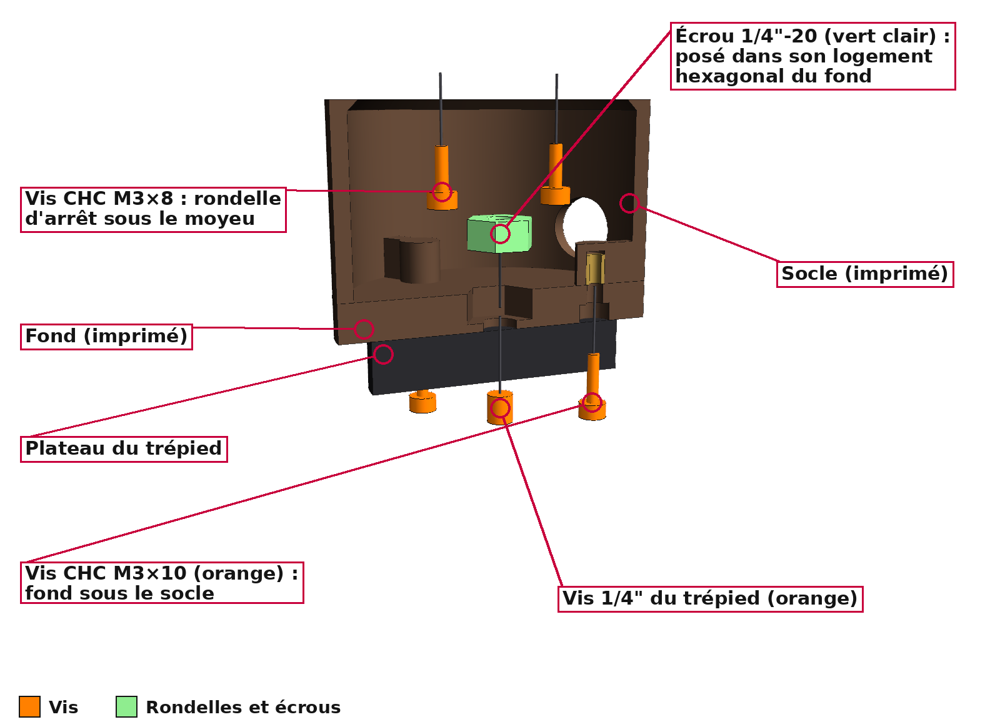
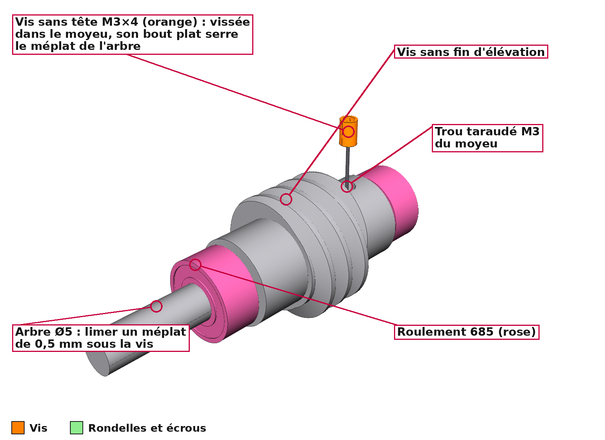
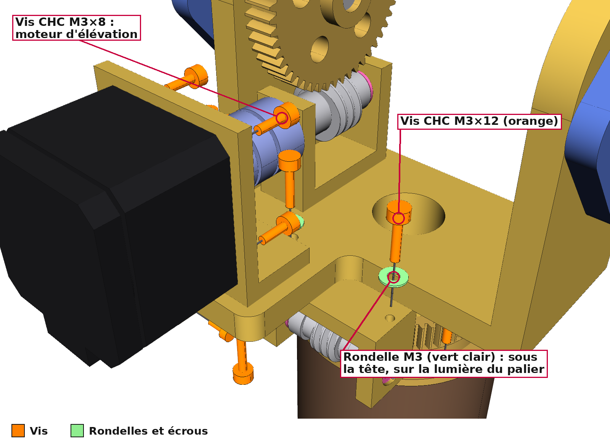
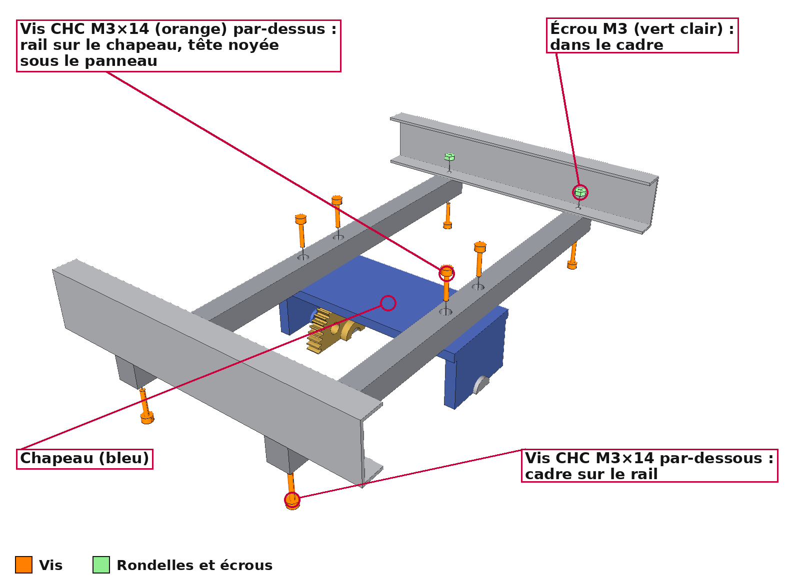
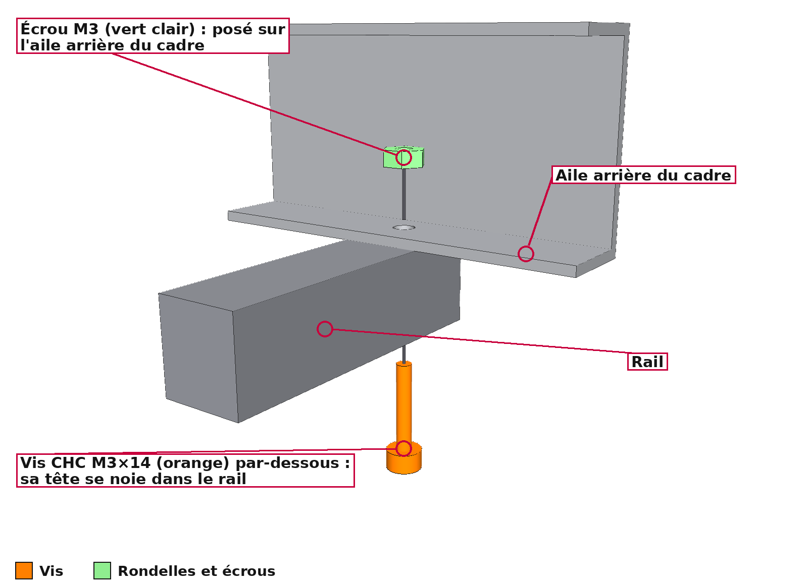
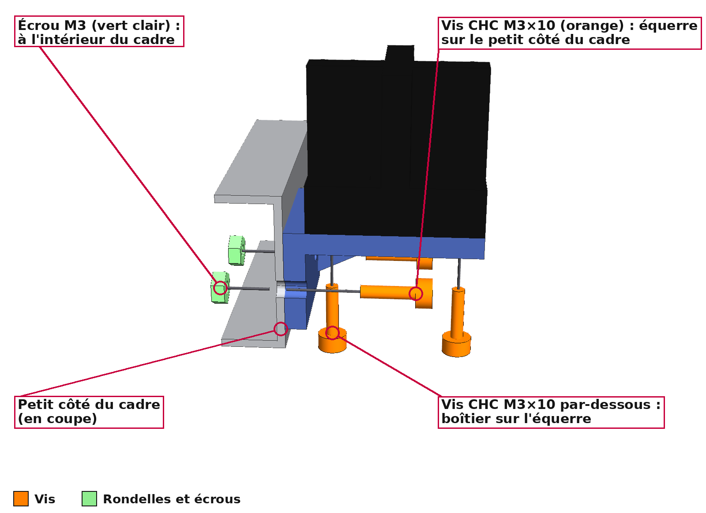

# Visserie : où va chaque vis

Guide détaillé de la visserie de la tête rotative, pour le cas lunaire et pour le cas
terrestre. Le résumé et l'ordre de montage complet du **cas terrestre (tête à fourche, 28BYJ-48)**
sont dans son [README](../../Fichiers%203D%20%28CAO%29/Cas%20Terrestre%20%28d%C3%A9monstration%29/README.md) (§ 3 « Pièces à acheter » et
§ 5 « Ordre de montage »).

> **Les vues éclatées ci-dessous montrent la tête à chape** du cas lunaire et de l'ancien modèle
> terrestre (le [modèle idéal personnel](../../.modele_ideal_personnel/README.md)). Elles restent
> valables pour les pièces communes aux deux têtes : socle, fond, roue d'azimut, moyeu, bague
> d'arrêt, chaîne d'azimut, vis sans tête des vis sans fin, capteur solaire. **Il n'y a pas encore
> de vue éclatée de la fourche** : la visserie du cas terrestre est décrite par le tableau
> ci-dessous et par le § 5 de son README, et modélisée en entier dans `Tete_Rotative_Fourche.step`.
> La planche à l'échelle de l'ancien modèle est dans `.modele_ideal_personnel/apercus/`.

**Code couleur**, le même que dans les fichiers STEP et les rendus : les **vis sont en
orange**, les **rondelles et les écrous en vert clair**. Dans les vues éclatées, chaque vis est
sortie de son trou le long de son axe (trait gris) ; chaque rondelle et chaque écrou est
écarté de la pièce sur laquelle il s'appuie.

## Les modèles et leurs quantités

| Cas lunaire |
|---|
|  |

| Modèle | Où (cas terrestre à fourche) | Cas lunaire | Cas terrestre (fourche) |
|---|---|---|---|
| Vis CHC M2,5×6 | NEMA 11 d'azimut sur son support (cas lunaire seulement) | 4 | 0 |
| Vis CHC M3×6 | Arrêt en rotation de la tête, à travers la colonne du trépied | 1 | 0 |
| Vis CHC M3×8 | Bague d'arrêt sous le moyeu (2) ; plateau sur le moyeu (3) ; palier et support d'azimut sur le plateau (4) ; bras sur le plateau (8) ; oreilles des deux 28BYJ-48 (4). Cas lunaire : NEMA 17 (4) et bague (2) | 6 | 21 |
| Vis CHC M3×10 | Capteur solaire (4) ; fond sous le socle dans la démonstration (3) ; palier et support d'élévation sous l'étagère du bras droit (4, cas terrestre) | 4 | 11 |
| Vis CHC M3×12 | Ferrures sur les grands côtés du cadre du panneau (8, cas terrestre). Cas lunaire : paliers et supports sur la chape (8) | 8 | 8 |
| Vis CHC M3×14 | Rails sur le chapeau (4) ; cadre du panneau sur les rails (4) | 8 | 0 |
| Vis CHC M3×25 | Fond sous le socle, têtes dans la colonne (cas lunaire) | 3 | 0 |
| Vis fraisée M3×8 (cas terrestre : M3×6) | Roue d'azimut sur le socle, têtes affleurantes | 3 | 3 |
| Vis sans tête M3×4 | Blocage de chaque vis sans fin sur son arbre | 2 | 2 |
| Vis sans tête M3×6 | Blocage des tiges Ø8 : roue d'élévation et deux ferrures (cas terrestre) | 0 | 3 |
| Rondelle M3 (3,2 × 7 × 0,5) | Sous les 4 vis posées sur les lumières de la chaîne d'azimut | 4 | 4 |
| Écrou M3 | Cas terrestre : ferrures (8), oreilles des moteurs (4), équerre du capteur (2). Cas lunaire : rails (4) et capteur (2) | 6 | 14 |
| Écrou 1/4"-20 | Prisonnier dans le fond, pour le trépied | 0 | 1 |
| Insert à chaud M3 × 5,7 / M3 × 3 | Cas terrestre seulement (le PETG se visse dans des inserts) | 0 | 7 / 25 |

Les chiffres du cas terrestre sont ceux de `scripts/generate_fourche.py`. La planche à l'échelle du
cas terrestre n'est pas régénérée pour la fourche.

La vis 1/4" n'est pas à acheter : c'est celle du plateau du trépied.

## Vue d'ensemble de la tête (cas lunaire, tête à chape)



## Étapes 2 à 4 : roue d'azimut, moyeu, fond

| Dessous de la tête (cas lunaire) | Fond de la démonstration, en demi-coupe |
|---|---|
|  |  |

* **Roue d'azimut** : 3 vis fraisées M3×8. Leurs têtes doivent affleurer, car la vis
  d'azimut passe juste au-dessus.
* **Rondelle d'arrêt du moyeu** : 2 × M3×8, par-dessous.
* **Fond** :
  * cas lunaire : 3 × M3×25 par-dessous, têtes dans la colonne, et une M3×6 à travers la
    colonne qui empêche la tête de tourner sur elle ;
  * démonstration : poser l'écrou 1/4" dans son logement hexagonal, par le dessus, puis
    visser le fond sous le socle (3 × M3×10, têtes noyées). L'écrou est alors prisonnier ;
    la vis 1/4" du trépied vient s'y visser par-dessous.

## Étape 5 : chaîne d'élévation (cas lunaire et modèle idéal personnel ; fourche : § 5, étape 8 du README du cas terrestre)



* Le palier et le support du moteur se vissent **par-dessous** la chape (4 × M3×12).
* Le NEMA 17 se visse sur son support par 4 × M3×8.
* La **vis sans tête M3×4** se visse dans le trou taraudé d'un moyeu de la vis sans fin.
  Son bout plat serre l'arbre Ø5 : limer sur l'arbre un méplat de 0,5 mm à cet endroit,
  pour que la vis ne glisse pas.

## Étapes 7 et 8 : chape sur le moyeu, chaîne d'azimut (tête à chape ; dans la fourche, le plateau d'aluminium remplace la chape)



* Démonstration seulement : la chape se visse sur le moyeu imprimé par 3 × M3×12,
  par-dessus.
* Le palier et le support de la chaîne d'azimut se vissent **par-dessus** la chape
  (4 × M3×12), dans des lumières (fentes) qui servent à régler l'engrènement. Une
  **rondelle M3** va sous chaque tête : sans elle, la tête Ø5,5 ne porterait que sur 0,4 mm
  aux bouts de la lumière.
* Le NEMA 11 se visse sur son support par 4 × M2,5×6 ; la vis sans fin d'azimut est bloquée
  sur son arbre par la seconde vis sans tête M3×4.

## Étape 10 : rails et panneau (tête à chape ; dans la fourche : 2 ferrures, § 5, étapes 9 et 10)

| Rails sur le chapeau, cadre sur les rails (laminé masqué) | Un bout de rail |
|---|---|
|  |  |

* Chaque rail se visse **par-dessus** le chapeau (2 × M3×14 par rail). Les têtes se noient
  dans le rail, sous le panneau.
* À chaque bout de rail, une M3×14 passe **par-dessous** à travers le rail et l'aile arrière
  du cadre. Un écrou M3 posé sur l'aile, dans le cadre, la serre ; on l'atteint par le dos
  ouvert du panneau.

## Étape 11 : capteur solaire (dans la fourche : sur le petit côté haut du cadre)



* Le boîtier se visse sur son équerre par 2 × M3×10, par-dessous.
* L'équerre se visse contre le petit côté du cadre (côté du pivot libre) par 2 × M3×10, avec
  un écrou M3 à l'intérieur du cadre pour chacune. **Dans la fourche, elle va sur le petit côté haut**
  du cadre (les grands côtés portent les ferrures) : même équerre, mêmes vis.

## Régénérer ces images

```bash
xvfb-run -a python scripts/render_visserie.py
```

(`render_visserie.py` décrit toujours la tête à chape : il n'a pas été adapté à la fourche.)

Les quantités de la planche sont comptées dans la CAO elle-même, à chaque régénération.
