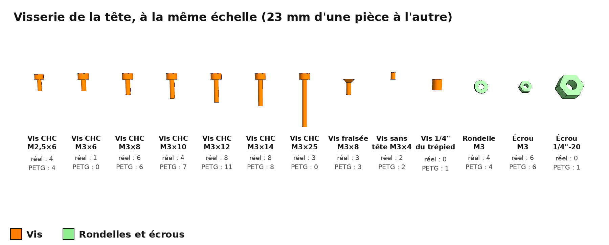
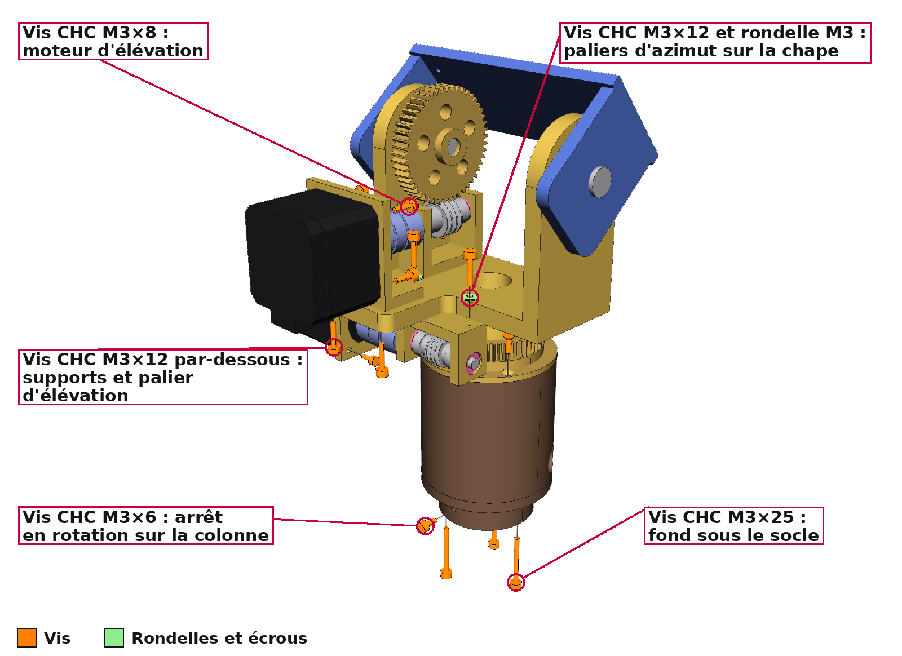
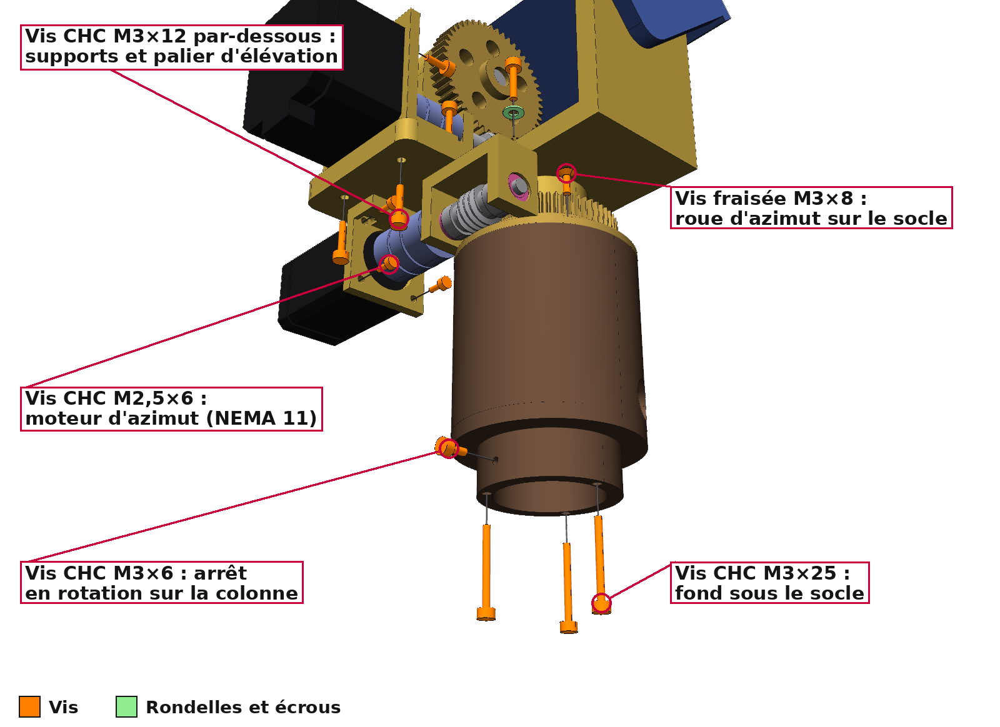
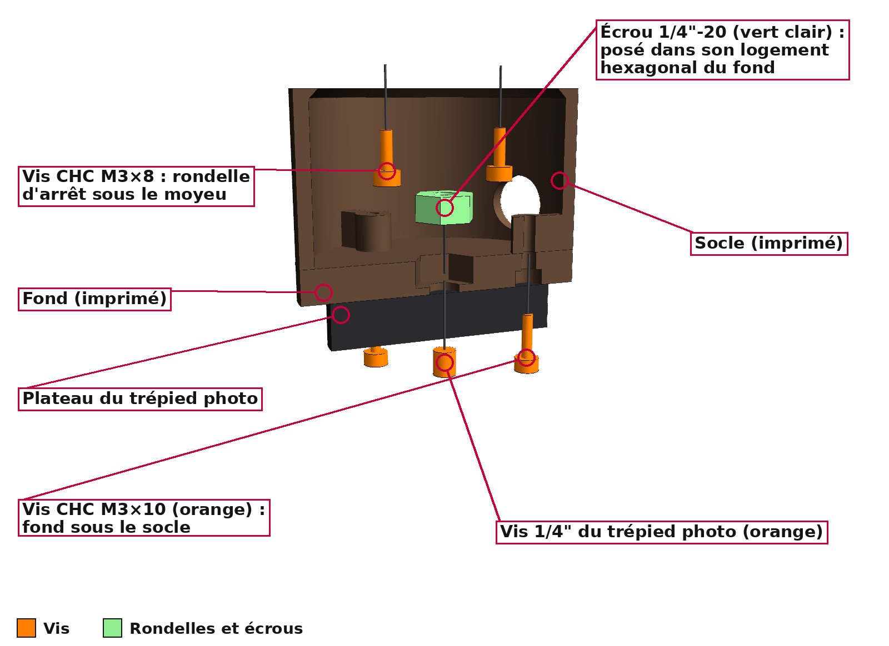
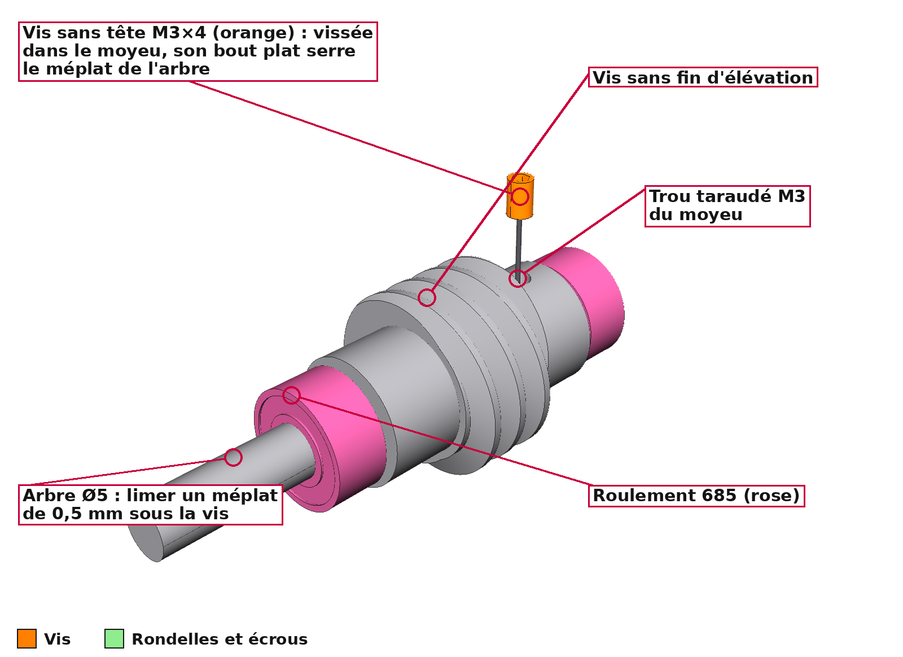
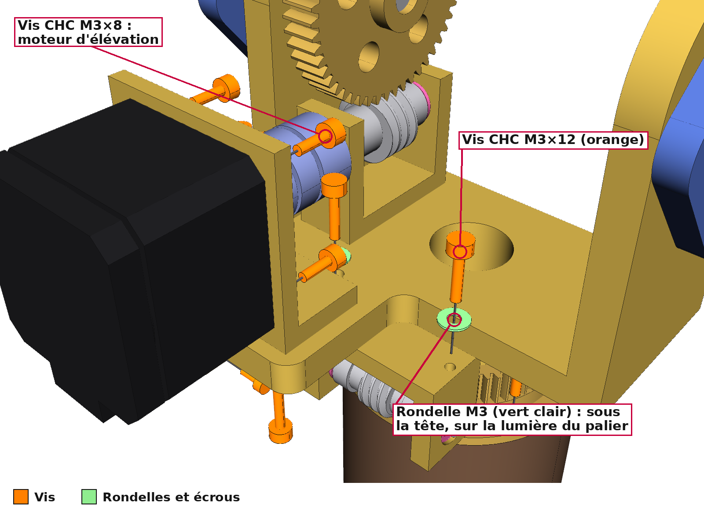
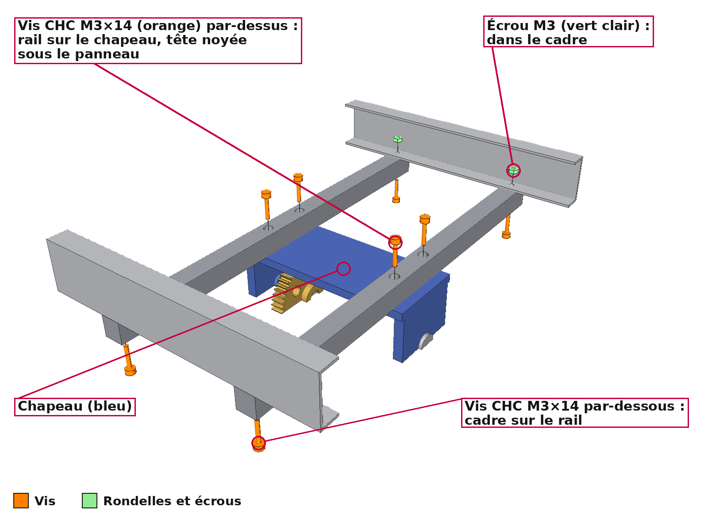
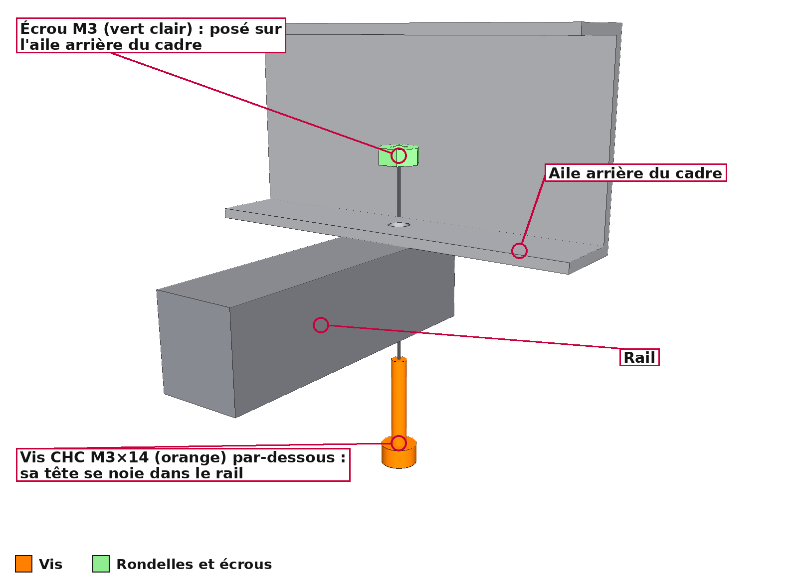
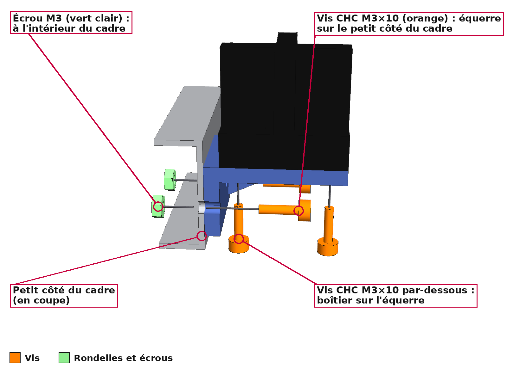

# Visserie : où va chaque vis

Guide détaillé de la visserie de la tête rotative, pour le cas réel et pour la démonstration
PETG. Le résumé et l'ordre de montage complet sont dans le [README principal](../../README.md)
(§ 13 « Pièces à acheter » et § 15 « Ordre de montage »). Les numéros d'étape ci-dessous sont
ceux du § 15.

**Code couleur**, le même que dans les fichiers STEP et les rendus : les **vis sont en
orange**, les **rondelles et les écrous en vert clair**. Dans les vues éclatées, chaque vis est
sortie de son trou le long de son axe (trait gris) ; chaque rondelle et chaque écrou est
écarté de la pièce sur laquelle il s'appuie.

## Les modèles et leurs quantités



| Modèle | Où | Cas réel | PETG |
|---|---|---|---|
| Vis CHC M2,5×6 | NEMA 11 d'azimut sur son support (ses taraudages ne font que 2,5 mm) | 4 | 4 |
| Vis CHC M3×6 | Arrêt en rotation de la tête, à travers la colonne du trépied | 1 | 0 |
| Vis CHC M3×8 | NEMA 17 d'élévation sur son support (4) ; rondelle d'arrêt sous le moyeu (2) | 6 | 6 |
| Vis CHC M3×10 | Capteur solaire (4) ; fond sous le socle dans la démonstration (3) | 4 | 7 |
| Vis CHC M3×12 | Paliers et supports des deux vis sans fin sur la chape (8) ; chape sur le moyeu imprimé (3, démonstration) | 8 | 11 |
| Vis CHC M3×14 | Rails sur le chapeau (4) ; cadre du panneau sur les rails (4) | 8 | 8 |
| Vis CHC M3×25 | Fond sous le socle, têtes dans la colonne (cas réel) | 3 | 0 |
| Vis fraisée M3×8 | Roue d'azimut sur le socle, têtes affleurantes | 3 | 3 |
| Vis sans tête M3×4 | Blocage de chaque vis sans fin sur son arbre | 2 | 2 |
| Rondelle M3 (3,2 × 7 × 0,5) | Sous les 4 vis posées sur les lumières de la chaîne d'azimut | 4 | 4 |
| Écrou M3 | Dans le cadre du panneau : rails (4) et capteur solaire (2) | 6 | 6 |
| Écrou 1/4"-20 | Prisonnier dans le fond, pour le trépied photo | 0 | 1 |

La vis 1/4" n'est pas à acheter : c'est celle du plateau du trépied photo.

## Vue d'ensemble de la tête (cas réel)



## Étapes 2 à 4 : roue d'azimut, moyeu, fond

| Dessous de la tête (cas réel) | Fond de la démonstration, en demi-coupe |
|---|---|
|  |  |

* **Roue d'azimut** : 3 vis fraisées M3×8. Leurs têtes doivent affleurer, car la vis
  d'azimut passe juste au-dessus.
* **Rondelle d'arrêt du moyeu** : 2 × M3×8, par-dessous.
* **Fond** :
  * cas réel : 3 × M3×25 par-dessous, têtes dans la colonne, et une M3×6 à travers la
    colonne qui empêche la tête de tourner sur elle ;
  * démonstration : poser l'écrou 1/4" dans son logement hexagonal, par le dessus, puis
    visser le fond sous le socle (3 × M3×10, têtes noyées). L'écrou est alors prisonnier ;
    la vis 1/4" du trépied photo vient s'y visser par-dessous.

## Étape 5 : chaîne d'élévation



* Le palier et le support du moteur se vissent **par-dessous** la chape (4 × M3×12).
* Le NEMA 17 se visse sur son support par 4 × M3×8.
* La **vis sans tête M3×4** se visse dans le trou taraudé d'un moyeu de la vis sans fin.
  Son bout plat serre l'arbre Ø5 : limer sur l'arbre un méplat de 0,5 mm à cet endroit,
  pour que la vis ne glisse pas.

## Étapes 7 et 8 : chape sur le moyeu, chaîne d'azimut



* Démonstration seulement : la chape se visse sur le moyeu imprimé par 3 × M3×12,
  par-dessus.
* Le palier et le support de la chaîne d'azimut se vissent **par-dessus** la chape
  (4 × M3×12), dans des lumières (fentes) qui servent à régler l'engrènement. Une
  **rondelle M3** va sous chaque tête : sans elle, la tête Ø5,5 ne porterait que sur 0,4 mm
  aux bouts de la lumière.
* Le NEMA 11 se visse sur son support par 4 × M2,5×6 ; la vis sans fin d'azimut est bloquée
  sur son arbre par la seconde vis sans tête M3×4.

## Étape 10 : rails et panneau

| Rails sur le chapeau, cadre sur les rails (laminé masqué) | Un bout de rail |
|---|---|
|  |  |

* Chaque rail se visse **par-dessus** le chapeau (2 × M3×14 par rail). Les têtes se noient
  dans le rail, sous le panneau.
* À chaque bout de rail, une M3×14 passe **par-dessous** à travers le rail et l'aile arrière
  du cadre. Un écrou M3 posé sur l'aile, dans le cadre, la serre ; on l'atteint par le dos
  ouvert du panneau.

## Étape 11 : capteur solaire



* Le boîtier se visse sur son équerre par 2 × M3×10, par-dessous.
* L'équerre se visse contre le petit côté du cadre (côté du pivot libre) par 2 × M3×10, avec
  un écrou M3 à l'intérieur du cadre pour chacune.

## Régénérer ces images

```bash
xvfb-run -a python scripts/render_visserie.py
```

Les quantités de la planche sont comptées dans la CAO elle-même, à chaque régénération.
